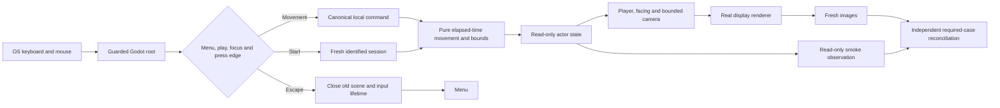

# Phase 2: Playable foundation - Research

**Researched:** 2026-11-14
**Domain:** Godot/C# local menu, bounded movement, rendered platform smoke evidence
**Confidence:** MEDIUM overall; repository mechanisms directly inspected, native Phase 2 behavior unimplemented and untested.

<user_constraints>
## User Constraints (from CONTEXT.md)

### Locked Decisions

The following is copied verbatim from the context's Implementation Decisions section. Source: `02-CONTEXT.md`.

<!-- DATA_a71d89c2_START -->
### No additional design interview

- **D-01:** The creator declined the offered discussion areas: “All of it is obvious. don't want to discuss”. Proceed to planning from the locked specification without further questions about routine presentation choices.
- **D-02:** No particular layout, palette, placeholder design, spawn position, camera implementation, scene dimensions, or control-hint placement was selected during this discussion. Do not turn proposed alternatives or agent defaults into creator-approved requirements.

### Communication

- **D-03:** Use English for user-facing communication. The creator explicitly corrected the initial French response. Preserve the existing interactive-question preference for future questions that actually need a decision; this instruction does not invite another Phase 2 design interview.

### Agent's Discretion

Research and planning may resolve the routine scene, placeholder, camera, menu, and hint choices within `02-SPEC.md`, using the smallest implementation that satisfies its acceptance criteria. They also choose concrete identity representations, command routing, world-unit/pixel mapping, resource layout, and smoke tooling consistent with Phase 1's completed rules and boundaries.

The source specification's applicable working baselines remain in force. Any implementation choice must preserve the explicit Phase 2 outcomes rather than adding features, requiring production art, weakening verification, or reopening already-settled requirements.
<!-- DATA_a71d89c2_END -->

### Deferred Ideas (OUT OF SCOPE)

<!-- DATA_2b07fe94_START -->
None. The creator proposed no new capability. Existing later-phase work remains assigned as specified in the roadmap.
<!-- DATA_2b07fe94_END -->
</user_constraints>

## Summary

Use a pure Core movement/session model, one engine-facing root script, and ordinary C# helpers for presentation and smoke observation. Keep the existing five-project architecture, pinned compiler/engine, strict analyzers, and actual native proof fixture. The graph manifest names exactly five project rows; adding a separate test assembly requires an architecture change and is unnecessary here. [VERIFIED: tools/phase1/projects.json:3-8] Verbatim project identities: `"src/core/KingdomZombies.Core.csproj"`, `"src/multiplayer-abstractions/KingdomZombies.Multiplayer.Abstractions.csproj"`, `"src/godot-game/KingdomZombies.csproj"`, `"tools/code-rules/Sebreiro.CodeRules.Analyzers.csproj"`, `"tests/phase1/KingdomZombies.Phase1.Tests.csproj"`.

The important planning cost is engine integration permission, rather than scene complexity. Direct Godot operations currently require an exact source/type/method match and a preceding main-thread guard. Generated companions have authenticated text/span permissions; introducing a script changes assembly-wide generated metadata too. Plan the smallest production root, then update its precise provenance and prove adjacent handwritten misuse still fails. [VERIFIED: tests/phase1/EngineAccessPolicy.cs:80-109] Verbatim existing adapter keys: `"Phase1"`, `"LifecycleFixture"`, `"ProofResource"`, `"ProofSequence"`; guard identity: `"KingdomZombies.Proofs.MainThreadGateway"`.

**Primary recommendation:** Implement the ordinary player-facing flow first, then drive that same window with operating-system keyboard/mouse events and observe actual state and rendered images. Engine event injection alone cannot establish desktop focus behavior: Godot documents that parsed input has no operating-system effects. [CITED: https://docs.godotengine.org/en/stable/classes/class_input.html]

## Architectural Responsibility Map

This is the recommended task division, within the existing composition boundary. [CITED: docs/architecture/boundaries.md]

| Capability | Primary Tier | Secondary Tier | Rationale |
|---|---|---|---|
| Stable session/player/actor/content identities | Core | Godot composition | Explicit identity is independent of node instance IDs |
| Movement command validation, direction, distance, bounds | Core | Godot elapsed-time adapter | One deterministic authoritative mutation route |
| Native input/focus, menu activation, tree lifetime | Godot adapter | Core command sink | Desktop and engine lifecycle belong at native boundary |
| Placeholder scene and camera projection | Godot presentation | Core read-only snapshot | Render the model; do not mutate model position here |
| Native observation and image capture | Godot smoke observer | External coordinator | Observation must not create a second control route |
| Process launch, OS input, evidence reconciliation | Repository tooling | Existing test assembly | Isolate processes and evidence per invocation |

## Project Constraints (from AGENTS.md)

- Read task-relevant indexed documents; preserve enforced Phase 1 standards, executable definitions, exemptions and qualitative review obligations. [CITED: AGENTS.md]
- Implement on the phase feature branch from current origin/dev; open its draft PR when first implementation commit exists, keep it updated and draft while required evidence is missing, mark the same PR ready only after required completion; merging requires separate authorization. [CITED: docs/workflow/ai-collaboration.md]
- Run relevant development-OS checks and account for complete Phase 2 scope on Windows and a local Linux VM; actual execution is mandatory. Use acceleration when available. The Phase 1 closure exception does not apply to Phase 2. [CITED: docs/workflow/ai-collaboration.md]
- Follow focused documentation/navigation conventions and strict UTF-8, exact Git path casing, heading/reference rules. Run the documentation checker on new navigation. [CITED: docs/code/README.md]
- Keep C# game and game tests, Core independent of Godot/services, explicit time/random inputs, guarded native lifetime and narrow proven generated exemptions. [CITED: docs/architecture/decisions/0003-state-and-engine.md]
- Treat warning-free strict builds and rule checks as implementation requirements; initialization documents alone never establish completion. [CITED: AGENTS.md]
- The orchestrator owns branch, PR, VM lifecycle and commits. This research edits only its assigned artifacts. [CITED: orchestrator task]

<phase_requirements>
## Phase Requirements

Descriptions below preserve the locked specification's requirement names; details and AC numbering remain authoritative in the specification. [CITED: 02-SPEC.md]

| ID | Description | Research Support |
|---|---|---|
| BASE-01 | Menu and scene lifecycle | Root-owned transitions, press-edge latches, disposal fences, real menu activation and clean exit |
| BASE-02 | Basic scene and walking | Pure command/state integration, explicit world scale, one actor, ground/bounds/facing/camera observations |
| BASE-03 | Repeatable foundation checks | Independent case catalog, production OS input, rendered evidence, current-run reconciliation and deliberate failure controls |
</phase_requirements>

## Standard Stack

Retain the established stack; do not upgrade from public documentation or registry latest values. These are repository pins, not a claim of newly verified upstream release availability. [VERIFIED: tools/phase1/toolchain.json:3-11] Verbatim: `"engine": "4.7.2"`, `"sdk": "10.0.404"`, `"language": "14.0"`, `"framework": "net10.0"`, `"node": "24.22.1"`, `"runtime": "10.0.15"`, `"editorRuntime": "8.0.16"`.

| Component | Version | Purpose |
|---|---|---|
| Godot .NET | 4.7.2 | Existing native launch target and C# source generation |
| .NET SDK / C# | 10.0.404 / 14.0 | Existing strict compilation |
| Node | 24.22.1 | External process/evidence coordinator |
| Existing C# test host | Existing locked dependencies | Add pure-model and runner contract cases in current assembly |

The game project explicitly declares `<Project Sdk="Godot.NET.Sdk/4.7.2">`, `<TargetFramework>net10.0</TargetFramework>` and `<LangVersion>14.0</LangVersion>`. [VERIFIED: src/godot-game/KingdomZombies.csproj:1-4]

The existing test host explicitly declares `<OutputType>Exe</OutputType>`, `<IsTestProject>true</IsTestProject>` and `<UseMicrosoftTestingPlatformRunner>true</UseMicrosoftTestingPlatformRunner>`. Invoke its existing runner conventions rather than assuming VSTest flags. [VERIFIED: tests/phase1/KingdomZombies.Phase1.Tests.csproj:3-7]

### Package Legitimacy Audit

No new managed or JavaScript package is recommended or installed by this research; reuse locked dependencies. The package installation gate is therefore not triggered. Linux display/input OS utilities must be inventoried and obtained from the guest's declared distribution repository by the execution owner if absent. This is a planned environment preparation step, not an availability or installation claim. [CITED: orchestrator task]

## Architecture Patterns

### System Architecture Diagram

Recommended data flow:



### Recommended Project Structure

Proposed additions only; names are recommendations, not verified existing filesystem paths. Keep pure classes in the existing Core project, one root plus plain helpers in the game project, and new test classes in the existing test project. Put the small Phase 2 coordinator/catalog in a phase-specific tooling directory and immutable ignored evidence in a separate phase-specific run directory. Do not create another engine project or general test framework. [CITED: 02-SPEC.md; docs/architecture/boundaries.md]

### Pattern 1: Pure commands and explicit elapsed time

Choose an explicit fixed-point world scale and legal min/max/spawn coordinates, documented once. Use an immutable movement command addressed to the active session/player/actor; normalize aliases into one signed direction. Supply elapsed integer time to the Core update, clamp position, retain facing on zero input, and preserve actor identity during movement. Carry conversion remainder when translating engine fractional delta to integer elapsed units; repeated truncation must not change walking speed. These are design recommendations within the context's discretion. [CITED: 02-CONTEXT.md; 02-SPEC.md]

The existing elapsed port exposes `long Milliseconds { get; }`; it is `internal interface IElapsedInput`, so it is not a cross-assembly gameplay API. Add deliberately designed minimal public gameplay contracts and exact visibility permissions rather than expose proof implementation types. [VERIFIED: src/core/IElapsedInput.cs:3-8] Verbatim: `internal interface IElapsedInput`, `long Milliseconds { get; }`.

### Pattern 2: One root, ordinary helpers

Use one script root for engine callbacks and delegate to small ordinary classes. Keep menu buttons as native controls with keyboard focus and mouse support. Set up named input actions and handle their press/release events through one controller. Build the simple scene with repository-owned resources or deterministic primitives; use a visible contrasting directional marker. A fixed camera showing the whole short scene is acceptable if it passes both end/visibility checks; a bounded following camera is also within discretion. Choose the simplest scene dimensions that satisfy the locked requirements. [CITED: 02-CONTEXT.md; 02-SPEC.md]

Avoid a large root method: extract ordinary helpers under the same guard policy. Explicitly add each native method to the source/type/method allow-list; do not permit an entire namespace or all scripts. Guard each permitted synchronous method before its first native operation, including property/constant access and constructors. Existing native method-group captures are rejected even when guarded at capture time; use authored callback wrappers that re-check the thread on invocation. [VERIFIED: tests/phase1/EngineAccessPolicy.cs:34-50,89-109] Verbatim assembly identities: `"GodotSharp"`, `"GodotSharpEditor"`; existing guard method: `"RequireThread"`.

### Pattern 3: Release barrier and transition lifetime

Track held native keys independently from model commands. On focus loss, Escape, Start, or teardown, clear commands and require release followed by a fresh key press before motion resumes. Ignore repeat echoes for transition activation. Fence/disconnect old callbacks before freeing scene nodes; ensure menu has zero gameplay actors and play has one. Input singleton polling alone needs additional gating because Godot documents that global input state is unaffected by GUI acceptance. [CITED: https://docs.godotengine.org/en/stable/classes/class_input.html]

Godot key events expose press/release and echo state; echo timing depends on OS settings. Do not move once per key event or increment speed per repeat. [CITED: https://docs.godotengine.org/en/stable/classes/class_inputeventkey.html]

### Pattern 4: Exact generated-source adaptation

Build the minimal script with generated sources emitted, inspect actual diagnostics and companion text, and record exact generator identity, package digest, generated file/text digests, member identity and permitted diagnostic span. Update any assembly-wide generated script list identity changed by the new root. Retain all existing proof companions; no broad generated-code exemption, filename heuristic or pragma suppressions. This follows the current mechanism. [VERIFIED: tests/phase1/EngineGeneratedTests.cs:21-58] Verbatim expected baseline counts: `rows.Length.ShouldBe(expected: 170);`, `ExemptionValidator.ReadPermissions().Count.ShouldBe(expected: 18);`; producer: `"Godot.SourceGenerators/4.7.2"`.

Plan updates to generated syntax/layout/callsite permissions and their authentic-origin, handwritten-partial, adjacent-span and collision rejection proofs as one coherent integration task. Change hardcoded inventory expectations only after inspecting actual emitted additions and preserving every prior row. New public Core types and any public native script also need exact R-34 permission entries. The current registry explicitly says: `"This grants no other script or generated source permission."` [VERIFIED: docs/code/visibility-exemptions.json:5-7]

## Don't Hand-Roll

| Problem | Use Instead | Why |
|---|---|---|
| UI keyboard/mouse activation | Native Godot Button/Control focus | Avoid a custom parallel menu input system |
| Scene projection | Native 2D nodes/camera and explicit scale | Keep simulation independent from pixels |
| Core test execution | Existing C# test assembly | Preserve exact project graph and established rules |
| Process/evidence basics | Adapt the existing runner conventions locally | Existing code already demonstrates independent manifest reconciliation |
| Placeholder art | Authored primitives/resources | Full production asset work belongs to Phase 4 |

These are implementation recommendations, supported by the phase boundaries and existing runner. [CITED: 02-SPEC.md; tools/phase1/check.cjs]

## Common Pitfalls

1. **Native controls tested through a bypass:** Calling movement setters, scene constructors, button callbacks or synthetic action state directly proves a different route. Use real OS input; optional engine-parsed events may be supplemental. Preserve actor/session command and observation logs. [CITED: 02-SPEC.md; https://docs.godotengine.org/en/stable/classes/class_input.html]
2. **Frame timing compared to host sleep:** TCG/rendering can be slower than real time. Measure displacement against accumulated game elapsed time over one second, with recorded start/end state and no bounds contact; host timestamps show latency only. The locked interval remains inclusive 2.85–3.15 u. [CITED: 02-SPEC.md]
3. **Screenshot filename accepted as appearance:** Require image decoding, expected dimensions/nonempty content, invocation association and visible scenario review; a headless native pass does not prove rendered desktop appearance. Capture only after a completed draw. [CITED: 02-SPEC.md; https://docs.godotengine.org/en/stable/tutorials/rendering/viewports.html]
4. **New script quietly weakens all rules:** Exact generated metadata changes can invalidate old hashes. Preserve authentic origin and adjacent/collision controls; do not replace them with blanket permissions. [CITED: tests/phase1/EngineGeneratedTests.cs]
5. **VM/software-renderer unavailable treated as pass:** Phase 2 has independent required Windows and Linux execution. Report unavailable display/input/rendering prerequisites as blockers, preserve diagnostic runs, and keep the PR draft. [CITED: docs/workflow/ai-collaboration.md; 02-SPEC.md]
6. **Two results substitute for missing identities:** Reconcile sets by exact independently declared case identity, reject duplicates/unknowns/missing IDs before acceptance, and require all expected images. Existing runner implements these checks. [CITED: tools/phase1/check.cjs]

## Code Examples

The following is a design algorithm, not a compilable repository API skeleton; all identifiers are proposed descriptive names. It avoids claiming unimplemented enum/type values exist. [CITED: 02-SPEC.md]

```text
leftHeld  = A-held OR Left-arrow-held
rightHeld = D-held OR Right-arrow-held
direction = integer(rightHeld) - integer(leftHeld)
if focus-or-transition-release-barrier is active: direction = 0
command = active session + active player + active actor + direction
newX = clamp(oldX + direction * walkSpeed * elapsedSeconds, minX, maxX)
if direction != 0: facing = direction
```

For screenshot implementation, Godot's official viewport documentation prescribes waiting for the completed draw signal, then reading viewport texture image data. In C#, implement this through a guarded synchronous draw callback wrapper rather than an async method containing native operations, to satisfy the repository policy. [CITED: https://docs.godotengine.org/en/stable/tutorials/rendering/viewports.html; tests/phase1/EngineAccessPolicy.cs]

## State of the Art

Retain the proven pinned project baseline rather than copying public documentation versions. Stable online Godot API documentation describes general behavior but does not prove every exact pinned binary/API signature; compile against the repository's local SDK and run native/rendered integration before acceptance. [CITED: tools/phase1/toolchain.json; docs/workflow/setup.md]

## Environment Availability

| Dependency | Observation this research | Required action |
|---|---|---|
| Node | Probe returned v24.22.1 | Reuse current host |
| .NET SDK | Probe returned 10.0.404 | Reuse isolated build settings |
| Windows Godot | Existing tool directory observed | Runner must validate exact executable/runtime identity |
| Local Linux VM | Orchestrator reports running/access verified using existing TCG fallback | Execute actual guest checks; no restart authorization |
| Linux display + OS input | Orchestrator reports xvfb, xdotool, imagemagick and openbox installed | Probe actual display, focus, renderer and production input; installation alone is not acceptance |
| Context7 | No MCP provider/ctx7 CLI observed | Official Godot documentation fetched via web fallback |

Host versions above are direct command output, not cross-platform acceptance. VM status is an orchestrator report, not this agent's native probe. [VERIFIED: session command output `node --version` and `dotnet --version`] [CITED: orchestrator message 2026-11-14]

Do not start a second VM or reuse its live disk independently. No host reboot is authorized. Software rendering plus Xvfb is the planned fallback, subject to actual guest proof; no image or Linux pass is claimed here. [CITED: orchestrator task and message]

## Validation Architecture

### Test Framework

Reuse the existing C# test executable and Phase 1 runner for affected boundary/rule/documentation checks. Introduce a small Phase 2 Node coordinator for pure tests, rendered scenarios and runner controls, with declared exact IDs. The Phase 2 commands below are **proposed interfaces to implement**, not runnable existing commands. [CITED: tests/phase1/KingdomZombies.Phase1.Tests.csproj; tools/phase1/check.cjs]

| Property | Value |
|---|---|
| Existing framework | Existing xUnit executable + Shouldly under locked restore |
| Quick proposed command | `node tools/phase2/check.cjs --group core` |
| Runner controls proposed command | `node tools/phase2/check.cjs --group runner` |
| Rendered proposed command | `node tools/phase2/check.cjs --group rendered` |
| Phase suite proposed command | `node tools/phase2/check.cjs --all` |
| Existing boundary feedback | `node tools/phase1/check.cjs --group graph` |
| Existing docs feedback | `node tools/phase1/check.cjs --group docs` |

### Phase Requirements → Test Map

Proposed case IDs below are new design, not current registry values. Test commands refer to the proposed coordinator interface. [CITED: 02-SPEC.md]

| Requirement | Cases | Type | Command | Exists? |
|---|---|---|---|---|
| BASE-01 | Menu keyboard/mouse, Start/repeat, Escape/restart, clean Quit | Rendered production flow | `node tools/phase2/check.cjs --group rendered` | Wave 0 |
| BASE-02 | Alias/cancel/release/focus, ±3 u/s, actor identity, ground/building/bounds/camera | Pure + rendered | `node tools/phase2/check.cjs --group core` and `--group rendered` | Wave 0 |
| BASE-03 | Exact results/images, freshness, concurrency, crash/timeout/tool/missing evidence | Coordinator contracts | `node tools/phase2/check.cjs --group runner` | Wave 0 |

The rendered driver must open the actual project main scene, use actual mouse click and focused keyboard activation for menu paths, send actual native A/D/arrows/Enter/Escape events, and exercise real window focus loss/regain. On Windows use a narrow OS input helper; on Linux use xdotool on the guest X display. These are proposed adapters requiring availability and behavior probes. Do not count direct test mutation as control evidence. [CITED: 02-SPEC.md]

Require both 1280×720 and 1920×1080 menu/play captures, facing-left/right and end-bound captures, restart capture and observed clean Quit. Associate every image with case, nonce, platform, input/tool hashes, resolution and state checkpoint. Review readability and visible content on actual current images; pixel/content assertions supplement that review. [CITED: 02-SPEC.md]

For the one-second movement checks, hold real input while observing accumulated simulation time and position over an unobstructed interval. Use a bounded external driver and a read-only observation hook; its readiness/image requests must not mutate player/session state. Expose no network listener for smoke coordination. [CITED: 02-SPEC.md]

Runner negative controls must deliberately test missing/duplicate/unknown IDs, zero execution, missing/empty/corrupt/wrong-size image, stale nonce/hash/platform, interrupted/incomplete output, missing executable, actual child crash/nonzero exit, actual timeout with descendant cleanup, reordered results, fresh rerun and isolated/refused concurrent invocation. Require valid setup and intended rejection before a negative-control pass. [CITED: 02-SPEC.md; tests/phase1/RunnerContractTests.cs]

### Sampling Rate

- Each model change: focused Core tests; target under 30 seconds after build, measure actual runtime.
- Each adapter/provenance change: strict solution build, affected engine/rules/graph cases and new permission rejection proofs.
- Each runner change: focused deliberate-defect controls, then rendered group after integration stabilizes.
- Phase gate: complete Phase 2 suite on Windows and Linux VM, affected baseline checks, actual image review, immutable reports and no missing required case/environment.

These are the recommended sampling obligations; duration is a target, not measured evidence. [CITED: docs/workflow/verification.md; 02-SPEC.md]

### Wave 0 Gaps

- [ ] Add pure movement/identity/input-latch tests in the existing test assembly.
- [ ] Add the independent Phase 2 case/evidence catalog and coordinator with strict selection/reconciliation.
- [ ] Add production-window input adapters and read-only current-run observation.
- [ ] Add image capture/decoding/content checks and saved-image review records.
- [ ] Probe guest display, input utilities, renderer and pinned tools before scheduling acceptance.
- [ ] Preserve all existing rules while adding exact new native adapter and generated permissions.

These are planned work items; this research claims no Phase 2 check passed. [CITED: orchestrator task]

## Security Domain

Security enforcement is enabled in project configuration. ASVS is a web-application standard, so apply relevant engineering controls to this offline desktop increment without claiming ASVS certification. The current official ASVS version is 5.0.0; the older template's V2–V6 labels are not current category numbering. [CITED: .planning/config.json; https://asvs.owasp.org/]

| Control area | Applicability | Phase control |
|---|---|---|
| Authentication/session cookies | No web identity boundary in locked scope | Do not add accounts or network services |
| Gameplay session ownership | Yes | Reject commands for inactive session/player/actor; invalidate callbacks on teardown |
| Input validation | Yes | Validate direction, elapsed range, identifiers, evidence schema and image dimensions |
| Filesystem access | Smoke tooling | Constrain output paths to owned invocation directory; reject traversal and symlink escape |
| Process execution | Smoke tooling | Argument arrays, no shell string construction, deadlines and owned descendant cleanup |
| Cryptography | Evidence identity only | Platform SHA-256 APIs; no custom cryptography or gameplay secrets |

Controls are phase-specific recommendations grounded in scope and existing runner safeguards. [CITED: 02-SPEC.md; tools/phase1/check.cjs]

| Threat ref | Pattern | Mitigation and proof |
|---|---|---|
| T-02-01 | Old scene callback changes new actor | Lifetime fence, identified command rejection, repeated transition tests |
| T-02-02 | Stale/forged/incomplete smoke evidence accepted | Exact IDs and nonce/input/tool/platform binding; deliberate corruption controls |
| T-02-03 | Tool path or argument escapes owned resources | No shell interpolation, canonical owned paths, process ownership and timeout tests |

## Assumptions Log

| # | Claim | Risk if wrong | Confirmation |
|---|---|---|---|
| A1 | [ASSUMED] Guest software rendering with Xvfb/window manager/xdotool will satisfy the rendered input scenarios | Linux acceptance blocked or slow | Probe actual guest early and retain explicit failure if unavailable |
| A2 | [ASSUMED] Native OS input helper can focus/control the intended Windows game window reliably in this session | Wrong-window input or flaky evidence | Probe window identity, focus acknowledgment and real-event observation before full run |

Routine implementation choices above are recommendations under explicit agent discretion, not unconfirmed creator requirements. [CITED: 02-CONTEXT.md]

## Execution Proof Obligations

1. Native rendered guest capability must be established by execution; the orchestrator owns VM preparation. There is no authority to omit Linux or reboot the host. [CITED: orchestrator task]
2. Exact new generated permissions cannot be enumerated honestly until the minimal script is built. Inspect actual diagnostics, record provenance and prove boundaries before proceeding. [CITED: tests/phase1/EngineGeneratedTests.cs]
3. The full old Phase 1 Linux suite has historical follow-ups. Keep those distinct from newly required Phase 2 affected checks and two-platform foundation smoke; do not relabel old unexecuted work as passed. [CITED: docs/workflow/verification.md]

## Sources

- Repository authority: AGENTS.md; Phase 2 SPEC/CONTEXT; code/architecture indexes; workflow setup/verification/collaboration.
- Direct source inspection: project graph, project files, strict build props, engine access policy, engine generated permission proofs, Core identity/state examples, runner reconciliation/process controls.
- Official Godot: [Input](https://docs.godotengine.org/en/stable/classes/class_input.html), [InputEventKey](https://docs.godotengine.org/en/stable/classes/class_inputeventkey.html), [Viewports](https://docs.godotengine.org/en/stable/tutorials/rendering/viewports.html), [Camera2D](https://docs.godotengine.org/en/stable/classes/class_camera2d.html).
- [OWASP ASVS](https://asvs.owasp.org/): scope/current standard.

## Metadata

Research-plan seam emitted Context7 for both documentation questions. Context7 MCP and ctx7 CLI were unavailable, so official web documentation/search was used. Classify-confidence returned MEDIUM for cross-checked websearch; digests were cached with that tier. Repository facts are attributed to directly opened files; proposed file/command names are explicitly prospective. Graphify reported disabled. [VERIFIED: session seam/tool output]

**Confidence:** Standard stack HIGH for repository declarations; architecture HIGH for inspected enforcement and MEDIUM for proposed production integration; rendered platform feasibility LOW until probes; official general API behavior MEDIUM. No package version upgrades or new package recommendations. Research date 2026-11-14; revisit if native/script/toolchain inputs change. [CITED: sources above]
