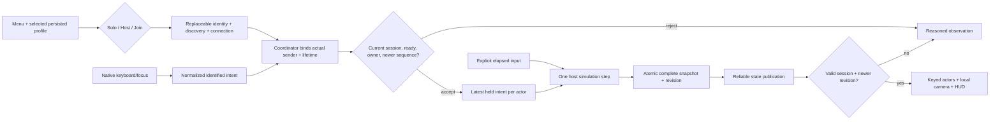

# Phase 03: Four-player LAN foundation - Research

**Researched:** 2026-11-15
**Domain:** Godot/C# LAN authority, admission, profiles, discovery and small process evidence
**Confidence:** MEDIUM; source contracts inspected, Phase 3 runtime acceptance remains unperformed.

<user_constraints>
## User Constraints (from CONTEXT.md)

### Locked Decisions

The following implementation decisions and discretion are copied verbatim from the phase context. [CITED: 03-CONTEXT.md]

<!-- DATA_7cf032a9_START -->
### No further design discussion

- **D-01:** The creator declined all offered discussion areas: “Nothing. all is obvious”. Proceed to planning from the locked specification without further questions about these routine choices.
- **D-02:** No particular host/join layout, session-naming convention, local-profile interface, display-name default, placeholder color, name-label style, local-player marker, progress presentation, or error/retry layout was selected. Do not turn offered discussion topics or agent defaults into creator-approved requirements.

### Carried-forward communication and presentation

- **D-03:** Continue using English for user-facing communication and available interactive question controls when a future question actually needs a decision, as recorded in Phase 2 context and the indexed collaboration instructions. This does not invite another Phase 3 design interview.
- **D-04:** Carry forward Phase 2's basic presentation direction. Its context delegates routine scene/menu/camera choices within its specification; this discussion adds no new visual preference or asset requirement.

### Agent's Discretion

Research and planning may resolve the routine host/join flow, session names, local-profile selection and display names, character distinction, and connection/error feedback within `03-SPEC.md`. Use the smallest usable implementation that meets the specified behavior, keyboard/mouse handling, and readability at both required resolutions. Concrete choices remain implementation decisions rather than additional creator-approved requirements.

Transport/discovery mechanisms, identifiers' representations, profile persistence details, authority and replication techniques, revision/readiness handling, camera implementation, configuration placement, and smoke-check tooling remain research/planning work under the locked specification and the completed prerequisite rules and boundaries. Preserve all specified capacity, identity, timing, ownership, teardown, substitution, and two-platform evidence obligations. No new protocol, library, numeric target, or architecture exemption was selected in this discussion.
<!-- DATA_7cf032a9_END -->

### Deferred Ideas (OUT OF SCOPE)

<!-- DATA_01f5c6b8_START -->
None. The creator proposed no new capability or roadmap change. Existing later-phase work retains its specified ownership.
<!-- DATA_01f5c6b8_END -->
</user_constraints>

**Current policy override:** Routine local verification is Windows at 1280×720, without a VM. Implement the whole phase, review and repair its code, then run grouped rendered scenarios. This overrides the older two-local-OS and extra-resolution evidence wording quoted above and in AC-16/AC-17; keep supported product layouts and separate Linux/hosted/release obligations visible without inventing passes. Physical mixed-computer/mixed-OS release acceptance remains Phase 10. [CITED: ../../../docs/workflow/local-testing.md; ../../../docs/workflow/ai-collaboration.md; orchestrator instruction]

## Summary

Use the existing five projects, extend the current pure movement authority into an identified four-participant session, and compose independent discovery/profile/connection ports in the existing Godot assembly. Use built-in ENet raw packets for reliable ordered transport, complete small snapshots, and application-level admission/readiness/sequence checks. Retain the existing root script and input latch; split ordinary C# helpers rather than adding scene scripts. These are implementation recommendations under D-01, not new creator requirements. [CITED: 03-SPEC.md AC-01–AC-15; ../../../docs/architecture/decisions/0002-boundaries.md]

The main risks are incorrect baseline ordering, recycled-slot callbacks, and false-green evidence. Keep transport connection distinct from a participant reservation, install a whole baseline atomically before enabling control, and guard every callback with the session and adapter generation. Preserve the ordinary menu/input path, and keep adversarial command delivery distinct from observation. [CITED: 03-SPEC.md AC-03–AC-17; ../../../docs/architecture/decisions/0003-state-and-engine.md]

**Primary recommendation:** Plan pure authority and protocol first, then adapters/UI and a small independent required-case runner; finish implementation and code review before opening game windows. A four-window input-driver gap must receive an explicit plan task rather than weakening focus-loss behavior. [CITED: ../../../docs/workflow/local-testing.md; 03-SPEC.md AC-06–AC-08]

## Architectural Responsibility Map

Recommended ownership follows the existing pure rules/service composition boundary. [CITED: ../../../docs/architecture/boundaries.md]

| Capability | Primary Tier | Secondary Tier | Rationale |
|---|---|---|---|
| Actor roster, intent acceptance, movement and revisions | Pure Core | Host composition | One deterministic authority; no addresses or transient peers in rules |
| Reservation/readiness and connection-to-participant binding | Session coordinator in Godot assembly | Pure authority | Bind trusted transport sender before calling rules |
| Connection, discovery and profile contracts | Independent service assembly | Godot composition | Framework-only interfaces, independent implementations |
| ENet, multicast and profile-file adapters | Godot assembly | OS/native services | Replaceable providers outside rules and contract assembly |
| Menu, profile/browser feedback, labels and local camera | Godot presentation | Accepted snapshot | Read current state; never move actors independently |
| Process/input driver and result reconciliation | Repository tooling | Existing C# test assembly | Fresh per-peer evidence; no production state mutation by observer |

## Project Constraints (from AGENTS.md)

- Read relevant indexed rule, architecture, testing and specification documents; preserve executable standards and exact permissions. Initial documentation alone does not establish implementation. [CITED: ../../../AGENTS.md]
- Implementation uses the phase feature branch from latest origin/dev, a draft PR to dev after the first implementation commit, and the same PR becomes ready only after required completion. Merge is not authorized. Research itself creates no branch/commit/PR. [CITED: ../../../docs/workflow/ai-collaboration.md; orchestrator instruction]
- Implement and review the complete phase before rendered testing. Declare Critical/new/changed/affected selection, omissions, run groups and scenario importance; collect failures, batch repairs, focused rerun, then full selected-set rerun after repairs. No VM or routine extra resolution. [CITED: ../../../docs/workflow/local-testing.md]
- Preserve C# production/tests, five-project reference direction, exact public API/engine permissions, controlled elapsed input, immutable publication and close-before-disconnect lifetime. New entries must name exact required types/methods and retain adjacent misuse rejection; no wildcard, suppression or blanket relaxation. [CITED: ../../../docs/code/README.md; ../../../docs/architecture/decisions/0003-state-and-engine.md; orchestrator clarification]
- Preserve warning-as-error builds, explicit named arguments, file-scoped namespaces, braces, sealed classes, one type per file, short methods and focused documentation conventions. [CITED: ../../../Directory.Build.props; ../../../.editorconfig; ../../../docs/code/README.md]

<phase_requirements>
## Phase Requirements

Descriptions below are verbatim requirement text; research support is the recommended implementation allocation. [CITED: ../../REQUIREMENTS.md]

<!-- DATA_9f2370c4_START -->
| ID | Description | Research Support |
|---|---|---|
| LAN-01 | A host and up to three guests can connect to the same foundation scene using separate game processes. | Admission state machine, multicast browser/manual endpoint, ordered baseline, cleanup |
| LAN-02 | Each participant can move only their own character while every participant observes consistent movement. | Trusted sender binding, host stepping, complete snapshots, local camera and timing traces |
| LAN-03 | Participants use the same authoritative action path for solo, host-local, and guest input without duplicate execution. | Shared intent acceptance and step; per-binding sequence; generation/revision fences |
| LAN-04 | Developers can replace discovery, identity, and connection services without changing gameplay rules or using a LAN address as persistent player identity. | Three independent ports, stable file-backed profiles, composition substitutions |
<!-- DATA_9f2370c4_END -->
</phase_requirements>

## Standard Stack

Keep existing pins; this phase needs no new external package or tool installation. These are repository pins, not a claim that they are the latest public releases. [CITED: ../../../tools/phase1/toolchain.json]

| Component | Exact baseline | Use |
|---|---|---|
| Godot .NET and SDK | `"engine": "4.7.2"`, `"sdk": "10.0.404"`, `"language": "14.0"`, `"framework": "net10.0"` | Existing native integration and Core |
| Node | `"node": "24.22.1"` | Existing process/evidence coordinator style |
| Test packages | `Include="xunit.v3" Version="[4.0.2]"`, `Include="Shouldly" Version="[4.3.0]"` | Existing C# proof executable |
| Built-ins | ENet, System.Net.Sockets, System.Text.Json, System.IO | Transport, discovery, wire validation and profile storage |

Pin quotes above are read from source. [VERIFIED: tools/phase1/toolchain.json:3-10; Directory.Packages.props:11-12] Built-in recommendations follow official engine/.NET APIs, not registry packages. [CITED: https://docs.godotengine.org/en/stable/classes/class_enetmultiplayerpeer.html; https://learn.microsoft.com/en-us/dotnet/api/system.net.sockets.udpclient?view=net-10.0]

### Package Legitimacy Audit

No external package installation is recommended, so registry legitimacy/version/postinstall gates do not apply. Keep existing locks and archive authentication; adding a package later requires a separate authoritative-source/registry audit. [CITED: ../../../docs/workflow/setup.md]

### Alternatives considered

| Use | Alternative | Decision |
|---|---|---|
| Raw ENet packets | High-level RPC/synchronizers | Raw packets keep readiness, ownership, ordering and substitutions explicit; high-level RPC is useful when synchronized node paths are already the application contract |
| .NET multicast discovery | UDP broadcast probe/reply | Multicast supports multiple local host listeners; broadcast is simpler for one host but shared Windows unicast/broadcast port delivery must not be assumed |
| Complete four-actor snapshots | Delta replication/prediction | Full small state avoids delta catch-up dependencies; optimize only if measured ordinary limits fail |
| Existing C# proof executable | New test project/framework | Preserve the approved five-project inventory and existing working runner |

These are implementation recommendations, not compatibility findings. Raw packet methods and transport modes are official APIs; Windows documents multicast as the shared-port delivery exception. [CITED: https://docs.godotengine.org/en/stable/classes/class_packetpeer.html; https://learn.microsoft.com/en-us/windows/win32/winsock/using-so-reuseaddr-and-so-exclusiveaddruse]

## Exact Integration and Permission Plan

Existing source facts, including discrete literals, are quoted here to distinguish them from proposed interfaces below.

- Current authority construction/stepping is single-actor: `public FoundationSession(string sessionId, string playerId, string actorId)`, `public FoundationActorState Actor { get; private set; }`, `public void Advance(FoundationMovementCommand command, long elapsedMilliseconds)`; position uses `positionSubunits: -8000`, `* 3 * command.Direction`, `min: -59000, max: 59000`. [VERIFIED: src/core/FoundationSession.cs:9-19; src/core/FoundationSession.cs:29-56]
- The command definition is `public FoundationMovementCommand(string sessionId, string playerId, string actorId, int direction)`. Retain its identity/direction meaning; add explicit sequence/session-binding data rather than accepting client elapsed duration. [VERIFIED: src/core/FoundationMovementCommand.cs:7-22]
- Current content values are `SchemaVersion { get; } = 1`, `"foundation.fixture.v1"`, `"foundation.ground.v1"`, `"foundation.building.v1"`, `"foundation.player.v1"`. Include exact fixture/content compatibility in the handshake; do not use a display name as a version. [VERIFIED: src/core/FoundationActorState.cs:31-39]
- The root currently calls `_session.Advance(command: command, elapsedMilliseconds: elapsed);` during its frame loop. Replace this direct single-actor route with a session coordinator used by solo/host/guest. Current return first does `_session?.Close();` before removing/freeing the world. Preserve that order for the larger lifetime. [VERIFIED: src/godot-game/foundation/FoundationRoot.cs:86-95; src/godot-game/foundation/FoundationRoot.cs:166-177]
- Projection currently reads `"Player"`, converts `* 16f / 1000`, clamps camera `min: -320, max: 320`, and smooths with `-seconds / 0.15`. Iterate actor presentations keyed by actor identity, then project the local camera once from its assigned actor. Do not run camera following once per remote actor. [VERIFIED: src/godot-game/foundation/FoundationView.cs:15-25]
- The sole existing independent service contract is `public interface IProofService` with `int Echo(int value);`. It proves composition, not production LAN services. Add separate production ports rather than converting it into a multipurpose message bus. [VERIFIED: src/multiplayer-abstractions/IProofService.cs:4-9]
- Production bans include `T:System.Diagnostics.Stopwatch`, `P:System.Environment.TickCount64`, `T:System.DateTime`, `T:System.IServiceProvider` and blocking waits. Use explicit elapsed milliseconds in rules and a guarded engine monotonic clock adapter for actual no-response deadlines; test with controlled time. Use external Node monotonic time for evidence. [VERIFIED: BannedSymbols.txt:3-19]
- Public registry matching fails with `"R-34: invalid or expanded exact visibility registry"`; engine access matches exact root/view methods. Plan exact additions to registry and its independent checker expectation, plus a negative adjacent-type/method control. Preserve engine guards for every helper that actually invokes Godot. [VERIFIED: tests/phase1/ArchitecturePolicy.cs:22-44] [CITED: ../../../tests/phase1/EngineAccessPolicy.cs]

### Component responsibilities

All new filenames/types below are **proposed**, not existing paths or locked API values. Adapt small naming details to actual diagnostics; retain these responsibility boundaries. [CITED: 03-CONTEXT.md D-01 and Agent's Discretion]

| Existing/proposed component | Responsibility |
|---|---|
| Existing FoundationSession / command / actor state | Extend pure authority to roster, per-actor held intent, trusted participant token, last accepted sequence and immutable snapshot/revision |
| Proposed Core FoundationSnapshot and participant types | Complete detached session publication and validation, ordinal identity uniqueness, actor/owner consistency and bounds |
| Proposed IDiscoveryService / IIdentityService / IConnectionService in service assembly | Independent framework-only contracts and DTOs; no Core/Godot dependency |
| Proposed FoundationCoordinator in game assembly | Bind actual transport sender to stable participant/actor; admission, baseline acknowledgment, timeout and session lifecycle |
| Proposed FoundationProtocol in game assembly | Strict bounded JSON wire DTOs, parse/validate, explicit mapping into Core; reject malformed envelopes without exceptions escaping the frame |
| Proposed EnetConnectionService in game assembly | Guarded create/poll/raw send/receive/close and transport generation; retain actual sender separate from payload claims |
| Proposed LanDiscoveryService in game assembly | Multicast advertisements/search, session identity deduplication, TTL and endpoint validation |
| Proposed LocalProfileService in game assembly | File-backed profile creation/loading/update with stable opaque identity and failures surfaced before entry |
| Existing FoundationRoot | Native composition, explicit menu/browser/profile states, input dispatch, entry/teardown and capture |
| Existing FoundationInput | Preserve normalized aliases and focus-block-until-release latch |
| Existing FoundationView / world resources | Keyed actor primitives, P-markers/roster, one local camera, unchanged fixture art/bounds |
| Existing test assembly plus proposed phase3 test files | Core and linked engine-free coordinator/protocol/provider substitutions; no sixth project or forbidden project reference |
| Proposed tools/phase3 catalog/check/evidence/rendered helpers | Small owned process runner and saved ordered scenarios, using existing input/PNG primitives where suitable |

Service ports must use their own framework-value DTOs; the game coordinator explicitly maps them to Core, because neither independent assembly may reference the other. Link engine-free coordinator/adapter sources and necessary port sources into the existing tests if direct game/ports project references would violate the graph; add exact Compile inputs and boundary proofs, never a broad glob. [CITED: ../../../tools/phase1/projects.json; ../../../tests/phase1/TypeBoundaryScanner.cs; ../../../tests/phase1/KingdomZombies.Phase1.Tests.csproj]

## Architecture Patterns

### Data flow

The following is the recommended architecture, derived from required authority and lifetime outcomes. [CITED: 03-SPEC.md AC-05–AC-15]



### Authority and ordering

Use a monotonically increasing command sequence per participant binding and new binding token per admission. Each command identifies session, actor and sequence, but the coordinator supplies the trusted participant from the actual sender. Validate lifetime, readiness, ownership, direction and strictly newer sequence **before** changing either held intent or last sequence. A duplicate command does not step movement. One explicit host update advances every ready actor exactly once from its most recent accepted direction; local host and solo enter that same method. Never integrate client-supplied elapsed time or write authoritative positions from packets. [CITED: 03-SPEC.md AC-06 and AC-09–AC-11; ../../../docs/architecture/decisions/0003-state-and-engine.md]

Use complete snapshots containing session, monotonic revision, ready participants, stable owner/actor IDs, positions/facing and content identity. Validate all detached values and uniqueness before one publication. Guest state accepts only its current session and a strictly newer revision. A matching duplicate baseline can acknowledge idempotently without reinstalling; an older baseline cannot reset the world. Keep integer subunits for positions and document error conversion in evidence. [CITED: 03-SPEC.md AC-05, AC-07, AC-11; ../../../src/core/FoundationActorState.cs]

### Admission and readiness

Recommended protocol stages (new protocol names): transport connection; hello with protocol/content/profile/attempt identity; host atomic reservation; detached baseline; guest validated installation; acknowledgment of that baseline revision; host promotion and newest complete ready snapshot; guest control after that promotion. Reservations consume capacity immediately and keep an opaque actor allocation, but an unready actor is never presented as controllable. Existing ready actors keep stepping during the exchange. The final ready snapshot supersedes the earlier baseline, avoiding a join-time freeze while other actors move. [CITED: 03-SPEC.md AC-03–AC-05]

Serialize reservation and release on the session update thread. Count the host plus both ready and pending reservations, at most four. Duplicate active player identity fails before allocating ownership; repeated hello for the same attempt returns its existing outcome. Use a bounded **transport** allowance greater than three remote sockets so a fifth attempt can receive an application-level full reason. A connected unauthenticated transport is not a participant or slot. Bound its hello deadline and number so rejected peers cannot exhaust memory. Do not configure ENet's transport maximum as the only four-player admission gate. [CITED: 03-SPEC.md AC-03–AC-04 and AC-14; https://docs.godotengine.org/en/stable/classes/class_enetmultiplayerpeer.html]

Cancel/failure/timeout release by reservation plus binding generation, not slot index. Guest departure closes that binding, removes exactly its actor, increments revision and publishes the remaining roster. Repeated cleanup is a no-op. Replacement admissions receive fresh actor and binding identities even if the visible P-number/slot is reused. [CITED: 03-SPEC.md AC-11–AC-13]

### Timing and transport

Use reliable raw packets for the small command/control/snapshot stream initially; send intent changes immediately, periodic liveness and bounded-rate complete state. Keep transport callbacks/main-thread drain bounded; do not hold unbounded queues. A candidate publication interval is one twentieth of a second, an implementation starting point requiring measured acceptance rather than a new target. Prediction and delta replication are unnecessary until ordinary timing proves otherwise. [CITED: 03-SPEC.md AC-07 and scope; https://docs.godotengine.org/en/stable/classes/class_multiplayerpeer.html]

Read packet sender **before** consuming its packet. Manually own/poll the ENet peer; do not simultaneously install it under a MultiplayerAPI that also consumes the packets. Official abstract Poll documentation says it can wait, but the exact pinned ENet implementation services with zero timeout in both client/server branches; rely on that implementation and keep an idle-poll responsiveness probe in the plan. [CITED: https://raw.githubusercontent.com/godotengine/godot/ed1daf0bf001b61586d9930840f2f1394092c079/modules/enet/enet_multiplayer_peer.cpp] The pinned managed documentation says `Returns the ID of the MultiplayerPeer who sent the next available packet.` [VERIFIED: .phase1/tools/Godot_v4.7.2-stable_mono_win64/GodotSharp/Api/Debug/GodotSharp.xml:141636-141639]

Join timeout is the first update at or after 30 seconds from attempt start, covering transport and baseline installation. Response loss is the first update at or after ten seconds since the last valid current-binding response; implement application heartbeat rather than trusting ENet's unrelated built-in timeout. Controlled tests hit immediately below/equal/above thresholds and a valid response at the boundary with a documented update order. First evaluate received valid responses, then expiration; graceful explicit leave/end can close immediately. [CITED: 03-SPEC.md AC-04 and AC-12–AC-13]

Use an injected monotonic millisecond source for coordinator deadlines. Engine Time ticks are monotonic per official documentation; use them only inside a guarded native adapter, never as ambient Core time. Do not derive response deadlines solely from clamped simulation delta or OS wall-clock dates. [CITED: https://docs.godotengine.org/en/stable/classes/class_time.html; ../../../BannedSymbols.txt]

For graceful host ending send an application end reason and allow a short bounded drain/ack before closing transport; force-close eventually. On unexpected transport disappearance retain the loss reason and observe the configured no-response condition, without resurrecting control. Close acceptance/increment generation before disconnecting, unsubscribing, clearing actors/input, cancelling work or freeing resources. [CITED: 03-SPEC.md AC-11–AC-13; ../../../docs/architecture/decisions/0003-state-and-engine.md]

### Discovery protocol options and recommendation

Use a versioned, small UDP multicast discovery channel with one administratively scoped group/port defined in adapter configuration. Set reuse and nonexclusive behavior before bind, join the multicast group on usable local interfaces, use link-local TTL and loopback for same-machine discovery, and bound receives per frame. Microsoft documents that multicast listeners sharing interface/port/group receive copies; ordinary reused UDP sockets do not provide that guarantee. [CITED: https://learn.microsoft.com/en-us/windows/win32/winsock/using-so-reuseaddr-and-so-exclusiveaddruse; https://learn.microsoft.com/en-us/dotnet/api/system.net.sockets.udpclient.joinmulticastgroup?view=net-10.0]

Recommend hosts periodically advertise; browser refresh sends a multicast query and hosts answer on the same multicast channel. Advertisement contains protocol/content identity, session ID, session/host display labels, transport port, ready-plus-pending count, availability and a short expiry. Derive endpoint address from the source datagram/interface rather than trusting an arbitrary advertised address. Deduplicate only by session identity, preserve selection across reorder, and expire missing rows without choosing another host. Bound datagram/text size and ignore malformed/incompatible rows. Search errors leave manual joining available. All concrete protocol numeric values beyond locked acceptance thresholds are planner-owned defaults. [CITED: 03-SPEC.md AC-02–AC-04 and AC-18]

Broadcast query/reply to ephemeral browser sockets is a reasonable alternative on single-host LANs, but a shared-port multi-host test cannot assume Windows broadcast/unicast delivery fanout. A process broker introduces an avoidable service lifecycle. Select multicast initially and validate a pair of same-machine host advertisements plus multiple browsers using real sockets without game windows. Manual joining remains an independent path when multicast is blocked; do not report that as a discovery pass. [CITED: https://learn.microsoft.com/en-us/windows/win32/winsock/using-so-reuseaddr-and-so-exclusiveaddruse; 03-SPEC.md AC-02]

### Profile persistence and exact identities

Use one opaque newly generated player ID per profile, persisted before entry. Keep session, actor, reservation/binding and transient peer identities separate. Guid.NewGuid supplies a version-four UUID per official API documentation; render/persist a single canonical representation at creation and compare stored/incoming identifiers ordinally without case conversion or truncation. Identity is a LAN ownership key, not proof of a person's authentication. Equal display names remain independent profiles. [CITED: https://learn.microsoft.com/en-us/dotnet/api/system.guid.newguid?view=net-10.0; 03-SPEC.md AC-14]

Resolve the user storage directory at composition through Godot's supported user-data location, then pass an ordinary absolute directory to the file adapter; do not pass engine objects into service contracts. Create/save profiles under an owned profile store with schema and selected profile metadata, no LAN address in the stable key. Use exclusive create/lock and same-directory temporary write plus replace/move publication; return success only after completion. Do not silently regenerate an unreadable/invalid saved identity. Expose the UI contract's load/save failures and create/select another profile recovery. Test same-profile concurrent writers, failed write/replace, duplicate names and repeated process restarts. [CITED: https://docs.godotengine.org/en/stable/tutorials/io/data_paths.html; https://learn.microsoft.com/en-us/dotnet/api/system.io.file.replace?view=net-10.0; 03-UI-SPEC.md]

The smoke runner uses invocation-owned isolated profile roots and selects four distinct profiles. Keep persisted profile files between intentional restart subcases; generate a fresh session/actor on rehost, never regenerate the tested profile. Ordinary application runs use the real profile store rather than a randomly generated per-process identity. [CITED: 03-SPEC.md AC-14–AC-18]

### UI and input integration

Apply the approved UI contract's native controls, copy, profiles, selection semantics, ready states, markers and roster. Current root keyboard activation assumes only Start/Quit; replace that two-action dispatch with explicit screen/focus dispatch so Enter on a profile/address/browser control cannot fall through to Quit. Consume menu movement while editing, maintain focus/caret after errors, clear held movement on entry/cancel/return and preserve focus-loss blocking. [CITED: 03-UI-SPEC.md; ../../../src/godot-game/foundation/FoundationRoot.cs; ../../../src/godot-game/foundation/FoundationInput.cs]

## Don't Hand-Roll

| Problem | Use instead | Reason |
|---|---|---|
| Reliable UDP delivery/reordering | Built-in ENet | Application ordering still required, but transport retransmission is already supplied |
| Native object serialization | Bounded explicit JSON DTOs | Avoid arbitrary Variant/object decoding; validate before mapping |
| UUID and hashing | Framework Guid/SHA APIs | No homegrown entropy or digest |
| Profile byte publication | Framework file operations with owned temp/lock | Preserve old identity on failed writes |
| New comprehensive game framework | Existing xUnit executable and small phase runner | Phase 5 owns the broad framework |
| New camera simulation | Existing projection with local actor selection | Camera follows accepted state only |

Recommendations derive from the small phase scope, existing tools and official primitives. [CITED: 03-SPEC.md scope; https://docs.godotengine.org/en/stable/classes/class_packetpeer.html; https://learn.microsoft.com/en-us/dotnet/api/system.guid.newguid?view=net-10.0]

## Runtime State Inventory

This phase extends/refactors the existing single-actor path; it does not rename an existing production identity or migrate a delivered save format. The inventory below is limited to the inspected repository/owned tooling, not an asserted exhaustive scan of unrelated machine services. [CITED: ../../../src/core/FoundationSession.cs; 03-SPEC.md scope]

| Category | Items found / evidence boundary | Action |
|---|---|---|
| Stored data | Current actor/session state is in memory; Phase 2 root creates temporary local identity. No existing profile schema is established by the inspected production path | Introduce new profile persistence; preserve deliberately reused test profile roots across restart |
| Live service config | Current production root composes no external discovery/connection/account service | Add locally owned sockets/configuration; no account/service data migration |
| OS-registered state | No scheduler/service registration is created by inspected Phase 2 process launch code; unrelated OS registrations were not scanned | No rename task; own and close every new process/socket |
| Secrets/env vars | Current smoke observation uses explicit environment configuration | Add phase-specific scoped configuration; retain or deliberately adapt Phase 2 regression invocation |
| Build artifacts | Existing compiled/generated Godot and C# output carries current public API and generated script metadata | Strict rebuild, refresh only authenticated exact generated permissions if output changed; never treat old binary evidence as current |

[CITED: ../../../src/godot-game/foundation/FoundationRoot.cs; ../../../tools/phase2/rendered.cjs; ../../../docs/code/engine-generated-spans.json]

## Common Pitfalls

- **Transport max equals gameplay capacity:** Prevents the fifth peer receiving a precise full reason. Reserve only in host authority and separately bound transport handshakes. [CITED: 03-SPEC.md AC-03–AC-04]
- **Intent delivery advances simulation:** Duplicate packets multiply distance; replayed moves override stops. Accept newest intent separately from once-per-update stepping. [CITED: 03-SPEC.md AC-09–AC-10]
- **Baseline and live updates cross:** A later-arriving baseline rewinds an already accepted revision. Stage complete validated values and compare session/revision at the publication boundary. [CITED: 03-SPEC.md AC-05 and AC-11]
- **Slot index is identity:** A delayed disconnect deletes the replacement. Release by session plus reservation/binding generation and actor identity. [CITED: 03-SPEC.md AC-11–AC-12]
- **Heartbeat accepts any packet:** Malformed/stale work keeps a dead connection alive. Update liveness only for valid current-session/binding responses. [CITED: 03-SPEC.md AC-11–AC-13]
- **Local authority bypass:** Host direct mutation and guest network path disagree. Test the same production accept/step method through all three roles. [CITED: 03-SPEC.md AC-09]
- **One camera per actor iteration:** Last remote actor takes over the local view. Update keyed actor visuals first and local camera once. [CITED: 03-SPEC.md AC-06]
- **Evidence polling too slow:** A screenshot request every half-second cannot establish a quarter-second visible response. Capture/timestamp frame checkpoints at sufficient cadence and report an upper bound with uncertainty. [CITED: 03-SPEC.md AC-07 and AC-17]

## Code Examples

The following is **proposed pseudocode**, not an existing API or copied wire schema. Identifier names and literals here are prospective design, not verified repository values. [CITED: 03-SPEC.md AC-09–AC-12]

```text
Accept(trustedBinding, command):
    reject unless accepting and command.session == activeSession
    reject unless trustedBinding is current and ready
    reject unless trustedBinding.actor == command.actor
    reject unless direction is valid and sequence > lastAccepted
    publish latest held direction and lastAccepted together

Update(now, elapsed):
    drain bounded current-generation transport messages
    accept valid responses, then expire pending/lost bindings
    advance each ready actor once using host elapsed and accepted direction
    publish one complete immutable snapshot with a newer revision
```

Official packet primitives should be wrapped in a guarded method: poll the owned ENet peer; while packets are available, read next packet's sender, then read bytes, check packet error, parse within bounds and deliver a detached envelope plus trusted sender/generation to the coordinator. Never trust the payload's claimed peer. [CITED: https://docs.godotengine.org/en/stable/classes/class_packetpeer.html; https://docs.godotengine.org/en/stable/classes/class_multiplayerpeer.html]

## Validation Architecture

### Existing infrastructure and new small entry points

Use the existing C# test executable and phase1 rule/graph/docs entry points. Proposed phase3 coordinator commands below are **to be implemented**, not existing commands or reported passes. [CITED: ../../../docs/workflow/verification.md; ../../../tools/phase2/check.cjs]

| Property | Value |
|---|---|
| Framework | Existing xunit.v3 pin, existing Phase1.Tests executable |
| Pure quick run | Proposed `node tools/phase3/check.cjs --group core` |
| Adapter/runner quick run | Proposed `node tools/phase3/check.cjs --group adapters` / `--group runner` |
| Rendered selection | Proposed `node tools/phase3/check.cjs --group rendered`, only after whole-phase code review |
| Full selected phase proof | Proposed `node tools/phase3/check.cjs --all` plus explicit selected inherited regressions |
| Strict build | `dotnet build KingdomZombies.slnx --no-restore --disable-build-servers -p:UseSharedCompilation=false -nodeReuse:false -p:NuGetAudit=false -v:q` after documented isolated setup |

### Requirement and acceptance mapping

Every proposed check is new/Wave 0; row commands are intended groups, with exact stable catalog IDs assigned in the plan. Preserve AC identities and later A-01–A-47 identities. [CITED: 03-SPEC.md; ../../../docs/workflow/local-testing.md]

| Source AC | Requirements | Check and observation | Group |
|---|---|---|---|
| AC-01 | LAN-01 | Solo/menu Host/Join/Cancel/Back rapid activation, one tree lifetime, direct Escape, bounded Quit; mouse and keyboard | rendered + core |
| AC-02 | LAN-01 | Actual multicast plus manual join; empty, repeated/equal-name Unicode advertisements, stable/vanished selection and stale full host | adapters + rendered |
| AC-03 | LAN-01 | Host-only through four; fifth reason; last-slot concurrent hello; pending reservation counts | core + rendered |
| AC-04 | LAN-01 | Invalid endpoint, unreachable/incompatible/full, repeated/cancelled join, timeout below/equal/above; no retained slots | core + rendered |
| AC-05 | LAN-01/03 | Join moving actors, no pre-install control, coherent revision/owner state, existing actors preserved | core + rendered |
| AC-06 | LAN-02 | Four independent walkers/aliases/opposition, 3u/s tolerance, finite bounds/facing and cameras | core + rendered |
| AC-07 | LAN-02 | Frame-timestamped start/reversal/stop across all peers; inclusive 250ms and 0.05u by 0.5s, unrounded | rendered |
| AC-08 | LAN-02 | Real OS focus loss clears one peer, fresh press required, others retain ownership | rendered + core |
| AC-09 | LAN-03 | Solo/host/guest same accept/step; deliberate wrong-owner and unready commands rejected | core + adapters |
| AC-10 | LAN-03 | Production validator duplicate/reordered command and stale move after stop, host-local replay | core + adapters |
| AC-11 | LAN-03/04 | Older baseline/update and old-session adapter callbacks after rehost leave state unchanged | core + adapters |
| AC-12 | LAN-01/02/03 | Graceful/lost guest, exact threshold, repeated cleanup and replacement slot with fresh actor | core + rendered |
| AC-13 | LAN-01/03 | Graceful host-end/loss copy, menu recovery, fresh host/join with no old actor/listener/input | core + rendered |
| AC-14 | LAN-04 | New/equal-name profiles, restart/endpoint/peer changes, invalid/duplicate active identity, failed persistence | adapters + rendered |
| AC-15 | LAN-04 | Swap each provider independently through actual composition; Core source hashes unchanged; unavailable adapters fail visibly | adapters |
| AC-16 | all | Saved readable scenarios, exact commands, bounded waits, host+3 real processes and selected solo regressions | runner + rendered |
| AC-17 | all | Fresh per-peer artifacts/images and timing; deliberate zero/missing/duplicate/stale/crash/timeout controls | runner |
| AC-18 | LAN-01/04 | No online account/runtime donor dependency; accurately scoped development-OS report | adapters + runner |

### Four-player input driver: explicit recommendation and limitation

The existing desktop helper repeatedly focuses the owned PID before key events, while the production focus callback clears held input. Reusing that helper serially across four windows cannot establish simultaneous held movement. Preserve the focus behavior; do not make a smoke flag disable it. [CITED: ../../../tools/phase2/windows-input.ps1; ../../../src/godot-game/foundation/FoundationRoot.cs; ../../../src/godot-game/foundation/FoundationInput.cs]

**Recommended plan task:** Add a PID/window-owned native message input mode and validate acknowledgments through actual Godot input events, held-latch state and authoritative movement. PostMessage targets a particular window queue per Microsoft documentation, but whether this pinned Godot input/polling path retains a background hold must be demonstrated, not assumed. Keep real foreground OS input for menus, per-peer start/stop timing and independent focus-loss cases; record which input method each checkpoint used. [CITED: https://learn.microsoft.com/en-us/windows/win32/api/winuser/nf-winuser-postmessagew]

If background message input does not pass, use a narrowly scoped per-process engine input-event driver for the simultaneous control subcase, flowing through the same native input handler and authority, with observer kept read-only. Explicitly label those events synthetic and retain separate real desktop-input/focus and timing proofs. Godot documents that ParseInputEvent invokes the input path without OS effects. This fallback is not physical keyboard evidence; if the acceptance interpretation requires physical simultaneous keyboard streams, record that gap for a genuine multi-input environment rather than forging a pass. Do not silently substitute direct command calls or direct actor mutation. [CITED: https://docs.godotengine.org/en/stable/classes/class_input.html; 03-SPEC.md AC-06–AC-08]

### Small trustworthy evidence runner

Use an independent required-case catalog and set-based reconciliation by exact case and peer role, not result position. Record expected host/three guests, actual process IDs, profile/player/session/actor/binding identities, revision, platform, tool/input hashes, nonce, timing samples and image hashes. Require every selected peer/result/checkpoint; a duplicate guest cannot substitute for the absent fourth participant. Validate PNG decoding/dimensions/content and review actual readability/appearance. Screenshot existence alone is insufficient. [CITED: 03-SPEC.md AC-16–AC-18; ../../../tools/phase2/evidence.cjs]

One invocation owns profiles, port allocation, observation directories and processes. Either allocate isolated native ports and evidence or take an exclusive desktop lock and explicitly refuse overlap. A lock must coordinate with the inherited runner too; two unrelated per-phase locks do not isolate the same desktop. Never globally kill Godot processes, delete another invocation, or overwrite a report. Preserve failed initial, focused-repair and final-selected-set reports; do not carry older passes over unresolved later failures. [CITED: ../../../docs/workflow/local-testing.md; 03-SPEC.md AC-17]

Recommended run groups: (1) no-window pure/adapters/runner controls; (2) solo/profile/menu/browser scenarios in one process or a reusable small host/browser set; (3) ordinary host+three guests for moving join, movement/timing/focus/guest leave/slot reuse and graceful end/rehost; add a fifth process only for capacity/race/identity refusals; (4) destructive host-loss check last, restarting only the owned host afterward if needed. Separate profile-restart process launches are necessary to prove persistence. Explicitly declare compatible resets through ordinary controls. Keep all routine windows 1280×720. [CITED: ../../../docs/workflow/local-testing.md; 03-SPEC.md AC-03, AC-14, AC-16]

Measure originating native input and first rendered changed frame using one external monotonic coordinator clock with request/ack brackets, or verified shared OS monotonic timestamps. Do not compare unrelated process startup-relative clocks. Capture at a cadence that can bound 250ms, include sampling/clock uncertainty, and fail if the conservative upper bound exceeds the limit. Record correct actor/session/revision and stopped-host position on every peer; rendering evidence must show the monitored actor in the camera. Avoid slow per-key PowerShell startup in measured intervals by keeping an owned driver alive. [CITED: 03-SPEC.md AC-07; ../../../tools/phase2/windows-input.ps1]

Negative runner controls must include zero selection, missing required peer/case/image, duplicate-substitution, unknown IDs, stale nonce/hash/platform, invalid/corrupt image, actual child nonzero exit/crash and timeout, owned descendant cleanup, reordered valid results, fresh repeat and concurrent refusal/isolation. Exercise the real coordinator rejection, with valid setup; never synthesize a passing result for an unexecuted subject. [CITED: 03-SPEC.md AC-17; ../../../tools/phase2/evidence.cjs]

### Sampling and Wave 0

- Per implementation task: focused pure/adapter checks and strict build as relevant, without game windows. Per integration wave: affected rule/type/graph/generated/docs checks. After full implementation: review all changed code and fix findings, then execute declared rendered groups. After repairs: focused checks then fresh full selected-set rendered pass. [CITED: ../../../docs/workflow/local-testing.md]
- Wave 0 adds the three service ports, pure tests, engine-free coordinator test composition, phase3 catalog/runner, read-only per-frame observer and owned input driver, plus exact public/native permission controls. None is delivered merely by this research. [CITED: orchestrator research-only scope]
- Save scenario importance/rationale/dependencies, selected/omitted IDs, group ordering, setup/reset, bounded waits/cleanup, expected observations and evidence/review steps. Include inherited Critical and affected Phase 2 input/scene/runner cases. [CITED: ../../../docs/workflow/local-testing.md]

## Environment Availability

This research performed version/read-only inspections only; no Phase 3 game or network acceptance run was launched. [VERIFIED: session tool output]

| Dependency | Observation | Fallback/action |
|---|---|---|
| Node | Actual `v24.22.1` | Existing runner runtime |
| .NET SDK | Actual `10.0.404` | Existing isolated setup |
| Godot console binary | Actual `4.7.2.stable.mono.official.ed1daf0bf` from version command | Existing authenticated distribution |
| Godot managed raw ENet APIs | Present in opened pinned XML documentation | Strict compile/native integration still required |
| Context7 MCP / ctx7 CLI | No Context7 tool discovered and ctx7 command not returned by availability probe | Official primary web docs plus exact pinned source |
| Multicast routing/firewall/input-driver feasibility | Not executed by this research | No-window real socket tests first; input proof after code review |
| Linux/physical mixed LAN | Not run; no VM requested | Separate hosted/native/release evidence scope, no cross-build pass |

[CITED: ../../../docs/workflow/setup.md; session tool output]

## Security Domain

Security enforcement is enabled in project configuration. ASVS is a web application/service standard; use relevant controls as a review taxonomy, without claiming desktop-game certification. Official ASVS 5.0.0 uses different numbering from the older template's authentication/session categories. [CITED: ../../config.json; https://asvs.owasp.org/]

| Current ASVS area | Applies | Phase control |
|---|---|---|
| V1 Encoding and Sanitization | Yes | Render names as plain text, never executable/markup identity |
| V2 Validation and Business Logic | Yes | Strict bounded envelope/profile/baseline validation and capacity invariants |
| V4 API and Web Service | Wire-boundary principles only | Bounded parsing/queues, fail closed, no arbitrary object deserialization |
| V6 Authentication | No online account scope | Stable profile ID is not user authentication; reject duplicate active identity |
| V7 Session Management | Session-lifetime principles | Session/attempt/binding generations, close fence and response deadlines |
| V8 Authorization | Yes | Trusted sender-to-ready-actor mapping before mutation |
| V11 Cryptography | Framework identifiers/digests only | Built-in Guid/SHA; no hand-rolled crypto or asserted authenticated LAN |
| V12 Secure Communication | LAN trust boundary | Validate hostile local packets; no Internet traversal/account requirement |
| V14 Data Protection | Local profile | Owned paths, controlled writes, do not expose unrelated user files |

Category names should be cross-checked against the official release document when writing the security review; these allocations are phase-specific recommendations. [CITED: https://asvs.owasp.org/]

| Threat | STRIDE | Mitigation / proof |
|---|---|---|
| Forged actor/player fields or duplicate profile | Spoofing / elevation | Actual sender binding, readiness/owner checks and duplicate-ID refusal |
| Replay after stop/rehost/reused slot | Tampering | Sequence/revision/generation fences and deliberate late delivery |
| Malformed/flooded discovery or wire data | Denial of service | Bounded size/depth/collections, bounded frame drain, handshake caps |
| False smoke completion | Repudiation / tampering | Independent required catalog, immutable per-peer hashes and negative controls |
| Evidence/profile path escape | Tampering | Owned canonical roots, no path from network name, invocation-only cleanup |

[CITED: 03-SPEC.md AC-03–AC-18; ../../../tools/phase2/evidence.cjs]

## State of the Art

Use documented Godot 4 raw packet methods and the exact pinned C# binding names. Do not copy Godot 3 NetworkedMultiplayerPeer examples or confuse transient ENet peer IDs with persistent players. The project research's earlier networking recommendation was a candidate, not an implementation proof; this research selects the smaller explicit packet/coordinator approach while keeping service replacements. [CITED: https://docs.godotengine.org/en/stable/classes/class_enetmultiplayerpeer.html; ../../research/SUMMARY.md]

## Assumptions Log

| ID | Claim | Risk / disposition |
|---|---|---|
| A1 | [ASSUMED] PID-owned background window key messages will produce usable simultaneous input through the pinned Godot event/physical-key path | Explicit driver proof task; use honestly labeled engine-event fallback and keep separate physical input/focus evidence; never waive focus clearing |
| A2 | [ASSUMED] Available local multicast interfaces/firewall permit the proposed discovery adapter | Real no-window socket probe; manual entry remains usable but cannot substitute for discovery acceptance |

These are feasibility hypotheses, not locked decisions. D-01 authorizes routine implementation choices; resolve with execution rather than a design interview or invented pass. [CITED: 03-CONTEXT.md]

## Open Questions

These planning questions are resolved below. Their assigned execution proofs remain pending; no feasibility, generated-output or timing pass is claimed.

1. **RESOLVED — Background input proof:** Plan 03-04 assigns the owned-window driver proof after complete implementation/code review and before accepting simultaneous input evidence. Preserve distinct synthetic/native/physical provenance; inadequate input evidence blocks acceptance. [CITED: 03-04-PLAN.md; 03-SPEC.md AC-06–AC-08]
2. **RESOLVED — Exact generated permission deltas:** Plans 03-01 and 03-03 derive exact companion text/hash/span changes from actual strict-build output, update narrowly and prove adjacent misuse remains rejected. The approach is selected; observed deltas and passing controls remain execution work. [CITED: 03-01-PLAN.md; 03-03-PLAN.md; ../../../docs/code/engine-generated-spans.json]
3. **RESOLVED — Ordinary synchronization margin:** Plan 03-04 measures the simple reliable state path using actual four-peer frame timings and tightens bounded send/receive cadence if limits fail. The measurement/repair approach is selected with no performance claim or presumed prediction requirement. [CITED: 03-04-PLAN.md; 03-SPEC.md AC-07]

## Sources

### Primary repository evidence

Opened this session: AGENTS, current collaboration/local-testing/setup/verification references; phase3 SPEC/CONTEXT/UI contract; phase2 research and current production root/input/view/model/scenes; requirements/roadmap/state/project/research summary; toolchain/project pins, strict build settings/banned APIs; architecture/engine/visibility/type policies; phase2 process/input/evidence runner and existing test project. Exact discrete source values are quoted beside verified citations above. [VERIFIED: session source-read output]

### Official external sources

- [Godot ENet](https://docs.godotengine.org/en/stable/classes/class_enetmultiplayerpeer.html), [MultiplayerPeer](https://docs.godotengine.org/en/stable/classes/class_multiplayerpeer.html), [PacketPeer](https://docs.godotengine.org/en/stable/classes/class_packetpeer.html): transport/raw packet semantics.
- [Pinned ENet implementation](https://raw.githubusercontent.com/godotengine/godot/ed1daf0bf001b61586d9930840f2f1394092c079/modules/enet/enet_multiplayer_peer.cpp): exact zero-timeout polling/sender ordering.
- [Windows socket reuse](https://learn.microsoft.com/en-us/windows/win32/winsock/using-so-reuseaddr-and-so-exclusiveaddruse), [UdpClient multicast](https://learn.microsoft.com/en-us/dotnet/api/system.net.sockets.udpclient.joinmulticastgroup?view=net-10.0): multicast/shared-port selection.
- [Godot paths](https://docs.godotengine.org/en/stable/tutorials/io/data_paths.html), [Time](https://docs.godotengine.org/en/stable/classes/class_time.html), [Input](https://docs.godotengine.org/en/stable/classes/class_input.html): storage, monotonic time and event provenance.
- [.NET Guid](https://learn.microsoft.com/en-us/dotnet/api/system.guid.newguid?view=net-10.0), [File.Replace](https://learn.microsoft.com/en-us/dotnet/api/system.io.file.replace?view=net-10.0): identifiers/file primitives.
- [Windows PostMessage](https://learn.microsoft.com/en-us/windows/win32/api/winuser/nf-winuser-postmessagew): owned-window message delivery, not proof of this engine input path.
- [OWASP ASVS](https://asvs.owasp.org/): current standard/scope. [CITED: URLs listed]

## Metadata

Research-plan seam selected Context7 for three documentation questions. Context7 MCP/CLI were unavailable, so official primary web lookup and installed binding/pinned upstream source were used. The confidence seam returned MEDIUM for verified websearch; graphify reported disabled. No new package was proposed and no package legitimacy claim was made. [VERIFIED: session research-plan/classify-confidence/availability output]

Research-store persistence was attempted for all three digests and failed with the actual error `EPERM: operation not permitted, mkdir 'C:\Users\User\.gsd\research-cache'`. Findings remain fully recorded in this repository artifact; no global cache write or cache-hit claim is made. [VERIFIED: session research-store output]

**Confidence breakdown:** Stack HIGH for inspected pins and actual version commands; architecture MEDIUM for recommended integration grounded in current source and locked outcomes; pitfalls HIGH for explicit acceptance failures; driver/multicast feasibility LOW until execution. Research date 2026-11-15; revisit upon toolchain, protocol or testing-policy changes. No runtime acceptance, branch, commit or game launch is claimed. [CITED: source findings and orchestrator research-only scope]

