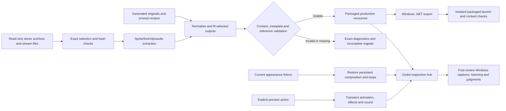

# Phase 04: Asset production — Research

**Researched:** 2026-11-16  
**Domain:** Unity donor extraction; Godot/C# composable pixel-art presentation, content production, inspection and Windows packaging  
**Confidence:** MEDIUM overall; donor feasibility has fresh local evidence, final content and export remain unproved.

<user_constraints>
## User Constraints (from CONTEXT.md)

The following decision/discretion and deferred sections are copied verbatim from the phase context. [VERIFIED: .planning/phases/04-asset-production/04-CONTEXT.md, opened this session]

<!-- DATA_a94b2e71_START -->
## Implementation Decisions

### Animation and equipment motion

- **D-01:** Use deliberate pixel-art poses for walking and attacks, with flexible arm/weapon movement where aiming needs it. Keep crisp pixel edges and the required concurrent walking/combat presentation; do not make full baked sheets for every equipment/action combination.
- **D-02:** Melee attacks have clear weight and follow-through. Shoulders and torso support the strike; heavier bodies and weapons feel weighty, while quick attacks remain sharp. Walking continues.
- **D-03:** Clothing, belts and bags follow their attachment points closely, with little independent sway or bounce. This selects mostly fixed gear rather than the proposed secondary-motion treatment.
- **D-04:** Melee effects are very minimal. Let the swing and target reaction carry the action; use only the small contact effects needed for clarity. The restrained-blood/no-dismemberment limit remains binding.
- **D-05:** Bow aiming is led mainly by the arms and bow. Keep the head and torso close to their normal pose while aiming up/down, rather than adding pronounced torso/head tracking.
- **D-06:** Death uses a short authored collapse suited to each body, ending in a stable, readable equipped corpse pose. A variable physical-collapse treatment was not selected.
- **D-07:** Hits cause a small, clear shoulder/torso flinch. This is visual feedback only and adds no stun, knockback or action delay.
- **D-08:** Use Godot's built-in animation tools and project code only, with no paid animation dependency. Research and planning should solve composition within that boundary rather than schedule a paid-add-on comparison or purchase.
- **D-09:** Direction changes switch facing immediately and continue the current stride/action coherently. Preserve logical left/right hand identity and actual equipment.
- **D-10:** Starting to walk uses a quick visual weight shift; stopping uses a short settle. Actual movement starts and stops immediately.
- **D-11:** Clothing, armor and bags have a practical scavenged fit: slightly loose, utilitarian and modestly bulky, fitted to each required body. Slightly loose shapes do not imply the independent sway/bounce rejected in D-03.
- **D-12:** Gathering, building, carrying and fireside rest use restrained, recognizable task poses with only the body movement each activity needs.

### Pixel scale and visual consistency

- **D-13:** Favor the recovered sprites' simpler, low-resolution logical detail. Simplify the larger zombie/base examples to match, rather than raising the whole pack to their richer detail. Exact pixel density and dimensions remain a research/production choice established through the required assembled survivor/zombie/wall/tower/base scale test.
- **D-14:** Use natural days and atmospheric nights: earthy scenery and warm wood in daylight, cooler/darker nights and restrained warm firelight. Required equipment, identities and states remain readable after dark.
- **D-15:** Keep character heads, hands and equipment close to natural proportions. Use pose and contrast for readability rather than noticeably enlarged heads/hands/items.
- **D-16:** Buildings and defenses look like practical camp construction: rough timber, straightforward bracing and functional reinforcement, with clear tier silhouettes. Preserve the specified wood/reinforced-wood/metal progression.
- **D-17:** Backgrounds are layered but unobtrusive. Distant scenery and parallax provide depth while quiet space keeps characters, equipment and sites clear.
- **D-18:** For normal unselected characters, strengthen dark outer pixel edges selectively where needed while keeping donor-style shading. Do not apply a uniform outline by default.
- **D-19:** Standing damaged structures show localized material damage: cracks, splintered timber, bent reinforcement and small damaged areas, increasing with severity. Keep tier, material and functional state clear.
- **D-20:** Provide one canonical inventory icon per item, without separate durability-level icon variants. The creator did not choose one of the proposed icon-art treatments and does not want that detail expanded now. Exact durability indicators remain a planning detail within the required layouts/state examples; this does not remove item identities or required broken/condition presentation, nor the separate worn/held/corpse forms.
- **D-21:** Zombie bodies share related muted undead skin tones, with subtle color differences supporting their required distinct silhouettes. Equipped items retain their actual appearance.
- **D-22:** Start portal colors from suitable recovered donor colors. Spit and cosmetic acid use separate restrained sickly colors. No exact hue or numeric palette was selected; cosmetic acid remains non-damaging.
- **D-23:** Use small, quiet pixel contact-shadow shapes beneath characters and small objects to establish their contact with the ground.
- **D-24:** Selected corpses, loot piles and other inspectable objects use a steady thin contrasting pixel outline and modest marker. This defines selected-state presentation; it does not implement later gameplay interactions.

### Inspection and review workflow

- **D-25:** Use one Windows inspection hub organized by category, with common navigation for characters, items, buildings/world, UI, data/text and audio. The complete obligation register and exact resource failures remain accessible under the specification.
- **D-26:** The live character page gives one character most of the space, with body, equipment, movement and attack controls alongside. Side-by-side or multi-character comparison layouts were not selected.
- **D-27:** Include play/pause, playback-speed and single-step controls to examine grips, layering, poses and timing. These operate the inspection preview; they do not change the active-game menu's no-pause rule.
- **D-28:** Keep each preview's resource ID, name and status visible in a compact summary. Expand provenance, dimensions, timing and other metadata when needed. Missing/invalid-resource errors remain visible rather than being hidden in collapsed details.

### Interface and sound treatment

- **D-29:** Use suitable recovered wooden buttons/borders as frames around simple dark, quiet panel interiors. Keep text, numbers and item grids clear.
- **D-30:** Use a clear sans-serif face for most body text and numbers, with pixel-style type for selected headings/accents. Exact font files, sizes and fallbacks remain subject to extraction/comparison and the specified readability/scaling/expanded-text checks.
- **D-31:** Sound effects are punchier and more game-like: sharper swings, stronger impacts and more noticeable confirmations. This is an explicit selection over the proposed restrained-audio recommendation; the minimal visual-effects preference does not make the audio equally restrained. Suitable recovered recordings still come first and require audition/adaptation.
- **D-32:** Keep forest, wind and fire ambience subdued so action sounds and important cues stand out. Include the required day/night/local ambience and audition controls; exact gains and mix parameters remain configurable production choices.

### Agent's Discretion

The creator left the exact durability indicator to planning ("numbers or something" was not a selected display design). No other answer explicitly delegated a product preference as "you decide."

Research/planning still choose the exact logical density through the required assembled scale test, native Godot composition/rig features, pose and attachment data, per-body fitting, timings, resource formats/folder layout, extraction/transformation tooling and validation implementation. These choices must preserve donor pixel registration, authored timing/events, logical hand identity, current equipment/ammunition, occlusion and persistent endpoints.

Select actual donor outputs, normalized palettes, font files/sizes/fallbacks and auditioned sound variants/mix values within the directions above. Retain the required stable IDs, versions, generation sources/recipes and portable dependencies. No particular new library, paid dependency, numeric density, playback increment, font or media format was selected here.

Routine inspection navigation/control details may be resolved within D-25–D-28. No extra comparison grid, additional cosmetic roster, new gameplay interaction or other capability was requested. Retain the approved baseline data and sound limits rather than inventing new balance from these presentation choices.


## Deferred Ideas

None — no new capability or backlog item was proposed. Exact durability-indicator design is a planning detail within the existing required UI, not a deferred feature. The specification's pre-existing bounded cosmetic-defect policy and later gameplay/release responsibilities remain unchanged.

<!-- DATA_a94b2e71_END -->
</user_constraints>

## Summary

**Primary recommendation:** Build a real, reusable production pack inside the existing Godot game project, starting with exact donor export and a source-side assembled scale/composition proof, then complete the humanoid/body-fitting system before multiplying content. Keep a fixed expected obligation register separate from produced outputs and evidence. The specification requires actual inspectable content for all 180 obligations; catalog rows, procedural rectangles standing in for character/building art, and a few flattering presets cannot complete it. [CITED: 04-SPEC.md, Requirements and Complete resource census; specs/0.1/assets-and-resources.md §§4–12]

Read-only feasibility probes freshly matched every preserved file to the donor manifest, decoded six selected sprites, read four embedded fonts, resolved seven animation clips and decoded five selected audio clips in isolated processes. These results establish extraction routes only. No phase acceptance, audio audition, native export, rendered scene, fitting matrix or complete census has passed during research. [VERIFIED: research-evidence/donor-probe.json; research-evidence/format-probe.json; research-evidence/audio-isolation-probe.json]

Plan a full production phase rather than a gallery/catalog task. Its dominant new work is eight ordinary humanoid body appearances, real wearable/weapon components, pose/action fitting and corpse endpoints, plus apocalypse main-building silhouettes and metal reinforcement. Donor scenery, wildlife, wood pieces, UI framing, fonts and recordings reduce drawing work but still need complete selected-dependency export and adaptation. The later gameplay phase retains the existing foundation entry point and placeholders. [CITED: specs/0.1/assets-and-resources.md §12.4; 04-CONTEXT.md Phase Boundary]

## Architectural Responsibility Map

This is a recommended responsibility assignment within the approved project topology; it does not propose a web stack or new service.

| Capability | Primary tier | Secondary tier | Rationale / provenance |
|---|---|---|---|
| Donor selection, hashes, extraction, production recipes | Offline authoring tools | Tracked production inputs | Donor archives are authoring inputs; inspection must run without them. [CITED: 04-SPEC.md ASSET-01/05] |
| Stable IDs, detached catalog/config values, reference and baseline validation | Pure C# Core where shared; small framework-only tooling where authoring-specific | Godot loader adapter | Keep engine objects out of pure state and avoid new project edges. [CITED: docs/architecture/boundaries.md] |
| Scene instantiation, Sprite2D layers, AnimationPlayer/Tree, UI Controls, audio players | Godot client | Immutable presentation state | Engine owns native objects and thread/lifetime guards. [CITED: docs/architecture/decisions/0003-state-and-engine.md] |
| Current appearance restoration versus explicit transient events | Pure presentation model | Godot event/audio adapter | Reconstruct current gear/ruins/loops without replaying old events. [CITED: 04-SPEC.md AC-14] |
| Inspection selection, playback and diagnostic shell | Godot client | Catalog/query model | Live controls expose actual resources and recover per entry. [CITED: 04-UI-SPEC.md] |
| Export/acquisition and source-bound evidence | Offline runner | Packaged Windows executable | Packaged files and native execution must be independently verified. [CITED: docs/workflow/verification.md; 04-SPEC.md ASSET-05] |
| Future transactions, session/save authority and AI | Existing later-phase gameplay owners | Pack IDs/metadata only here | Resource examples do not implement those systems. [CITED: 04-SPEC.md Boundaries] |

## Project Constraints (from AGENTS.md)

- Read the relevant task documents; follow the linked phase branch/PR workflow before starting or finishing implementation. The branch is already assigned by the orchestrator; this research must neither switch nor commit. Implementation must keep its existing phase branch, create/update the draft PR once implementation commits exist, target dev, and leave merge to the creator. [VERIFIED: AGENTS.md:5-7, quote: "Before starting or finishing phase implementation, follow the [phase branch and pull request rules](docs/workflow/ai-collaboration.md#phase-branches-and-pull-requests)."; CITED: docs/workflow/ai-collaboration.md]
- Respect executable C# rules, exact exemptions, qualitative reviews, project/type boundaries, toolchain isolation and verification evidence rules linked by the guide. [CITED: AGENTS.md:11-18; docs/code/README.md; docs/architecture/README.md]
- The strict build treats warnings as errors: quote "<TreatWarningsAsErrors>true</TreatWarningsAsErrors>", "<ImplicitUsings>disable</ImplicitUsings>" and "<DisableTransitiveProjectReferences>true</DisableTransitiveProjectReferences>". [VERIFIED: Directory.Build.props:3-12]
- Split engine adapters and builders into small methods. Quote: "SCR0006: a member body holds at most 60 lines" and "SCR0001: every argument at every call site is named". Do not solve production volume by suppressing these checks or copying large UI construction methods. [VERIFIED: tools/code-rules/BodyLengthAnalyzer.cs:10-15; tools/code-rules/NamedArgumentAnalyzer.cs:9-13]
- New native adapter methods need exact engine-access-policy entries, guarded at invocation; new public script/resource types need exact visibility/generated-source provenance support where required. The policy scans native calls, constructors, properties, fields, events and method references; a class-wide convention alone is insufficient. [VERIFIED: tests/phase1/EngineAccessPolicy.cs:34-61; CITED: docs/code/README.md; docs/architecture/boundaries.md]
- Keep only approved project references. Quote: "<ProjectReference Include=\"../core/KingdomZombies.Core.csproj\" />" and "<ProjectReference Include=\"../multiplayer-abstractions/KingdomZombies.Multiplayer.Abstractions.csproj\" />". No sixth project or engine dependency in Core/ports is selected. [VERIFIED: src/godot-game/KingdomZombies.csproj:10-13; CITED: tools/phase1/projects.json]
- Preserve deterministic time/random input and fence old async results before cancellation/disconnection. Native scene recreation must not accumulate event subscriptions, node layers, players or loop sounds. [CITED: docs/architecture/decisions/0003-state-and-engine.md; src/godot-game/proofs/MainThreadGateway.cs; src/godot-game/proofs/LifetimeToken.cs]
- Implement the entire phase using checks without a real game window; independently review/fix it; only then run grouped Windows 1280×720 scenarios. Select active Critical + every new/changed + affected regressions, record omissions, collect failures, batch repairs and rerun the entire selected set after focused repairs. No VM, per-plan rendered gates or additional routine native resolution is required. [CITED: docs/workflow/local-testing.md; 04-UI-SPEC.md Display, Text and Accessibility Fixtures]
- Save stable AI-readable case IDs, importance/rationale, setup/actions/expected outcomes, dependencies and persistent ordered run groups. Preserve failures and distinguish pure/headless, rendered, actual audio listening, export and release evidence. [CITED: docs/workflow/local-testing.md]
- Local authored documentation uses exact ordinal Git path spelling, strict UTF-8 and the documented heading/link rules. Installed tools and provenance archives have separate scopes. [CITED: docs/code/README.md]
- The older personal sprite skill's richer-detail preference is superseded by the later phase D-13. Apply its transparency, reference inspection, generation recipe and registration discipline within the phase's simpler donor-scale target; do not re-open locked style decisions or require approval for each routine production choice. [CITED: 04-CONTEXT.md D-13 and Agent's Discretion; C:/Users/User/.codex/skills/kingdom-zombies-sprites/SKILL.md]

<phase_requirements>
## Phase Requirements

The description column quotes the approved requirements verbatim. [VERIFIED: .planning/REQUIREMENTS.md:57-61]

<!-- DATA_b672cf10_START -->
| ID | Description | Research support |
|---|---|---|
| ASSET-01 | Developers can trace selected recovered assets and reused logic to preserved originals, transformations, stable output IDs, versions, and evidence. | Exact owning-file/type/object selection, original hashes, transitive dependencies, output hashes, recipes and separate evidence ledger. |
| ASSET-02 | Players receive content covering all 180 resource obligations, reusing suitable donors before adapting or generating missing outputs. | Complete census and family work packages below; donor-first production and generated raster gaps. |
| ASSET-03 | Developers can inspect required body, equipment, hand, direction, action, corpse, building, and portal combinations in content fixtures. | Layered pose/attachment composition, two independent animation tracks, fitting/occlusion matrices and live selectors. |
| ASSET-04 | Developers can inspect the required UI/text/data resources and audition every required sound/ambience category with its event bindings. | Native UI assemblies, all separate baseline domains, English/schema validation and isolated-decoder sound bank with actual listening evidence. |
| ASSET-05 | Players can run the packaged content without access to the creator's recovered-material folder or other absolute development paths. | Pack-relative resolution, explicit export filters/templates and isolated packaged launch/content failure checks. |
<!-- DATA_b672cf10_END -->
</phase_requirements>

## Standard Stack

### Core

| Technology | Selected version | Purpose and verified basis |
|---|---|---|
| Existing Godot .NET + native animation/UI/audio resources | 4.7.2 | Keep the pinned engine. Quote: "engine": "4.7.2", "engineFullVersion": "4.7.2.stable.mono.official.ed1daf0bf". Actual version probe returned the same full identity. [VERIFIED: tools/phase1/toolchain.json:3-4; research session native --version probe] |
| Existing .NET SDK / C# / target | 10.0.404 / 14.0 / net10.0 | Quote: "sdk": "10.0.404", "language": "14.0", "framework": "net10.0". SDK and runtime probes succeeded. [VERIFIED: tools/phase1/toolchain.json:5-11] |
| Existing Node orchestration | 24.22.1 | Quote: "node": "24.22.1"; live node --version matched. Use current runner conventions. [VERIFIED: tools/phase1/toolchain.json:9] |
| Native AnimationPlayer/AnimationTree + Sprite2D/Node2D composition | Engine built-in | Filter upper-body actions separately from locomotion; no paid dependency. [CITED: https://docs.godotengine.org/en/stable/tutorials/animation/animation_tree.html] |
| Godot Controls, Theme, StyleBoxTexture, packaged FontFile | Engine built-in | Reusable wood borders and quiet interiors, not web components/screenshots. Nine-patch borders preserve corners. [CITED: https://docs.godotengine.org/en/stable/classes/class_styleboxtexture.html; 04-UI-SPEC.md] |
| JSON baseline/catalog sources and native imported media | Project-authored | Keep editable domain data separate, validate before loading; use native scenes/resources for UI/layout/animation where useful. This is a design recommendation within the phase discretion. |

### Authoring support and package audit

Use the already installed decoder for this workspace and retain the selected raw exports in the repository so runtime and clean content checks do not require authoring dependencies. No new gameplay/runtime package or npm package is recommended. UnityPy's official repository documents its image/audio extraction API and recommends version pinning. [CITED: https://github.com/K0lb3/UnityPy]

| Tool/package | Observed local version | Role / limitation |
|---|---|---|
| CPython | 3.12.14 | Explicit bundled interpreter successfully imported donor decoder and image modules. PATH python is a Windows Store alias and did not report a usable version. [VERIFIED: research session interpreter/import probes; research-evidence/donor-probe.json] |
| UnityPy [WARNING: flagged as suspicious — verify before using.] | 1.23.0 | Installed donor extraction version; preserve exact version. Current upstream API differs in naming, so use tested local read/image/samples route. [CITED: https://github.com/K0lb3/UnityPy; VERIFIED: research-evidence/donor-probe.json] |
| Pillow [WARNING: flagged as suspicious — verify before using.] | 13.0.0 | Already installed, used for lossless RGBA export/inspection; no new image-production framework. [VERIFIED: research-evidence/donor-probe.json] |
| Bundled pyfmodex and FMOD DLL | pyfmodex 0.7.2 observed in installed metadata | Decoder-only dependency, not shipped gameplay dependency. Native decode was proved with owner-isolated processes. [VERIFIED: research-evidence/audio-isolation-probe.json; CITED: donor .tools/resource-python/UnityPy/export/AudioClipConverter.py] |
| Built-in image generation | Available tool, no generation executed during research | Use for missing raster bodies/gear/building art; retain prompt, references and original generated output. Generated quality, exact pixel grid and repeatable rig fit still require review. [VERIFIED: session image_gen__imagegen tool inventory; CITED: C:/Users/User/.codex/skills/.system/imagegen/SKILL.md] |

### Package Legitimacy Audit

The seam returned SUS for both authoring packages solely because download counts were unavailable. That is not an OK verdict and must not be relabeled. No package was installed. Correct-ecosystem pip index calls failed with "ERROR: No matching distribution found for UnityPy" and the corresponding Pillow message; this session's index failure is not evidence that either package is absent. Official PyPI JSON and official project sources were reachable through web fallback. [VERIFIED: research session package-legitimacy and pip outputs; CITED: https://pypi.org/pypi/UnityPy/json; https://pypi.org/pypi/Pillow/json]

| Package | Registry | Version publish observation | Downloads | Source | Verdict | Disposition |
|---|---|---|---|---|---|---|
| UnityPy | PyPI | Seam timestamp 2026-10-03T10:03:55.925015Z; this was registry response metadata, not proof of the local pin's publish date | Unknown | Official K0lb3/UnityPy repository | SUS | Reuse existing tested installation for authoring; add checkpoint:human-verify before any new installation. |
| Pillow | PyPI | Seam timestamp 2026-10-16T22:15:24.672561Z; local pin publish date not independently established | Unknown | Official python-pillow/Pillow repository | SUS | Same; no installation is required for proved local route. |

**Packages removed due to SLOP:** none. **New-install commands:** none recommended. A portable re-extraction bootstrap must capture exact wheels/hashes and run the required legitimacy/checkpoint flow if it installs these dependencies elsewhere. Do not upgrade the project/decoder to an untested newest version. [VERIFIED: research session seam results; CITED: docs/workflow/setup.md]

## Architecture Patterns

### System Architecture Diagram



This is the recommended data flow. Keep authoring source paths and provenance display text outside runtime resolution, and keep production-content status separate from source catalog evidence. [CITED: 04-SPEC.md ASSET-01/05, AC-14/16/22]

### Recommended project organization

**Proposed new locations below are design choices, not claims that these files already exist.** Keep production content under the Godot project root so the importer/exporter can see it; keep generator inputs, recipes, review records and offline tools elsewhere in the repository. Do not put runtime content under a dot-directory, since Godot's exporter excludes those. [CITED: https://docs.godotengine.org/en/stable/tutorials/export/exporting_projects.html]

```text
src/godot-game/assets/          selected PNG, fonts, WAV, effects and themes
src/godot-game/content/         catalog, configs, map, poses/fits, UI state resources
src/godot-game/inspection/      separate hub scene, guarded native adapters and fixtures
src/core/                      only truly shared framework-only values/validators
tools/phase4/                  extraction, source checks, export and bounded test orchestration
production/phase4/             selected raw exports, generated masters, prompts and recipes
docs/content/                  field reference, production/export guide and known issues
```

Use one independent expected-ID set and one output manifest. Recommended output records contain immutable stable ID/version, exact relative path and hash, route, source identities/dependencies or generation identity, transformation history, image/audio/animation metadata, applicability, inspection binding, and separate validation/listening/judgment records. Do not invent a completed status because a file exists. Publish generated/exported results atomically from staging after validation; competing runs must not mutate originals or partially replace a valid manifest. [CITED: 04-SPEC.md ASSET-01/02 and H01–H11/H33/H34]

### Exact donor extraction route

1. Resolve each selection by owning serialized file + type + path ID + expected name. Check against the preserved manifest before extraction, and assign an independent project output ID. Enumerate each chosen family and recursively resolve its referenced dependencies; export only selected content. Prefer catalog lookup to loading the entire recovery tree. [CITED: specs/0.1/assets-and-resources.md §3.5]
2. Use an adapted project-owned extractor based on the inspected donor example. The existing script defines "OUTPUT = ROOT / 'sprite_samples'", creates it with "OUTPUT.mkdir(exist_ok=True)" and writes "target = OUTPUT / f'{label}.png'"; it hardcodes ten samples, so running it unchanged would write in the other repository. Do not run it unchanged. Use its owner/type/name/hash assertions and sprite.image RGBA path, directing all output into this project. [VERIFIED: D:/Work/Games/KindomCrown/tools/export_sprite_samples.py:8-13,33-58]
3. Preserve Sprite logical rectangle, pixel-to-original-unit value, pivot, trim offsets, atlas render-data key/texture, packed rotation and alpha dependencies. UnityPy handles atlas/tight mesh/rotation decoding; preserve the original metadata alongside the exported image. The original render-data object can contain binary fields, so a naive JSON dump fails; encode those binary portions explicitly or emit only documented portable fields. [CITED: https://github.com/K0lb3/UnityPy; VERIFIED: research-evidence/probe_donors.py and donor-probe.json]
4. Keep full logical registration separate from the trimmed image. The fresh wall output is 32×43 with logical 32×88; tower 44×48 with logical 96×124; peasant 32×32 with visible bounding box [11,12,21,32]. Tower/portal offsets include fractional original mesh padding. Preserve exact values first, then make any deliberate pixel-grid normalization explicit and test the composed ground line. [VERIFIED: research-evidence/donor-probe.json, sprite rows; research-evidence/*-sprite.json]
5. Export embedded font bytes directly; the four tested fonts have byte counts 81192, 350200, 25652 and 18336 and TrueType magic 00010000. Package selected faces and fallback, then test actual names/numbers/diacritics at contract sizes. Font byte presence does not prove glyph coverage or legibility. [VERIFIED: research-evidence/donor-probe.json, fonts; CITED: 04-UI-SPEC.md Typography]
6. Extract each selected AudioClip in a fresh bounded subprocess loading its owning serialized archive alone. Read full stream range, invoke samples, write decoded PCM WAV and verify sample frames/rate/channels/length/hash before trimming/mixing. Batch loading multiple owners in one environment produced FMOD FORMAT/INVALID PARAM errors; all five tested clips succeeded when isolated. This identifies a working route without claiming the root cause of the failed batch. [VERIFIED: research-evidence/donor-probe.json errors; research-evidence/audio-isolation-probe.json]
7. Read runtime animation data, bindings and events as described next; exporting numerically sorted names is insufficient. Palette/material/biome references must be followed or deliberately baked into a final approved palette. Keep raw exports so later fitting changes do not need the recovery root. [CITED: specs/0.1/assets-and-resources.md §§3.3–4.2]

### Animation conversion: runtime curves, not filename order

The tested clips have empty editor sprite curves while runtime sprite sequences are present. Quote the actual source fields: "m_PPtrCurves": [], "m_MuscleClip", "m_ClipBindingConstant", "genericBindings", "pptrCurveMapping". Resolve each pointer through its own serialized-file external references, including the binding path/type/attribute; mapping order alone is not elapsed timing. [VERIFIED: research-evidence/clip-1214.json:12-13 and runtime/binding objects; research-evidence/format-probe.json]

The probe reads streamed words as frame time + key count, then curve index + four coefficients. It retained the final value/index and resolved all pointer names. This is a feasibility probe for the sampled curves, not a complete generic Unity animation converter: production must also support encountered dense/constant/transform tracks, multi-layer bindings and held/repeated frames. Preserve start/stop/loop and events, clamp the negative-time initialization sentinel to the authored start for sampling, and treat the infinity sentinel as termination; never emit Infinity into shipped strict JSON. [VERIFIED: research-evidence/probe_formats.py; research-evidence/format-probe.json]

| Sample | Observed runtime fact | Planning implication |
|---|---|---|
| peasant_walk | 6 sprite mappings, 7 Hz, stop 0.8571428656578064, looping | Preserve six timed poses and loop, not a guessed eight-frame sheet. [VERIFIED: research-evidence/format-probe.json] |
| archer_shoot | 5 sprite mappings, 8 Hz, stop 0.625, nonloop | Separate upper-body shot/recovery timing from leg stride. [VERIFIED: research-evidence/format-probe.json] |
| worker_hammer | 8 sprite mappings, 1 second loop; OnAnimHammerHit at 0.4166666567325592 | Translate a permitted presentation event; never execute donor callback names. [VERIFIED: research-evidence/format-probe.json] |
| portal_close | 120 pointer mappings with multiple bindings, 1.5 seconds | Export all relevant layers/bindings, not one presumed 120-frame sequence. [VERIFIED: research-evidence/format-probe.json] |
| portal_permanent_destroy | stop 7.5714263916015625; SpitOutHermits / SpitOutGems events | Preserve visual timing as useful, explicitly remove excluded callbacks. [VERIFIED: research-evidence/format-probe.json] |
| bunny_dead | Single sprite mapping, looping source clip | Adopt an explicit persistent endpoint; a looping source clip does not define cleanup policy. [VERIFIED: research-evidence/format-probe.json; CITED: 04-SPEC.md AC-07] |

### Reusable body, equipment and action composition

Use a shared rig contract with lower-body stride, torso/shoulder contribution, head, front/rear arm segments, hands, weapon grips, arrow-release/mouth/crown/bag anchors and per-pose occlusion. Use authored discrete pixel poses and fitted layers; add limited native transforms for flexible aim and strike reach. Do not deform whole low-resolution characters continuously to fake all actions. Godot supports filtered track blending; keep leg locomotion alive beneath a filtered upper-body action. [CITED: https://docs.godotengine.org/en/stable/tutorials/animation/animation_tree.html; 04-CONTEXT.md D-01–D-12]

Recommended fitting records select body template, pose, facing, logical slot/item component, anchor/offset, draw order, masking/occlusion and corpse endpoint. Share templates where valid, but explicitly fit broad brute/bloater bodies and spitter mouth-cover interaction. A color change cannot satisfy distinct zombie silhouettes. Clothes may be naturally covered by armor, but removal must reveal the real selected item. Inventory icons never substitute for worn/held components. [CITED: specs/0.1/assets-and-resources.md §§4.2,5,6]

Maintain logical left/right identities separately from front/back render order. Facing swaps visual order and mirrored anchors, not inventory ownership. Weapon geometry and grips follow actual item state; no arrow when the hand is empty, no active weapon use when broken, no extra bag for nested storage. Synchronize both mixed dual swings to the configured accepted action interval without stopping stride. Aim comes mostly from arms/bow; torso/head stay close to baseline. [CITED: 04-CONTEXT.md D-05/09; 04-SPEC.md AC-04–06]

Drive presentation with explicit elapsed time. Playback speed and pause affect only the inspector clock. Step to the next authored sample boundary, retaining held/repeated poses and nonuniform duration. Body/gear/action changes clear the old composition and event generation immediately, then restart cleanly if necessary. Restore state through a silent path; explicit Trigger effect/attack is a separate command. [CITED: 04-UI-SPEC.md Live characters, world and items; 04-SPEC.md H15–H18]

### Source-side scale proof and art generation

Before multiplying fits, build one assembled survivor/zombie/wall/tower/base comparison and inspect its source art/metadata without opening a game window. Suggested initial candidate: an 8-logical-pixel design unit with a 640×360 world viewport gives an 80-unit horizontal view and 2× integer presentation inside 1280×720; compare proportions against the donor's visible approximately 20-pixel human height rather than its padded 32-pixel canvas. This is a discretionary starting experiment, not a locked final numeric density. Preserve each donor's native pixels and original 32-pixels-per-original-world-unit metadata independently. Final native readability judgment remains post whole-phase review. [CITED: initial-spec.md §§3.1,13.2; 04-CONTEXT.md D-13; VERIFIED: research-evidence/donor-probe.json, peasant sprite row]

Use generated raster masters for neutral bodies, seven zombie silhouettes, missing weapons/clothes/armor/bags/poses and missing building silhouettes/metal. Supply inspected donor/reference images and prompt explicit logical proportions, independent components, ground line, pose/facing, palette and no baked crown/bag/armor. Keep original generated image and expanded prompt, then produce the fitted production version with transformations recorded. The generator is available, but no generated output's quality is presumed. Simple code-generated shapes are appropriate for grids/masks/bars/shadows/symbols/basic particles, not substitutes for substantive required character/building art. [CITED: specs/0.1/assets-and-resources.md §4.3; C:/Users/User/.codex/skills/kingdom-zombies-sprites/SKILL.md; VERIFIED: image tool inventory]

### Complete production work packages

All rows are required, not optional catalog categories. Counts and ID ranges quote the phase census. [VERIFIED: 04-SPEC.md Complete resource census]

| Register | Required work / donor route | Completion unit |
|---|---|---|
| CH-01–CH-13 (13) | Neutral survivor; seven distinct equipped zombie bodies; structural archer; rabbit/deer; four leadership identities; ordinary equipped corpse/pile systems. K14–18 motion/clothing references, K12/13 wildlife, K20/21 bow/crown. | Actual bodies, fits, poses, palettes and live/corpse fixtures, not eight recolors. [CITED: asset plan §5] |
| AN-01–AN-18 (18) | Idle/turn, walk/faster, player jump, fists, each-hand melee, mixed dual, bow aim/release, ammo/broken fallback, hit/death, sit/stand, gather, build/repair/chop, loot/carry, eat, spit, bloater, prey and guard actions. | Reusable timed component sequences/events with applicability matrix; concurrent walk/combat. [CITED: asset plan §5.2] |
| IT-01–IT-24 (24) | Distinct icons, names/descriptions, full definitions and relevant held/worn/corpse forms; bags/grids and condition overlay. K20, K04/05, K14 and generated modern gear. | Item identity plus all applicable presentations/fits; one icon per item. [CITED: asset plan §6] |
| BL-01–BL-16 (16) | Nine main/wall/tower tiers; all lifecycle overlays/ruins, sites, stash, seating, rally and six portal placements. K06–11/22/30 + new shelter/metal. | State assemblies and socket metadata; 1/2/3 guards, main final 1+1 only. [CITED: asset plan §7.1] |
| EN-01–EN-11 (11) | Complete authored map, ground/forest/sky/day/night, clearing groups, four berry/two fruit plants, six prey zones, interaction/exploration/props. K01–05/22/25/29. | Assembled map and all placement/navigation/collision/reveal metadata plus stock/clearing fixtures. [CITED: asset plan §7.2] |
| FX-01–FX-12 (12) | Arrow/material contacts, restrained melee, work/collapse, fire, portal, spit, cosmetic bloater, hit/food, selection, crown, material profiles, warnings/outcomes. K06/08/11/20/21/23/29. | Real native effects/materials with event/lifetime/config bindings and persistent-corpse independence. [CITED: asset plan §8] |
| UI-01–UI-27 (27) | Native shared kit and every required layout/state from UI-SPEC, not screenshots or generic panels with changed headings. K24/27/26/25/20/21. | Reusable layout and explicit normal/error/legacy/conflict fixtures, typography/current bindings and all 70 UI backstops. [CITED: 04-UI-SPEC.md] |
| AU-01–AU-30 (30) | Select/audition every candidate category; reuse suitable variants, adapt punch/gain/trim/loops, synthesize only documented gaps. | Auditioned samples, complete event definitions and exact evidence for each category, allowing explicit shared recordings. [CITED: asset plan §10] |
| DT-01–DT-27 (27) | All separate baseline domains and provenance/fit/world/UI/audio/compatibility/preferences/fixture/delivery packs. | Complete values and documented fields/references, independent progression and no hidden balance constants. [CITED: asset plan §11] |
| TXT-01/TXT-02 (2) | Full English catalog, item/zombie/role/site labels/descriptions/messages, plural/placeholders/current-binding text, longer test strings and controls help. | Validated actual text in native layouts with packaged fonts/fallback. [CITED: asset plan §9.3] |

Plan task ownership for each complete register row and cross-register dependencies. Map every obligation to real output IDs plus its inspector route; explicitly declare shared outputs without merging distinct obligation/item identities. The sum is 180 unique obligations, not 180 files or a rounded percentage. [CITED: 04-SPEC.md AC-01, H06/H07/H10/H34]

### Structures, authored map and current-state restoration

Compose wood donors into the required rough-camp tier progression. Do not import stone donor tier 3 as metal. Keep construction/damage/repair as separate overlays, and preserve old functional tier/guard count until upgrade completion. Destruction leaves the correct previous completed tier/rebuild state; portal ruins stay inert/passable. Guards are independently animated socket children, never baked into facades. [CITED: asset plan §§3.3,7; 04-SPEC.md AC-08]

Author all baseline map positions from the game specification in data, including both sides, sites, clearings, food and wildlife. Separate imagery from interaction, blocker, navigation and projectile anchors; transparent bounds are not collision geometry. The hub can pan/zoom the full assembled map and inspect fixture states without implementing traversal or AI. [CITED: initial-spec.md §3.1; asset plan §7; 04-SPEC.md Boundaries]

Keep persistent corpse/ruin/current-work/loop state separate from blood, acid and one-shot events. A corpse's remaining gear changes after sample looting; crown disappears; wildlife endpoints persist; structural guards never produce corpse/loot. Preview reset uses a complete current state, not replay of death/destruction. [CITED: 04-SPEC.md AC-07/14/24]

### UI, data and text implementation

Implement UI-SPEC using reusable native layouts, per-surface authored state data and actual controls. Keep the hub rail/summary/failure state outside the fixture viewport. Use layout containers, clipping/scroll regions and theme resources, with explicit UI scale applied once; keep pixel world zoom separate. Author both supported fixture canvases and endpoint UI scales inside the 1280×720 hub; fitted thumbnail zoom does not prove small text readable, so provide 1:1 pan. [CITED: 04-UI-SPEC.md]

Every gameplay-domain file must contain all corresponding working-baseline values, units/defaults/ranges/dependencies and stable references. A file with a domain name and an empty object does not complete data. Preserve independent zombie progression; do not collapse it into base zombie stats. Include exact source-table crosswalks and representative item, cost, zombie, progression, sound and map editing examples. [CITED: initial-spec.md §12; asset plan §§11.1–11.2]

Use a schema/field inventory alongside the actual baseline and reject missing/wrong/unknown references with file, field, value and reason. A recommendation is to walk all authored fields and all declared references, not maintain a second hand-picked validator that checks only counts. Compare item footprints/stacks/weights/storage, all progression rows/weights and map coordinates against the source tables. Package the field reference with the inspection deliverable. [CITED: 04-SPEC.md AC-13; initial-spec.md §12.3]

Do not implement future transactions/save/LAN/gameplay to make state examples work. Supply named fixture views of those states, including losing shared operations, legacy grids, unknown definitions, host-save failure, active world messages and outcome continuation. Preserve eleven actual slot labels, four food references and four number/name/shape/color identities. [CITED: 04-UI-SPEC.md; 04-SPEC.md AC-10/14/20]

### Audio production, routing and audition

Use decoded PCM WAV for selected short effects; retained PCM WAV also works as the initial long-ambience route without adding a transcoder. Godot officially imports WAV/Ogg Vorbis/MP3. A later compressed ambience output is optional optimization after checking loop/gain fidelity; do not rename an FSB payload to WAV/OGG. [CITED: https://docs.godotengine.org/en/stable/tutorials/assets_pipeline/importing_audio_samples.html]

The isolated tested samples yielded arrow 3016 frames, hammer 14401, UI select 9242, fire 570452 and forest day 4057200; all stereo 44100 Hz 16-bit PCM. Retain source/output identities and exact frames rather than rounding duration to reconstruct payload sizes. A constrained PCM16 unwrap independently matched the first three sample counts, but use the working decoder route for production instead of creating a general proprietary codec. [VERIFIED: research-evidence/audio-isolation-probe.json; research-evidence/format-probe.json]

Make one event bank with variants, bus, distance/attenuation, priority, repeat cooldown, lifecycle and configurable global/per-effect limits. Loop ownership belongs to the current preview generation; category changes cancel owned players, repeated restore reconciles exactly current loops, and deliberate audition is separate from selection. Record all AU categories individually even when sharing samples. [CITED: asset plan §10; 04-UI-SPEC.md Audio audition]

**Audition is a real remaining gate:** this tool inventory exposes image generation and audio output content, but no verified machine-audio capture/listening/transcription or sound-generation service. No sounds were played or heard in research. Native Play/Stop/Loop controls and waveform/peak checks establish playback/format, not suitability, punch, absence of music/voice, clipping perception or seamless loops. Plan actual listening via an available capable reviewer and record listener, exact sample/version, route/mix and verdict. If no listener is available at acceptance, AC-12 stays blocked; never mark metadata or successful decoding as audition. Generated audio gaps may use deterministic code synthesis as permitted, but also require actual audition. [VERIFIED: session tool inventory; CITED: 04-SPEC.md AC-12; asset plan §10]

### Windows packaging

Preserve the foundation main scene: quote "run/main_scene=\"res://foundation/Foundation.tscn\"" and "window/size/viewport_width=1280" / "window/size/viewport_height=720". Provide a separate inspection scene/launcher and an explicit export entry mode without rewriting foundation production art. How the export selects the hub must be tested; do not merely distribute a command that opens the foundation. [VERIFIED: src/godot-game/project.godot:13-23]

Use a named Windows .NET export preset, matching authenticated export templates and self-contained managed output. Include the executable, PCK/data, managed/native runtime dependencies and any loose docs/config required by the chosen layout. Explicitly include non-resource JSON/text data; an export selecting only statically linked scenes can miss manifest-only media. A PCK/ZIP data export alone is not a runnable Windows build. [CITED: https://docs.godotengine.org/en/stable/tutorials/export/exporting_projects.html; https://docs.godotengine.org/en/stable/tutorials/scripting/c_sharp/c_sharp_basics.html]

**RESOLVED export route; execution proof pending:** use the pinned Godot 4.7.2 .NET Windows x86_64 templates and actual net10 self-contained publish. The later 2026-11-16 acquisition record verifies the official Godot_v4.7.2-stable_mono_export_templates.tpz archive (1,202,598,411 bytes) against official SHA512-SUMS.txt, SHA512 bb5c41d72370ed743660361f6228006f808ab04ca33abdc545d740b044f3fe057f32ae8cb7873a1bc86ddcd82ae683b9f6dfdfe4179852f2c0f1acde2ff6bd5a, with Windows debug/release x86_64 binaries and console wrappers observed. Reuse and re-authenticate this cached archive in 04-02. Template installation, genuine project export, managed runtime dependency closure and exported-process launch remain unperformed production/acceptance proofs in 04-02/04-31/04-32, not unresolved library/product choices. Preserve the engine/framework pin; the editor binary is not an export. [VERIFIED: research-evidence/export-template-acquisition.json; CITED: docs/workflow/setup.md; official Godot export guidance]

Use headless import/build/export and packaged content validation during implementation. After full implementation/review, launch the actual packaged build from a clean owned directory with source/donor paths unavailable and development environment overrides removed. Test exact missing/invalid entry diagnostics in an isolated disposable content variant, keep unaffected entries inspectable, and prove clean re-launch. A system with SDK installed cannot by itself prove that the SDK is unnecessary: inspect dependency closure and use a suitable isolated runtime environment/procedure. [CITED: 04-SPEC.md AC-15–17, H27–H32]

## Don't Hand-Roll

| Problem | Use instead | Reason / source |
|---|---|---|
| Unity atlas slicing/rotation/alpha decompression | Tested UnityPy Sprite.image / Texture2D.image | Real atlas references, masks and packed orientation exceed ad hoc crops. [CITED: https://github.com/K0lb3/UnityPy] |
| General FSB/Vorbis decoder | Tested owner-isolated UnityPy samples + bundled decoder | All five anchors decoded; keep the PCM-only probe as cross-check, not replacement codec. [VERIFIED: research-evidence/audio-isolation-probe.json] |
| Full equipment × body × action atlases | Shared body/gear/pose/fitting data and native animation | Required composition and live switching would otherwise explode and duplicate state. [CITED: 04-SPEC.md ASSET-03] |
| GUI/layout/font rendering engine | Native Godot Controls, Theme, FontFile and containers | Reusable layout/state resources are required. [CITED: 04-UI-SPEC.md] |
| Application runtime deployment | Godot .NET export toolchain with exact templates | Actual dependency closure/export must be tested. [CITED: official export and C# docs above] |
| General Phase 5 selector/reuse framework | Small phase-local extension of existing bounded runner conventions | General framework/reuse certification belongs to Phase 5. [CITED: docs/workflow/local-testing.md; docs/workflow/lan-foundation-checks.md] |

## Common Pitfalls

1. **Metadata-only completion.** A name/ID/path exists but real art/audio/layout is absent or a fallback is counted. Keep fixed expected IDs and require usable output plus applicable evidence; retain explicit incomplete state. [CITED: 04-SPEC.md AC-01/16/22]
2. **Trimmed-image pivot drift.** Donor PNG size is smaller than its authored canvas. Use original logical rect/pivot/trim metadata, verify assembled ground line, and record deliberate normalization. [VERIFIED: research-evidence/donor-probe.json]
3. **Empty editor curves interpreted as empty animation.** Follow runtime streamed/dense/constant data and pointer bindings; preserve repeated poses, timings and events. [VERIFIED: research-evidence/clip-1214.json; research-evidence/format-probe.json]
4. **Wrong audio conclusion from a batch failure.** Multi-owner batch had FMOD errors; isolated owner subprocesses succeeded. Use successful isolation and retain original diagnostics without claiming universal compatibility. [VERIFIED: research-evidence/donor-probe.json; research-evidence/audio-isolation-probe.json]
5. **Procedural animation substitutes missing artwork.** Moving a rectangle or icon is not fitted visible clothing, correct grips, corpse pose or silhouette. Produce real components before expanding controls. [CITED: asset plan §§4–6; 04-SPEC.md AC-04/05]
6. **Shared mutable native resources.** A per-character palette/animation mutation can change other previews or old state. Keep authored resources immutable and instantiate/localize only mutable per-instance parameters; verify rapid switching and resets. This is a design safeguard for H15–H18/H25–H26. [CITED: 04-SPEC.md Edge Coverage]
7. **Mirroring swaps hands or hides ammunition.** Keep logical hand identity separate from front/back order and test both facing changes during action with actual equipped items. [CITED: 04-SPEC.md AC-06/H15]
8. **Wrong structure materials/guard counts.** Stone donor tiers, baked guards or premature new guards imply the wrong state. Compose wood/reinforced wood/metal with correct completed tier/socket count. [CITED: asset plan §7.1]
9. **Native adapters blocked by existing exact source policy.** New scene code compiles but source-policy/generated/visibility checks reject undeclared native access. Plan narrow exact permission additions and negative controls as part of the same adapter task. [VERIFIED: tests/phase1/EngineAccessPolicy.cs:19-61; CITED: docs/code/README.md]
10. **Editor launch mistaken for portable export.** JSON/media reachable from the development tree can vanish in the PCK or depend on caches. Verify actual packaged resolution and isolated relaunch, separately from import/build. [CITED: official export docs; 04-SPEC.md ASSET-05]
11. **Code generation silently rewrites balance.** Generic defaults or numeric rounding leave baseline fields incomplete. Carry every source table into separate data with units and exact cross-checks. [CITED: initial-spec.md §12; 04-SPEC.md AC-13/H24]
12. **Playback mistaken for listening and judgment.** Format checks and a moving playhead cannot approve sound; rendered images and provenance review remain actual acceptance gates. [CITED: 04-SPEC.md AC-12/21–24]

## Code Examples

### Guarded manual preview clock and silent restoration

The pinned local API XML was opened. Verbatim symbols include "Godot.AnimationMixer.AnimationCallbackModeProcess.Manual", "Godot.AnimationMixer.Advance(System.Double)" and "Godot.AnimationPlayer.Seek(System.Double,System.Boolean,System.Boolean)". The Seek documentation states: "If updateOnly is true, the method / audio / animation playback tracks will not be processed." [VERIFIED: .phase1/tools/Godot_v4.7.2-stable_mono_win64/GodotSharp/Api/Debug/GodotSharp.xml:45688-45703,45918-45922,17537-17543]

```csharp
// API sketch inside an exact declared, main-thread-guarded adapter method.
// Variables are illustrative; the actual rig owns independent locomotion/action tracks.
player.CallbackModeProcess = AnimationMixer.AnimationCallbackModeProcess.Manual;
player.Advance(delta: authoredSampleSeconds);
// State restoration deliberately excludes old method/audio/animation-playback events.
player.Seek(seconds: savedAppearanceTime, update: true, updateOnly: true);
```

Use the actual source clock to coordinate both tracks, and a separate explicit presentation-event adapter for intentional one-shots. Seeking alone does not reconcile currently owned loop players or corpse layers; those are current-state responsibilities. [CITED: 04-SPEC.md AC-14/H17/H25]

### Repeatable read-only donor probes

The phase evidence scripts are feasibility tools, not the production manifest. Run donor probe before the format probe because it emits the selected raw payloads; audio isolation is independent. Use an explicit Python interpreter and -B to prevent bytecode writes in the donor installation. The scripts write only their phase-local evidence directory. [VERIFIED: research-evidence/probe_donors.py; research-evidence/probe_formats.py; research-evidence/probe_audio_isolation.py]

```powershell
# Use the already tested explicit interpreter; do not rely on the PATH Store alias.
& C:/Users/User/.cache/codex-runtimes/codex-primary-runtime/dependencies/python/python.exe -B .planning/phases/04-asset-production/research-evidence/probe_donors.py
& C:/Users/User/.cache/codex-runtimes/codex-primary-runtime/dependencies/python/python.exe -B .planning/phases/04-asset-production/research-evidence/probe_formats.py
& C:/Users/User/.cache/codex-runtimes/codex-primary-runtime/dependencies/python/python.exe -B .planning/phases/04-asset-production/research-evidence/probe_audio_isolation.py
```

Retain the original probe failures and corrected isolation evidence. Research removed temporary FSB/WAV payloads after gathering metadata; rerunning the first two scripts recreates them. Production export must use project-owned selected destinations and a durable reproducible manifest. [VERIFIED: research session cleanup; research-evidence scripts]

## State of the Art

| Prior pattern / trap | Selected approach | Basis |
|---|---|---|
| Complete sheets per equipped character | Reusable components + authored poses + filtered native animation | Locked phase composition requirement. [CITED: 04-CONTEXT.md D-01/08] |
| Guess sprite order from file suffixes | Resolve actual runtime binding/mapping/timing and native events | Fresh runtime clip evidence. [VERIFIED: research-evidence/format-probe.json] |
| Pixel UI enlarged with whole world viewport | Full-resolution native UI plus independently scaled world/fixture viewport | Engine supports resolution/stretch controls; the exact split is this research's design recommendation. [CITED: https://docs.godotengine.org/en/stable/tutorials/rendering/multiple_resolutions.html] |
| Copy entire recovered archives and engine callbacks | Selected dependency exports and translated approved events | Source preservation/self-contained boundary. [CITED: asset plan §3.5] |
| Game window per task | Source-only implementation, whole-phase review, grouped phase-end run | Current local policy supersedes older instructions. [CITED: docs/workflow/local-testing.md] |

No engine/package upgrade is proposed. Public stable documentation is API guidance, not proof of this project's exact export/runtime compatibility. Pinned local API XML and actual probes take precedence for concrete implementation names. [CITED: docs/workflow/setup.md; VERIFIED: local XML/probes above]

## Environment Availability

| Dependency | Available / observed version | Required by | Fallback / action |
|---|---|---|---|
| Windows Godot .NET editor/console | Yes; full 4.7.2 identity matched | Import/native inspection/export orchestration | Keep verified local toolchain. [VERIFIED: native version probe; tools/phase1/toolchain.json:3-4] |
| SDK/runtime | SDK 10.0.404; runtime 10.0.15 and editor runtime 8.0.16 present | C# build/export | Keep isolated CLI homes/caches. [VERIFIED: runtime probes; tools/phase1/toolchain.json:5-11] |
| Node | 24.22.1 | Existing and phase runner | Available. [VERIFIED: node version probe] |
| Explicit bundled Python | 3.12.14 | Offline authoring | Available; PATH alias is insufficient. [VERIFIED: donor-probe.json] |
| Installed decoder/image dependencies | UnityPy 1.23.0 / Pillow 13.0.0 | Donor authoring | Existing tested install; retain exports locally for clean content checks. [VERIFIED: donor-probe.json] |
| Original archives/streams | 32/32 hashes matched | Donor export | Read-only inputs; no production runtime dependency. [VERIFIED: donor-probe.json originals] |
| Matching .NET export templates | Official 4.7.2 mono archive acquired and SHA512 verified on 2026-11-16; Windows x86_64 debug/release entries observed | Genuine Windows build | RESOLVED route. Reuse authenticated cache; installation, net10 self-contained export/dependency proof and launch remain unperformed in 04-02/04-31/04-32. [VERIFIED: research-evidence/export-template-acquisition.json] |
| ffmpeg, ffprobe, vgmstream CLI, fsbext, aseprite, ImageMagick CLI | Not resolved by Get-Command | Optional media tooling | Existing decoder/Pillow/native Godot route avoids requiring these; no automatic installation. [VERIFIED: session tool availability probe] |
| Built-in raster generation | Exposed, not exercised | Generated art gaps | Use built-in image tool; no paid animation/art dependency. [VERIFIED: session tool inventory] |
| Audio listening/capture/generator | No capable machine-listening tool or actual named listener verdict established in research | Actual audition approval | RESOLVED review method: a capable named reviewer listens to exact exported files/versions using delivered native audition/PCM outputs and records suitability/loop/mix verdicts. Actual route/capability availability is checked in 04-02; no verdict is presumed, and AC-12 stays blocked if actual review cannot occur. [VERIFIED: tool inventory; CITED: AC-12] |
| Context7 MCP/CLI | No matching tool; ctx7 not resolved | Docs research | Official web source fallback used; do not auto-install ctx7. [VERIFIED: session inventory] |
| Knowledge graph | graphify status returned disabled | Optional discovery | Continue from authoritative code/docs; no graph relationships asserted. [VERIFIED: graphify status] |

Remaining execution work is explicit: install/select the already acquired authenticated matching templates, prove real net10 self-contained export/closure/launch, and obtain actual named listening evidence. The production/review routes are resolved; these unperformed proofs prevent declaring ASSET-04/05 complete until actual evidence exists. [VERIFIED: research-evidence/export-template-acquisition.json; CITED: 04-SPEC.md AC-12/15/17]

## Validation Architecture

Enabled by quote "nyquist_validation": true; security is also enabled by "security_enforcement": true. [VERIFIED: .planning/config.json:23-27,50-53]

### Existing framework and runnable commands

The proof project uses the existing xUnit Microsoft Testing Platform executable; quote "<UseMicrosoftTestingPlatformRunner>true</UseMicrosoftTestingPlatformRunner>" and "<PackageReference Include=\"xunit.v3\" />". The central pin is quote "<PackageVersion Include=\"xunit.v3\" Version=\"[4.0.2]\" />". Do not add a separate test framework/project. [VERIFIED: tests/phase1/KingdomZombies.Phase1.Tests.csproj:3-7,45-48; Directory.Packages.props:11]

The following commands already exist. They test existing subjects; none currently implements Phase 4 resource acceptance. Commands are quoted verbatim from the workflow references. [VERIFIED: docs/workflow/verification.md:23-43; docs/workflow/lan-foundation-checks.md:13-24]

<!-- DATA_c1e8a570_START -->
| Need | Existing runnable command | During implementation? |
|---|---|---|
| Strict solution build after isolated restore/setup | `dotnet build KingdomZombies.slnx --no-restore --disable-build-servers -p:UseSharedCompilation=false -nodeReuse:false -p:NuGetAudit=false -v:q` | Yes, no game window. |
| Documentation feedback | `node tools/phase1/check.cjs --group docs` | Yes. New authored documents must be included per checker convention. |
| Current source rules/boundaries | `node tools/phase1/check.cjs --group rules`; `node tools/phase1/check.cjs --group graph` | Yes; select affected controls as required. |
| Native source-policy proof | `node tools/phase1/check.cjs --case engine.source-policy` | No-window source-policy subject. |
| Existing phase-3 pure regressions | `node tools/phase3/check.cjs --group core` | Yes. |
| Existing socket/file adapter regressions | `node tools/phase3/check.cjs --group adapters` | Yes. |
| Existing phase-3 headless native regressions | `node tools/phase3/check.cjs --group network` | Yes; no rendered/physical-input credit. |
| Existing runner integrity | `node tools/phase3/check.cjs --group runner` | Yes. |
| Existing saved rendered regression group | `node tools/phase3/check.cjs --group rendered` | Only after complete phase implementation/review/fixes and valid current review/selection artifacts. |
| List exact current selection | `node tools/phase3/check.cjs --list` | Yes; list does not execute/approve. |
<!-- DATA_c1e8a570_END -->

Phase 3 rendered runner deliberately checks exact current source/review fingerprints. Its old completion/review file cannot approve Phase 4 source. Plan an explicit phase-owned current review/selection/evidence path or extend the exact review machinery with matching proof, without rewriting historical evidence or weakening gates. There is no existing generic priority/reuse selector or Phase 4 command yet. [CITED: docs/workflow/lan-foundation-checks.md; docs/workflow/local-testing.md]

### Required new tooling — must be implemented before these commands can be run

The names below are **proposed interfaces**, not delivered commands or passing checks. Make their actual CLI arguments part of the implementation and saved scenario contract.

| Proposed interface | Required behavior | Expected cost/scope |
|---|---|---|
| `node tools/phase4/check.cjs --group content` | Exact census, files/hashes/media decode, references, mandatory metadata, generation/origin routes and all baseline fields | Fast source-only selection; report actual time, split cache/hash checks when necessary |
| `node tools/phase4/check.cjs --group composition` | Fitting applicability, hands/aim/ammo/condition, timing, corpse state, guards/map sockets, current-state reconciliation | Pure/detached plus headless native where needed |
| `node tools/phase4/check.cjs --group layouts` | All surface/state resources, message/placeholders, endpoint layout calculations, glyph/reference diagnostics | No real window; appearance judgment remains later |
| `node tools/phase4/check.cjs --group export` | Authenticated templates, import/export and packaged dependency/content proof | No real window; record missing tooling as blocker |
| `node tools/phase4/check.cjs --group rendered` | Current reviewed build, declared ordered groups, actual 1280×720 PNG/draw/input evidence, per-case outcomes and exact listening/review links | Only after complete phase review |
| `node tools/phase4/check.cjs --verify-completion <index>` | Exact fresh selected-set outcome accounting, review/media/hash/source identities, omissions and prior failure history | Do not invent general Phase 5 reuse certification |

### Phase requirements → test map

All entries remain required/new; "new" means the acceptance tooling does not exist yet.

| Requirement | Source-only / headless proofs to author | Post-review evidence | Existing Phase 4 test? |
|---|---|---|---|
| ASSET-01 | Original immutability, exact source/output/dependency IDs, recipe/hash/metadata completeness, atomic interrupted export, order/case/re-export controls | Actual provenance/status judgment across selected and generated resources | No — new |
| ASSET-02 | Independent expected 180-ID set, explicit shared outputs, missing/empty/duplicate/count controls, baseline family/dependency coverage | Full census content review, real icons/bodies/buildings/art usability | No — new |
| ASSET-03 | Composition/timeline/applicability/state restoration, logical hands, last arrow, corpse independence, tier/guard/map metadata | Live controls, mid-action changes, day/night/crowd, hidden combinations and fitting/pose judgment | No — new |
| ASSET-04 | Full data-schema/reference/text/UI state inventory, six canvas-scale calculations, sound frame/rate/limits/loop ownership | Native layouts/readability, actual listening/mix/loop seams, muted warnings and legacy examples | No — new |
| ASSET-05 | Path confinement, inclusion filters, headless import/export, packaged resource census, exact failures independent entries | Packaged Windows launch/close/relaunch with donor paths unavailable, current logs/PNGs | No — new |

### Preserve acceptance identity and independent backstops

Carry AC-01–AC-24, all H01–H34 and all four judgment-tier prohibitions into the planner's must-haves and scenario definitions. Do not interpret the SPEC's "resolved" flag as a result. The UI contract additionally has 70 surface/category backstops. Preserve each pair as its own case identity; recommended stable identity is the exact surface name plus category, avoiding arbitrary row-order numbering. [CITED: 04-SPEC.md Acceptance Criteria/Edge Coverage/Prohibitions; 04-UI-SPEC.md UI Considerations]

| Backstops | Distinct planning coverage |
|---|---|
| H01–H05 + H33 | Donor/output identity, missing provenance, encoding, enumeration, interrupted publication, repeated export |
| H06–H11 + H34 | Exact unique coverage, sharing, empty/partial dependency sets, reordering, precision, interruption/repetition |
| H12–H18 | Resource boundaries, occlusion, empty state, operation ordering, pixel/time precision, reset and mid-action replacement |
| H19–H26 | Scale/text/sound endpoints, adjacent identities, missing refs, encoding, order, numerical/media precision, repetition/rapid changes |
| H27–H32 | Conflicting/missing packaged paths, empty pack, exact diagnostics, order independence, clean repeated launch and interrupted checks |

The rows above summarize organization only; planners must retain each original full H-row verbatim in its held-out catalog rather than replacing 34 cases with five omnibus passes. Choose actual hidden inputs independently of the implementation presets. Likewise retain every one of the 70 UI surface/category pairs and the four separate visual/provenance prohibitions. [CITED: 04-SPEC.md AC-19; 04-UI-SPEC.md final UI Considerations paragraph]

### Sampling rate and run grouping

- Per task/commit: strict build plus affected source-only content/composition/layout/runner checks; no real game window.
- After whole-phase code review and fixes: declare active Critical + new/changed + affected regressions and omissions. Suggested compatible groups are one hub process for broad content/characters/world/UI/data/audio views, one actual packaged process for portability/relaunch, and existing solo/LAN sets where selected foundation regressions require them. Do not launch one game per obligation.
- Failure cycle: continue independent cases while usable, collect logs, batch repairs, focused rerun failed/blocked/newly affected cases, then fresh entire selected-set rendered pass on the repaired build.
- Phase gate: all selected required checks and actual content/listening/judgment evidence accounted for; unperformed requirements remain gaps. Short crowd and corpse previews supply resource evidence only, not 30-FPS, mixed-OS LAN or real-duration endurance certification.

[CITED: docs/workflow/local-testing.md; 04-SPEC.md AC-09/17/19]

### Wave 0 gaps

- [ ] Independent complete expected census, output/recipe/evidence schema and fail-closed validator.
- [ ] Project-owned selected export tool, deterministic staging and isolated audio decoder wrapper.
- [ ] Complete rig/fitting/action schema plus source-only scale/composition fixture.
- [ ] Native inspection hub, stateful preview lifetime and exact engine/generated/visibility policy support.
- [ ] Baseline field inventory, reference graph, English catalog and UI fixture/state catalog.
- [ ] Authenticated matching export templates, inspection export preset/entry mode and non-resource inclusion.
- [ ] Phase-owned source-bound runner/review/selection/evidence records and grouped native observations.
- [ ] Full AC/H/UI backstop identities and four actual judgment procedures.
- [ ] Actual listener/reviewer route for audition, with no false machine-listening claim.

These are implementation tasks, not already-created production tools. [CITED: phase scope; VERIFIED: repository/tool inventory during research]

## Security Domain

The phase is a local content authoring/inspection feature with no new authentication, remote API or session authority. Apply file/parser/resource integrity controls; do not add unrelated web security infrastructure. Authentication/session authorization remain existing foundation/later gameplay behavior, and their selected regressions must stay intact. [CITED: 04-SPEC.md Boundaries; docs/architecture/boundaries.md]

Use ASVS versioned chapter names accurately: ASVS 5.0 names V2 Validation and Business Logic, V5 File Handling, V6 Authentication, V7 Session Management and V8 Authorization. The older generic research template's V2/V3/V4 labels belong to a different numbering scheme. This is a scoped control mapping, not ASVS certification. [CITED: https://github.com/OWASP/ASVS/tree/v5.0.0/5.0/en]

| Category | Phase applicability | Required standard control |
|---|---|---|
| V1 Encoding / sanitization | Yes | Strict UTF-8; exact ordinal stable IDs/paths; safely display text instead of executing donor strings. |
| V2 Validation / business logic | Yes | Bounded types/arrays/timing/media sizes; mandatory schema/reference validation; reject unknown required content. |
| V5 File handling | Yes | Normalize and confine production/runtime paths; atomic staging; verify hashes; never write originals; no executable donor callbacks. |
| V6 Authentication | No new mechanism | Preserve selected existing foundation regressions; do not interpret content fixtures as access authority. |
| V7 Session management | No new mechanism | Inspector preview-generation ownership and teardown are local lifetime controls, not a network session replacement. |
| V8 Authorization | File/task scope | Restrict extraction/output writes to owned project destinations and preserve other agents' work. |
| Cryptography | Integrity hashes only | Use standard platform SHA-256/file hashing; no custom cipher or network secret scheme. |

The control selection above is this phase's design recommendation informed by the local-file threat surface. [CITED: 04-SPEC.md AC-02/15/16; official ASVS directory above]

| Threat | STRIDE | Mitigation |
|---|---|---|
| Malicious/invalid manifest path escapes output root | Tampering | Canonical containment checks, relative runtime paths and no donor-defined filesystem writes |
| Corrupt/missing media reported complete | Tampering / repudiation | Actual decode/reference/hash checks; independent expected census and immutable per-case evidence |
| Old async load changes a new preview | Tampering | Close acceptance fence before cancellation and reject obsolete-generation results |
| Oversized media or leaked loop/node sets | Denial of service | Bounded decoder subprocesses/limits; owned cleanup and idempotent state reconciliation |
| Donor callback strings trigger incompatible gameplay | Elevation of privilege | Whitelist translation into presentation events; never reflective invocation |

These are prescriptive controls for the tested/required boundaries, not claims of discovered exploitation. [CITED: 04-SPEC.md H05/H11/H17/H25/H32; docs/architecture/decisions/0003-state-and-engine.md]

## Assumptions Log

No training-only package/version/API compatibility assertion is used as a locked decision. The scale candidate, data organization, module responsibilities and proposed CLI names above are explicit design recommendations within granted discretion, not claims of existing implementation. Matching-template archive acquisition is now verified; actual net10 export/dependency closure, generated-art quality, complete selected donor outputs and named actual listening verdicts remain scheduled unperformed execution/acceptance proofs under the resolved routes below. [VERIFIED: research-evidence/export-template-acquisition.json; CITED: 04-CONTEXT.md Agent's Discretion]

| # | Unproved proposition | Section | Risk / handling |
|---|---|---|---|
| A1 | RESOLVED acquisition/implementation route: official matching archive is acquired/hash-verified. Actual installation/net10 export/dependency closure/launch are pending execution proofs. | Windows packaging | Consume research-evidence/export-template-acquisition.json in 04-02; execute genuine headless export/closure in 04-02/04-31 and actual reviewed launch in 04-32. No export pass is claimed. |
| A2 | RESOLVED method: actual capable named reviewer verdicts for exact exported files/versions. Reviewer availability and all actual verdicts remain unperformed acceptance work. | Audio production | 04-02 checks the concrete listening route; 04-21 produces recordings and 04-29 native controls; 04-32 obtains actual named listening. No available listener or hearing/pass is asserted; missing review blocks AC-12. |
| A3 | [ASSUMED] Remaining generated artwork can meet donor-scale fidelity and modular fitting with available built-in generation. | Art generation | Produce the hard survivor/wide-zombie/gear/metal-building samples before bulk expansion; revise as needed and retain actual judgments. |
| A4 | [ASSUMED] Untested selected donor families decode through the same verified routes. | Donor extraction | Enumerate/export/validate actual families individually, report errors; five samples do not certify all audio or six sprites all art. |

These are execution feasibility assumptions, not new product choices. The planner must resolve them through concrete implementation/probes and actual evidence, without silently locking them or reopening D-01–D-32. [CITED: 04-SPEC.md AC-17/22]

## Resolved production routes and pending execution evidence

No unresolved research/product choice remains in this section. RESOLVED marks the implementation/review route; it never marks a production or acceptance proof passed.

| Item | Resolution | Pending scheduled proof / limit |
| --- | --- | --- |
| Matching templates / self-contained export | RESOLVED: pinned 4.7.2 mono Windows x86_64 templates, official archive acquired and hash-verified; use native .NET export and real net10 dependency closure. | 04-02 authenticates/installs and proves genuine tracer export; 04-31 full pack export/isolation; 04-32 actual reviewed launch/relaunch. Installation/export/launch remain unperformed. |
| Actual audio listening | RESOLVED: capable named reviewer listens to actual exported PCM/native-audition files/versions and records sample/loop/mix verdicts; no paid service or machine-listening claim. | 04-02 checks concrete route/capability; 04-21 recordings; 04-29 controls; 04-32 actual listener/verdict evidence. Research has no actual named listener/pass. Unavailable review remains an explicit AC-12 blocker. |
| Source-side scale / readable equipment | RESOLVED: use D-13's assembled survivor/zombie/wall/tower/base production proof at the candidate logical density, preserving native donor pixels and natural proportions; settle numeric registration before bulk fits. | 04-04 executes the source-side scale/generation proof before 04-05–10/11–13 expansion. Final actual readability judgment remains 04-32. The production measurement is scheduled work, not an unanswered product question. |
| Complete selected donor dependency / palette closure | RESOLVED: exact owner/type/ID/name selection, actual runtime binding/stream dependency enumeration, palette reconstruction and per-family suitability/export using the already tested installed route. | 04-04 executes complete selected-family closure; each later production shard validates actual bytes/refs. Named sample feasibility is not full-family completion; remaining failures are execution findings. |

The earlier failed upstream lookup and absent-template inventory are retained as historical observations in source evidence. The later authenticated acquisition resolves that uncertainty without fabricating installation/export/listening or native acceptance. All AC/H/UI/prohibition execution remains pending.

## Sources

### Evidence output path provenance

The research evidence directory is the containing directory of each phase-owned probe, quoted as "ROOT = pathlib.Path(__file__).resolve().parent" (or its spacing-equivalent assignment in the other two scripts). The donor probe writes "output = ROOT / f'{owner}-{path_id}.png'", "(ROOT / f'{owner}-{path_id}-sprite.json').write_text(...)" and "(ROOT / f'clip-{path_id}.json').write_text(...)"; its summary filename is "donor-probe.json". The exact write statements are the path-creation authority, not a predicted directory listing. [VERIFIED: research-evidence/probe_donors.py:10-13,35-38,84-91]

The format and isolation summaries are created by the statements "(ROOT/'format-probe.json').write_text(json.dumps(result,indent=2),encoding='utf-8')" and "(ROOT/'audio-isolation-probe.json').write_text(json.dumps(result,indent=2),encoding='utf-8')". [VERIFIED: research-evidence/probe_formats.py:68; research-evidence/probe_audio_isolation.py:31]

### Primary: fresh local source/probes

- AGENTS.md and linked code, architecture, setup, verification and local-testing references — project constraints.
- 04-CONTEXT.md, 04-SPEC.md and 04-UI-SPEC.md — locked decisions, complete scope and independent backstops.
- specs/0.1/initial-spec.md and assets-and-resources.md — baseline tables and full 180-obligation register.
- tools/phase1/toolchain.json, native --version and dotnet/node runtime probes — actual installed pin observations.
- Native GodotSharp XML excerpts opened this session — manual advance and silent seek API names.
- Donor export_sprite_samples.py, resource_recovery.py, resource_configs.py, UnityPy SpriteHelper.py and AudioClipConverter.py — actual extraction and stream handling.
- research-evidence/donor-probe.json — 32 original hashes, selected sprites/font bytes, initial batch failures and raw clip keys.
- research-evidence/format-probe.json and clip-*.json — runtime timing/bindings/events and constrained PCM cross-check.
- research-evidence/audio-isolation-probe.json — five successful independent decoder subjects.

### Official web/API guidance: MEDIUM per classify-confidence seam

- [UnityPy official repository](https://github.com/K0lb3/UnityPy) — extraction API and version-pinning discipline.
- [Godot AnimationTree](https://docs.godotengine.org/en/stable/tutorials/animation/animation_tree.html), [AnimationMixer](https://docs.godotengine.org/en/stable/classes/class_animationmixer.html) — layered/manual animation.
- [Image import](https://docs.godotengine.org/en/stable/tutorials/assets_pipeline/importing_images.html), [multiple resolutions](https://docs.godotengine.org/en/stable/tutorials/rendering/multiple_resolutions.html), [StyleBoxTexture](https://docs.godotengine.org/en/stable/classes/class_styleboxtexture.html) — native texture/layout guidance.
- [Audio import](https://docs.godotengine.org/en/stable/tutorials/assets_pipeline/importing_audio_samples.html) — supported production formats.
- [Exporting projects](https://docs.godotengine.org/en/stable/tutorials/export/exporting_projects.html), [Windows export](https://docs.godotengine.org/en/stable/tutorials/export/exporting_for_windows.html), [C# basics](https://docs.godotengine.org/en/stable/tutorials/scripting/c_sharp/c_sharp_basics.html) — preset/templates/file inclusion/runtime boundary.
- [VGMStream official FSB5 implementation](https://raw.githubusercontent.com/vgmstream/vgmstream/master/src/meta/fsb5.c) — independent PCM mode/header/sample-count cross-check only; no new decoder installation selected.
- [ASVS 5.0 official source](https://github.com/OWASP/ASVS/tree/v5.0.0/5.0/en) — version-correct category names.
- Official PyPI JSON responses for UnityPy/Pillow — package-source corroboration; seam SUS verdicts preserved.

### Lookup method and limits

Research-plan seam emitted Context7 fetches despite Context7 being unavailable; CLI ctx7 was also absent. Official web fallback was used, then each digest cached. classify-confidence with provider websearch and --verified returned MEDIUM; webfetch is unrecognized by this seam and returned LOW, so it was not used to inflate official-source confidence. Exact template release lookup failed and is recorded as no observation. No inferred support claim was made from absent metadata. [VERIFIED: research session seam/tool outputs; research-evidence/research-plan-input.json]

## Metadata

| Area | Confidence | Reason |
|---|---|---|
| Existing stack and constraints | HIGH local observation | Exact files and actual runtime pins opened/probed; no upgrade invented |
| Donor extraction feasibility | HIGH for named samples; MEDIUM overall | Fresh sprite/font/runtime-clip/isolated-audio results; full selected families still production work |
| Composition architecture | MEDIUM | Locked constraints plus official native APIs; exact fits/visual results not implemented |
| UI/data/text coverage method | MEDIUM | Complete authoritative register and UI contract; new validator/resources still required |
| Portability/export | Route resolved; actual export feasibility unproved | Official matching archive acquisition/hash/Windows entries verified; installation, real self-contained net10 export/dependency closure and actual launch remain unperformed scheduled proofs |
| Audio suitability and generated-art quality | LOW until production review | No actual audition or generated result judgment occurred |

**Research date:** 2026-11-16. **Recheck before execution:** tool inventory, exact templates/export and package acquisition immediately; stable architecture/API guidance within 30 days. This is planning evidence only. No AC/H/UI/prohibition status is marked passed. No commit was made, per orchestrator instruction.

