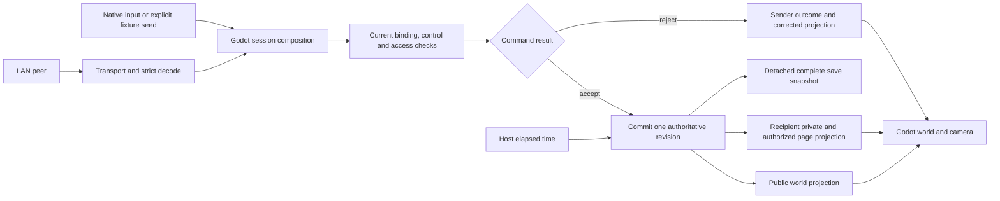

# Phase 6 — Survivors, inventory, and combat research

**Researched** 2026-11-24

**Baseline** Phase 5 merge `b9aaa2b`, “Phase 5: CI and repeatable game testing (#15)” [VERIFIED: git log -1]

**Domain** Godot/C# cooperative gameplay, authoritative inventory and combat, and repeatable local verification

**Confidence** HIGH for inspected baseline behavior and requirements. Implementation recommendations below call out design decisions and unverified proof obligations.

<user_constraints>
## User Constraints (from CONTEXT.md)

## Implementation Decisions

The 48 decisions below reflect the creator’s selected answers, including custom responses. Offered alternatives and recommendations that were not selected are not approvals.

### Inventory layout and nested bags

- **D-01:** Arrange the main inventory with the character silhouette and eleven equipment slots on the left, and labeled item-provided pocket/bag grids on the right. Keep equipment and storage visible together at 1280×720.
- **D-02:** Open each nested container in its own movable window, allowing several actual grids to be arranged side by side.
- **D-03:** While dragging, show the full cell footprint, distinguish legal/illegal placement and highlight compatible equipment slots. Explain a rejected drop using the chosen failure-feedback surface.
- **D-04:** Assign carried food to quick slots by dragging onto a slot or using an Assign to quick slot item-menu action. These remain references to actual carried stacks.
- **D-05:** Provide deliberate world dropping through the item-menu Drop action. Releasing a drag outside a valid grid cancels it; there is no dedicated world-drop zone selected.
- **D-06:** Shift-drag opens an exact quantity field with a Half shortcut, confirm/cancel and a preview of extracted/remaining quantities. Preserve the specification’s exact split identities and integer limits.
- **D-07:** Closing an outer container window also closes windows for its nested descendants. This changes views only and never moves their belongings.
- **D-08:** Open inventory panels take over movement input: close them before walking, sprinting or jumping again. The live world, other actors, recovery, physics and cleanup continue under authoritative time; the input rule must not freeze the simulation.
- **D-09:** Put detailed item information, including weight, exact condition, stack limit and storage size, in hover tooltips rather than a fixed selected-item inspector.
- **D-10:** Show a slim condition bar on equipment icons, exact values in the tooltip and a clear broken marker. Keep one canonical inventory icon per item definition.
- **D-11:** On first opening a bag window, place it beside the source grid/window, keeping it on screen where possible. The player can move it afterward; later openings use D-15’s remembered position.
- **D-12:** Equipping is drag-only. Do not add the offered Equip item-menu shortcut. Occupied slots still require manual unequipping first; no automatic swap is introduced.
- **D-13:** Use almost the full screen for the inventory workspace, with a semi-transparent background so the active world remains visible. Preserve readable text, icons, cell boundaries and damage/status cues.
- **D-14:** Escape first cancels an active drag and leaves browsing open. A subsequent Escape closes the active inventory window, before any enclosing in-run menu action.
- **D-15:** Within the same play session, remember bag-window positions but keep bag windows closed when inventory reopens. Reopen only the main inventory; manually reopened bags return to their remembered positions. Access must still be valid.
- **D-16:** Containers open through the item-menu Open action only. Ordinary clicks, double-clicks and drags do not open them; do not add the offered dedicated Open button.

### Stash and nearby looting

- **D-17:** Use a fixed side-by-side workspace for external access: own equipment on the far left, carried storage in the middle and the stash/NPC/corpse/pile inventory on the right. Nested bags retain their movable windows and the semi-transparent treatment.
- **D-18:** Creator-approved scope amendment: defer all stash and inventory filtering to Phase 12 under INV-14. Phase 6 has no filter controls or filtering acceptance; retain unlimited pages, navigation, local access, deliberate placement, quick transfers and stack-first auto-placement under INV-10. No offered filter-results layout was selected.
- **D-19:** For overlapping permitted nearby targets, show the selector inside the external inventory panel on the right. Selecting an entry loads that target’s current contents there.
- **D-20:** Show failed-transfer explanations in the affected panel, with corrected authoritative contents. If access closes that panel, use a brief HUD notice instead. No dismissal dialog was selected.
- **D-21:** Ctrl-click withdrawals use any carried storage: merge compatible carried stacks first, then find legal space in pockets or bags. This is storage placement, not automatic equipping or arrow-hand refilling; maintain actual capacity, nesting and ownership rules.
- **D-22:** Browse stash pages with Previous/Next arrows, current-page/total information and direct page-number entry. Scrollable page tabs and vertically stacked page grids were not selected.
- **D-23:** After an automatic deposit affects another stash page, switch to the first affected page, highlight changed cells and indicate any additional affected pages. Present the committed result without moving items for display.
- **D-24:** If an external target becomes inaccessible while other permitted targets remain, close its contents and related bag windows safely, keep own inventory open and return the external panel to the nearby-target list with the loss-of-access reason.

### Combat HUD and feedback

- **D-25:** Place health/stamina and carried money/load at the top left; put hands, ready arrows and four food slots along the bottom action bar.
- **D-26:** Damage to the controlled survivor uses a restrained screen-edge tint and health-bar pulse, visible over panels, alongside the established character flinch. The world continues running.
- **D-27:** Explain blocked attacks briefly beside the action bar near the hands/ammunition display, emphasizing the relevant readout. D-43 explicitly overrides this for empty ammunition: do not show an empty-ammo or failed-empty-shot explanation.
- **D-28:** Show attack and food cooldowns as shaded sweeps over the relevant icons, clearing as readiness returns. Food references display the same personal food cooldown, not independent slot timers.

### Death, handover and spectating

- **D-29:** Require the player’s Respawn request before post-death succession. On actual assignment, move the camera smoothly for a nearby successor and cut directly for a distant successor; preserve that survivor’s real location and state.
- **D-30:** Enable Respawn one second after death. Time passing alone does not assign a survivor; clicking an enabled button assigns an available eligible survivor immediately, subject to earlier queued requests. The click does not start an additional one-second delay.
- **D-31:** If no eligible successor is available, clicking Respawn records a waiting request. That request completes automatically when a survivor becomes available in request order, retaining player-slot ties for equal authoritative request times. No second confirmation is required after queuing. Preserve exclusive assignment, random eligible selection, actual belongings and duplicate-command safety.
- **D-32:** Spectating follows other players’ living survivors, using Previous/Next buttons plus a compact teammate list and visible Respawn/request status. Do not provide a freely moving spectator camera or substitute ordinary NPC following. Preserve the specification’s spectator permissions and no-unexplored-territory rules.
- **D-33:** Immediately after the controlled survivor dies, hold a fixed camera view at the death location until the player chooses a living teammate to follow or Respawn completes. Do not automatically attach to an available teammate.
- **D-34:** If a followed teammate dies, hold the camera at its current view and let the spectator select another teammate. Do not automatically cycle to another living teammate. Zero living teammates remains an explicit waiting/no-follow-target state.
- **D-35:** For a queued request, show a simple Waiting for a survivor status. Do not display the offered queue position or full waiting-player list.
- **D-36:** On successful handover, show a brief Control transferred banner as the camera, crown and HUD update to the newly controlled survivor’s actual state.

### Actions while inventory is open

- **D-37:** Any open inventory, stash or loot panel blocks attacks until panels close, in addition to the movement-input block in D-08. Semi-transparent panels never pass clicks through to world actions.
- **D-38:** Block quick-food keys 1–4 while inventory panels are open. Number input in inventory cannot also consume quick-slot food.
- **D-39:** Add a Consume action to the item menu for actual carried food. Use that exact action name rather than the offered Eat label. It consumes one real carried unit under the existing health/stamina/full-stat/cooldown rules. Food in external inventories must first be transferred to the controlled survivor.
- **D-40:** Nonlethal damage keeps inventory panels open and preserves the current safe preview/interaction while showing the chosen damage cues. The player decides when to close the panels; death/access-loss cleanup still follows the specification.

### Bow aiming and ammunition cues

- **D-41:** Use a small crosshair at the cursor while using the bow. Do not add the offered short aim line.
- **D-42:** The action-bar ammunition readout shows only arrows ready in the opposite hand. Inspect carried reserves through inventory; do not add a reserve total to the HUD or its ammunition tooltip.
- **D-43:** Specific creator override: empty ammunition shows only a zero count and no visible arrow on the bow. Add no extra empty-hand marker, refill hint or blocked-empty-shot explanation. This is an exception to D-27, not approval of the offered zero-count-plus-explanation option. Empty shots still reject safely and do not queue or create ammunition.
- **D-44:** An empty bow continues aiming and following the cursor, visibly unloaded. Do not lower it into the offered carry pose merely because the arrow hand is empty.

### Recovery and load feedback

- **D-45:** Represent safe health recovery with short Unsafe / Resting / Recovering status labels, without a qualification progress display. The authoritative safety conditions, continuous five-second qualification and recovery rate remain those in the specification.
- **D-46:** Show carried weight, Normal/Heavy/Overloaded state, current movement-speed modifier and current stamina-cost modifier directly in the HUD. Exact load penalties are not restricted to a tooltip; the configured thresholds/curve remain unchanged.
- **D-47:** Use the stamina bar alone to show spending and refilling. Do not add a separate recovery-delay or active-regeneration indicator.
- **D-48:** For a sprint or jump blocked by load or insufficient stamina, show a short reason beside the vitals and emphasize the relevant stamina/load readout rather than using the action-bar notice area.

### Agent's Discretion

The creator did not select a general “you decide” option. Research/planning may resolve routine implementation choices within the decisions and locked specification: exact panel dimensions/transparency, contrast and font sizing; window placement/clamping/scrolling; valid Half rounding and quantity widgets; labels/localization keys; short cue durations; the distance threshold for smooth-versus-cut camera handover; numeric display precision; stable authoritative command, item/state and snapshot representations; and the required scenario wiring. These are implementation choices, not additional creator-approved gameplay requirements.

Preserve the existing project boundaries, configurable baseline, manual arrow refill, private/local access, continuous simulation and all quantity/identity/timing invariants. Do not interpret input blocking as pausing the world, auto-equip quick transfers, substitute another food stack, or use generic failure text for the explicitly quiet empty-ammo case. No new library, project, paid tool, protocol or architecture exemption was selected. Full preferences/remapping/scale, legacy extraction and complete campaign/economy behavior retain their specified later owners.

## Deferred Ideas

**Phase 12: Stash and inventory filtering — INV-14.** The roadmap phase exists at `.planning/phases/12-stash-and-inventory-filtering/`. No filtering is delivered in Phases 6–11. Phase 12 owns the detailed filter interface, matching/empty/text-normalization behavior, permissions and unchanged-layout/transfer proof; no offered results list, page-dimming or combined layout was selected here. This remains final scope and requires actual implementation/evidence in its owner phase.

No other new capability was deferred from the discussion. The existing Phase 7 economy/AI, Phase 8 campaign, Phase 9 persistence/preferences/legacy extraction, Phase 10 release and Phase 11 nightly responsibilities retain their amended boundaries in the locked specification/roadmap.
</user_constraints>

## Summary

Build on the Phase 5 merge. The Phase 6 specification's historical file paths and prerequisite progress describe an earlier scout. Phase 4 closed on the creator's source/headless exception. Phase 5 now provides the shared test runner and records 92/92 reduced objective checks, inspection judgments and basic hosted Windows/Ubuntu checks. The tracked asset index still reports `"status": "incomplete"` and its source readiness is `"available": 180, "validated": 0, "accepted": 0`. The Phase 5 hub observed 180/180 source-ready and 0/180 accepted. Plan Phase 6 proofs against the required tracked asset subset and its actual production consumers. Keep the aggregate asset certification with its recorded owner. [VERIFIED: .planning/STATE.md:30-40,209-217] [VERIFIED: .planning/phases/05-ci-and-repeatable-game-testing/05-VERIFICATION.md:9-17,84-88] [VERIFIED: src/godot-game/game/content/pack-index.json:1-16]

The present movement session ties transport participants to temporary actors, sends the same roster snapshot to every peer, and accepts a guest state only if the original local actor still appears. The first playable LAN slice should establish persistent run state, actor-independent connection identity, production command ingress, recipient-specific private publication and bounded access revocation together. Implement the required time/safety/reachability foundation before dependent flows. Then grow the same solo/host/guest path through real inventory, combat, corpse ownership, succession and snapshots. [VERIFIED: src/godot-game/core/FoundationSession.cs:12-70,74-100] [VERIFIED: src/godot-game/game/foundation/FoundationCoordinator.cs:116-134,224-236] [VERIFIED: src/godot-game/game/foundation/FoundationCoordinator.GuestPublication.cs:48-69] [VERIFIED: .planning/phases/06-survivors-inventory-and-combat/06-SPEC.md:29-35,220-228,268-312]

## Architectural Responsibility Map

| Capability | Primary tier | Integration tier | Planning recommendation and basis |
| --- | --- | --- | --- |
| Run clock, safety/access, survivors, movement, combat, item transactions, succession | Pure authoritative Core | Godot host/solo composition | One ordered host-owned rules path driven by elapsed input. Use the existing elapsed step, snapshot and command boundary as the integration point. [VERIFIED: src/godot-game/core/FoundationSession.cs:74-100] [VERIFIED: docs/architecture/decisions/0003-state-and-engine.md:9-15] |
| Admission, readiness, liveness, reliable commands, state delivery | Godot host/guest adapter | Existing multiplayer ports | Separate persistent player binding from transient survivor control. Keep connection generation and sender validation at ingress. [VERIFIED: src/godot-game/game/foundation/FoundationCoordinator.cs:161-199] [VERIFIED: src/godot-game/game/foundation/FoundationPeerBinding.cs:6-28] |
| Public world, private player state and permitted external views | Authoritative projections | Godot wire codec and client installation | Produce authorized recipient views from one revision. Preserve world silhouettes and actual equipped appearance while withholding hidden possessions. [VERIFIED: .planning/phases/06-survivors-inventory-and-combat/06-SPEC.md:260-268,280-280,312-312] |
| Snapshot/restore and layout preservation | Core detach/validate/commit | Future save adapter | Define an explicit full run state and validation at the restore boundary. Use saved geometry and metadata to preserve layout independently of current definitions. [VERIFIED: .planning/phases/06-survivors-inventory-and-combat/06-SPEC.md:290-294] |
| Input, panels, view/camera/HUD and asset access | Godot main thread | Core command and projection values | Preserve focus fences, route panel priority before world actions, and apply current committed views to native nodes. Simulation advances independently of panel focus. [VERIFIED: src/godot-game/game/foundation/FoundationRoot.cs:56-143] [VERIFIED: docs/architecture/decisions/0003-state-and-engine.md:9-15] |
| Fixtures and verification | Existing test assembly and shared scenario adapter | Normal production scene and command path | Seed through explicit fixture setup. Drive gameplay and observe actual per-role production outcomes. [VERIFIED: docs/workflow/shared-game-tests.md:29-33] [VERIFIED: .planning/phases/06-survivors-inventory-and-combat/06-SPEC.md:300-306] |

<phase_requirements>
## Phase Requirements

| Source | Required behavior | Research support |
| --- | --- | --- |
| CHAR-01 | Eight survivors and one configured kit per run | Typed run data, normal-start proof across every participant count, persistent roster. [VERIFIED: .planning/REQUIREMENTS.md:88-88] |
| CHAR-02, CHAR-03 | Walk/sprint/jump/air control, stamina costs and recovery | Explicit elapsed and fresh-input rules with boundary proofs. [VERIFIED: .planning/REQUIREMENTS.md:89-90] |
| CHAR-04, CHAR-05, CHAR-06 | Safe recovery, real food and cooldown, nested load thresholds | Core time/access, actual item graph and full-stat consumption proofs. [VERIFIED: .planning/REQUIREMENTS.md:91-93] |
| INV-01, INV-02, INV-03 | Item identity, eleven slots, item-provided space, legal rotation | Typed authored item contract plus atomic placement. [VERIFIED: .planning/REQUIREMENTS.md:99-101] |
| INV-04, INV-05, INV-06, INV-07 | Exact stacks, nested ownership and food references | Candidate graph validation, stable identity and closure invalidation. [VERIFIED: .planning/REQUIREMENTS.md:102-105] |
| INV-08, INV-09, INV-10, INV-11 | Nearby private access, safe dragging, paged stash and authoritative conflict outcomes | Recipient filtering at the codec boundary and last-commit validation. [VERIFIED: .planning/REQUIREMENTS.md:106-109] |
| INV-12, INV-13 | Actual remaining belongings and continuous empty-only cleanup | Shared item roots, death transaction and authoritative cleanup time. [VERIFIED: .planning/REQUIREMENTS.md:110-111] |
| COMBAT-01, COMBAT-02, COMBAT-03 | Fists, single/dual melee and manual real-ammo bows | Fresh command acceptance, gear and projectile ordering. [VERIFIED: .planning/REQUIREMENTS.md:118-120] |
| COMBAT-05, COMBAT-06, COMBAT-08 | Armor/wear, faction/obstruction and actual equipment presentation | Config-driven raw-hit math, authoritative contact ordering and public appearance. [VERIFIED: .planning/REQUIREMENTS.md:122-125] |
| RUN-01, RUN-02, RUN-03, RUN-04 | Exclusive control, explicit Respawn, queue and teammate spectating | Separate permanent survivor identity, binding and assignment generation. [VERIFIED: .planning/REQUIREMENTS.md:131-134] |
| Local R01, R20–R22 | Safety/access, snapshot and saved layout, usable UI, playable fixture and stored proof | Shared runtime composition, test drivers and captured acceptance mapping. [VERIFIED: .planning/phases/06-survivors-inventory-and-combat/06-SPEC.md:31-35,145-186] |
</phase_requirements>

## Project Constraints (from AGENTS.md)

- Follow the phase branch and draft/ready PR rules when implementation starts. Preserve the draft through required verification, update its scope/evidence during implementation, and leave the merge with the creator. Follow cleanup at task end, preserving reproduction details before removing owned scratch. [VERIFIED: AGENTS.md:5-19] [VERIFIED: docs/workflow/ai-collaboration.md:5-23] [VERIFIED: docs/workflow/cleanup.md:5-37]
- Follow the actual five-project, allowed-edge and repository layout policies. Keep gameplay in pure Core, ports independent, and engine objects in Godot composition guarded on the captured main thread. Prefer internal implementation types and retain executable code-rule and generated-source checks. [VERIFIED: AGENTS.md:11-21,31-31] [VERIFIED: docs/architecture/boundaries.md:3-15] [VERIFIED: docs/architecture/repository-layout.md:3-19]
- Use pinned tools, code documentation and focused review. Apply the latest local testing policy, phase fixture and asset proof boundaries, canonical requirements and GSD delivery artifacts. [VERIFIED: AGENTS.md:16-29] [VERIFIED: docs/workflow/local-testing.md:5-29,44-72]

## Standard Stack

| Existing component | Pinned value | Phase use |
| --- | --- | --- |
| Godot .NET and C# | `Godot.NET.Sdk/4.7.2`, `net10.0`, `14.0` | Native scene graph, main-thread guarded resources and transport composition. [VERIFIED: src/godot-game/game/KingdomZombies.csproj:1-16] |
| .NET SDK and Node | `"version": "10.0.404"`, `"rollForward": "disable"`, `"node": "24.22.1"` | Keep locked restore and shared tool entry points. [VERIFIED: src/godot-game/global.json:1-7] [VERIFIED: src/godot-game/tools/verification/toolchain.json:1-13] |
| xUnit and Shouldly | `xunit.v3` `[4.0.2]`, `Shouldly` `[4.3.0]` | Existing verification assembly and Tier 1 rules/edge tests. [VERIFIED: src/godot-game/Directory.Packages.props:6-14] |
| Existing JSON, immutable values and ENet | `System.Text.Json`, `ImmutableArray<FoundationParticipantState>`, `ENetMultiplayerPeer` | Reuse strict explicit parsers, immutable projections and current service/transport composition. [VERIFIED: src/godot-game/core/FoundationSnapshot.cs:3-31] [VERIFIED: src/godot-game/game/foundation/FoundationProtocol.cs:5-49] [VERIFIED: src/godot-game/game/foundation/EnetConnectionService.cs:93-114,146-150] |

Install existing locked prerequisites through repository setup as needed. No new package or package legitimacy gate is planned under the locked discretion. [VERIFIED: .planning/phases/06-survivors-inventory-and-combat/06-CONTEXT.md:127-131]

## Architecture Patterns



### Production seams and ordering

| Current surface | What to preserve or change |
| --- | --- |
| `FoundationRoot._Input`, `_Process`, `Enter`, `ShowWorld`, `LoseFocus` | Keep the actual start/join scene. Extend native intent and panel focus before enqueuing gameplay, keep live elapsed stepping, and clear movement/attack holds across panel, focus, control and session transitions. `FoundationInput.SetContext`, `Set`, `Clear` already separate held and blocked keys. [VERIFIED: src/godot-game/game/foundation/FoundationRoot.cs:56-143,184-237,292-319,385-390] [VERIFIED: src/godot-game/game/foundation/FoundationInput.cs:6-50] |
| `FoundationCoordinator.Start`, `Update`, `Submit`, `Accept`; `FoundationSession.AddParticipant`, `RemoveParticipant`, `Step` | The current constructor creates the host actor, admission adds a temporary actor, and departure removes its participant and held intent. Introduce one persistent run root, one initialized roster/kit and distinct participant bindings. On departure release control and intent without removing the survivor graph. Route local and received commands through the same host gate. [VERIFIED: src/godot-game/game/foundation/FoundationCoordinator.cs:47-61,77-134,204-221] [VERIFIED: src/godot-game/core/FoundationSession.cs:12-100] |
| `FoundationCoordinator.Reserve`, `ReceiveHost`, `ReceiveGuest`, `InstallBaseline`, `Bound` | Preserve admission attempt, peer generation, session, identity, readiness and monotonic revision. Decouple stable binding from assignment. The current peer `ActorId` property is getter-only, `InstallBaseline` sets `_localActor`, the state predicate requires `p.Actor.ActorId, y: _localActor`, and liveness/close carry that identity. Make connection-level liveness work while unassigned and on handover. Fence gameplay with host-owned control generation and target actor, including old holds and displaced commands. [VERIFIED: src/godot-game/game/foundation/FoundationPeerBinding.cs:6-28] [VERIFIED: src/godot-game/game/foundation/FoundationCoordinator.Admission.cs:12-69,136-156] [VERIFIED: src/godot-game/game/foundation/FoundationCoordinator.GuestPublication.cs:12-105] [VERIFIED: src/godot-game/game/foundation/FoundationCoordinator.cs:239-265] [VERIFIED: src/godot-game/game/foundation/FoundationCoordinator.Lifetime.cs:124-181] |
| `BroadcastState`, `HostPublication`, `FoundationProtocol`, `FoundationWireFrame` | Build a public world projection plus revision-bound recipient views and action outcomes. Both periodic and cached admission messages currently reuse the common roster. Keep a cached baseline limited to bootstrap/public identity and check any current private request afresh. Serialize only authorized values before sending; UI gating alone cannot protect wire data. Keep public telemetry and diagnostics free of restricted state. [VERIFIED: src/godot-game/game/foundation/FoundationCoordinator.cs:224-236,251-257,286-300] [VERIFIED: src/godot-game/game/foundation/FoundationCoordinator.Admission.cs:82-108,136-156] |
| `FoundationView.ProjectRoster`, `Project`, `FoundationHud.Project` | The view is an actor roster projection keyed to an owned node/camera. Extend it to stable world identities, separate visual equipment and spectator camera selection, and private HUD/panels. On own death or followed teammate death hold the camera until explicit selection or actual handover. [VERIFIED: src/godot-game/game/foundation/FoundationView.cs:13-88] [VERIFIED: src/godot-game/game/foundation/FoundationHud.cs:11-42] [VERIFIED: .planning/phases/06-survivors-inventory-and-combat/06-CONTEXT.md:95-104] |

### Command, publication and transaction contract

- Bind submission to the real sender/connection plus current host-resolved player and control. Advance per-binding command sequencing independently of transport retries and clock updates. A stale duplicate can return an idempotent acknowledgement or corrected view, but the authoritative effect must have one committed outcome. Check expected source identity/location and current relevant access at commit. Avoid requiring every request to match the global moving-world revision exactly. Use it to order presentation and use action-specific preconditions for conflicts. This is a proposed design for the locked authority rules. [VERIFIED: .planning/phases/06-survivors-inventory-and-combat/06-SPEC.md:103-107,223-225,260-268]
- When a target becomes controlled, a participant dies, or distance/reachability changes, invalidate grants and reject old drag/action commands. Project a new coherent recipient view without the revoked target and close its associated windows. Tie private view installation to the intended session, recipient, control generation, target and revision. Test late arrivals, access-loss feedback and loss/retry for both the old and new controller. Preserve reachable NPC/corpse/pile/stash interactions using the same latest authority checks as ordinary local UI. [VERIFIED: .planning/phases/06-survivors-inventory-and-combat/06-SPEC.md:260-268,286-298,312-312] [VERIFIED: .planning/phases/06-survivors-inventory-and-combat/06-CONTEXT.md:79-86]
- Keep transport bounds explicit. The existing codec has `MaximumBytes = 32768` and `MaxDepth = 16`, `Encode` throws `"WIRE_SIZE"`, and `Send` sets `reliable: envelope.Kind is not "state"`. Use narrow public actor/appearance values, an authorized stash page/view and bounded nested detail or chunks with identities and revision. Unlimited stash capacity is a gameplay rule. Admit no unpublished roots to a recipient by enlarging one broadcast. Acceptance should exceed one wire frame in aggregate and prove cross-page transfers and reopening. [VERIFIED: src/godot-game/game/foundation/FoundationProtocol.cs:13-39] [VERIFIED: src/godot-game/game/foundation/FoundationCoordinator.cs:251-257] [VERIFIED: .planning/phases/06-survivors-inventory-and-combat/06-SPEC.md:264-268]
- Stage atomic candidate transactions over one stable item ID and one location per instance. Model equipment slot roots, the item-owned storage graph, stash pages, corpses and piles. Route split/partial merge, movement of an occupied subtree, attached quick-reference invalidation, death and cleanup through the same ownership rules. Validate the deepest descendant, exact quantity conservation and destination geometry before commit. Use a fixed tie order for pages/cells/rotations, equal projectile contacts and melee targets. [VERIFIED: .planning/phases/06-survivors-inventory-and-combat/06-SPEC.md:248-280,284-294,306-308]
- Preserve host-selected explicit integer elapsed input in the simulation and document precision for fractional gameplay. Drive recovery/cooldown/cleanup by host elapsed time and interval intersections. Keep snapshot, transport liveness and UI animation clocks separate. Test exact boundaries, equivalent split elapsed steps and chronological action order. Store persistent random continuation and idempotency state needed after restore. [VERIFIED: docs/architecture/decisions/0003-state-and-engine.md:9-15] [VERIFIED: src/godot-game/core/FoundationSession.cs:92-100,148-163] [VERIFIED: .planning/phases/06-survivors-inventory-and-combat/06-SPEC.md:232-246,284-294]

### Typed content and delivery

- Map existing authored gameplay JSON once into validated, immutable Core definitions. Read required fields, stable item/reference keys, ranges and relationships at bootstrap. Validate each fixture/normal definition set and isolate gameplay fields from inspection fields and later-phase options. Keep resource loading in a guarded native adapter, followed by pure typed validation and explicit diagnostics. `ContentPack.Load` and `ResourcePath` establish detached authenticated pack diagnostics and logical-to-resource mapping. The native `InspectionRoot` demonstrates guarded file reads and packaged `Godot.FileAccess.Open`; preserve the packaged path in gameplay even when loose files work in the editor. [VERIFIED: src/godot-game/core/ContentPack.cs:17-53,110-149] [VERIFIED: src/godot-game/game/inspection/InspectionRoot.cs:224-232,268-304] [VERIFIED: docs/architecture/repository-layout.md:72-78]
- Authored keys include survivor `"id": "DT-03"`, item `"id": "DT-04"`, combat `"id": "DT-05"`, inventory `"id": "DT-06"` and run `"id": "DT-01"`. The item definitions carry `"footprint"`, `"maxStack"`, `"weightKilograms"`, `"slot"`, `"storage"`, `"conditionMaximum"` and `"canonicalIcon"`. Consume typed authoritative gameplay values and stable links to canonical visual resources. The tracked defense assembly says `"sampleDataOnly": true`; use tracked art and fixture geometry as inputs to real rules for safety, reachability and collision. [VERIFIED: src/godot-game/game/content/config/survivors.json:1-29] [VERIFIED: src/godot-game/game/content/config/items.json:1-27] [VERIFIED: src/godot-game/game/content/config/combat.json:1-15] [VERIFIED: src/godot-game/game/content/config/inventory.json:1-37] [VERIFIED: src/godot-game/game/content/config/run.json:1-31] [VERIFIED: src/godot-game/game/content/world/defense-assemblies.json:1-14]
- The starter configuration says `"startingSurvivors": 8`, `"playerLimit": 4`, `"startingOutfit": ["IT-11", "IT-12", "IT-17"]` and `"stashPerRunNotPerPlayer": true`. The tracked item footprints and configured stack counts imply 102 occupied cells before packing, beyond one `"pageGrid": [10, 10]` page. Initialize using production stash placement, creating additional pages when needed. Keep exactly the configured stack quantities through initialization and prevent duplicate starts. [VERIFIED: src/godot-game/game/content/config/run.json:4-31] [VERIFIED: src/godot-game/game/content/config/inventory.json:4-17] [VERIFIED: src/godot-game/game/content/config/items.json:6-51,81-102,156-252,515-540,571-596]
- The current native configuration carries `"automaticPlacement": ["combine-compatible-stacks", "fitting-empty-spaces", "rotate-if-allowed", "create-page"]`. Use the locked acceptance's stack-first existing pages, deterministic legal rotation/cells, then new pages. Reconcile old authored preview semantics with the later written amendments. Examples include `"reconnectPreviousPriority": true` in readiness data and legacy/filtering portions owned by later phases. [VERIFIED: src/godot-game/game/content/config/inventory.json:4-37,65-82] [VERIFIED: src/godot-game/game/content/config/run.json:31-32] [VERIFIED: .planning/phases/06-survivors-inventory-and-combat/06-SPEC.md:9-11,266-266,288-294]
- Reuse `CharacterPresentation.Configure`, `ConfigureBow`, `Advance` and `AppearanceState.Restore`, `TriggerDeath`, `Advance` for authored appearance and timing patterns. Derive logical hand and wearable identity from authoritative equipment, then layer fitted art and cosmetic crown in the existing main scene. Presentation events display committed actions. Combat validation, actual ammo and hit authority stay in Core. Check gameplay content through a packaged resource consumer, using the current `include_filter="*.json,*.md,*.txt,*.csv,*.ttf,*.otf,*.wav,*.ogg,*.png"` and the Phase 5 portable-export pattern as references. [VERIFIED: src/godot-game/core/CharacterPresentation.cs:138-273] [VERIFIED: src/godot-game/core/AppearanceState.cs:53-121] [VERIFIED: src/godot-game/game/export_presets.cfg:1-16] [VERIFIED: .planning/phases/05-ci-and-repeatable-game-testing/05-VERIFICATION.md:128-134]

## Don't Hand-Roll

| Problem | Reuse |
| --- | --- |
| New authority path for fixture, solo or local host | Existing session/command composition. Add only explicit seeded subjects and fixture trigger input through production action rules. [VERIFIED: src/godot-game/game/foundation/FoundationCoordinator.cs:47-61,116-134] [VERIFIED: .planning/phases/06-survivors-inventory-and-combat/06-SPEC.md:300-306] |
| Arbitrary resource path normalization and native thread bypass | `ContentPack.ResourcePath`, guarded native resource reads and existing package closure tooling. [VERIFIED: src/godot-game/core/ContentPack.cs:38-53] [VERIFIED: src/godot-game/game/inspection/InspectionRoot.cs:268-304] |
| New serializer or externally coupled Core | Existing `SnapshotCodec.Decode`, `ExampleStateStore.Restore` and strict detached validation pattern. Use a separately scoped production snapshot DTO for the enlarged graph. [VERIFIED: src/godot-game/core/SnapshotCodec.cs:21-46] [VERIFIED: src/godot-game/core/ExampleStateStore.cs:17-47] |
| Local phase runner, ad hoc launches or cloned native tooling | Shared scenario adapter, existing foreground/peer/process helpers and supported resets. [VERIFIED: docs/workflow/shared-game-tests.md:29-33] [VERIFIED: src/godot-game/tools/lan-checks/scenarios.cjs:41-64,334-371] |

## Common Pitfalls

| Risk | Required plan response |
| --- | --- |
| Public roster, cached admission messages, logs or correction replies leak restricted state | Prove sanitized bytes and recipient views for every delivery path. Test permitted local access, remote/stale/controlled denial, private data absence and current corrections through clean and deliberately incorrect subjects. Public equipped appearance may remain visible. [VERIFIED: src/godot-game/game/foundation/FoundationCoordinator.cs:224-236] [VERIFIED: src/godot-game/game/foundation/FoundationCoordinator.Admission.cs:82-108,136-156] [VERIFIED: .planning/phases/06-survivors-inventory-and-combat/06-SPEC.md:310-312,475-486] |
| Stationary fixture proofs bypass native commands, supply items to normal starts, or substitute constant safety | Seed only the designated fixture. Prove living/destroyed outer wall, refuge, exact hostile distance, terrain obstruction and reachable interaction through the actual host rules before dependency integration. Send fixture attacks through the real melee/bow path. [VERIFIED: .planning/phases/06-survivors-inventory-and-combat/06-SPEC.md:232-236,272-274,300-306] |
| Current actor ID serves as transport credential and future character ID | Establish connection, control and world actor lifecycles explicitly before combat joins the wire. Test post-death liveness, stale actions, readiness, resumption and independent peer departure. [VERIFIED: src/godot-game/game/foundation/FoundationCoordinator.GuestPublication.cs:36-69] [VERIFIED: src/godot-game/game/foundation/FoundationCoordinator.Lifetime.cs:124-181] |
| New C# contracts accidentally broaden the public permission boundary | Choose the narrow typed boundary before splitting plans. The checked registry includes `KingdomZombies.Core.FoundationSession`, `KingdomZombies.Core.FoundationSnapshot`, `KingdomZombies.Core.FoundationParticipantState` and named content/presentation types. `ArchitecturePolicy.Visibility` enumerates public type declarations, including descendants, and checks the exact register. New API exposure requires an explicitly governed decision and matching enforcement. The scanner pins the expected register entries in source as well as reading the register, so an authorized change must update both and keep the negative controls. The Context grants no new exemption. [VERIFIED: docs/code/visibility-exemptions.json:5-19,31-43,60-68] [VERIFIED: src/godot-game/tests/verification/ArchitecturePolicy.cs:16-84] [VERIFIED: .planning/phases/06-survivors-inventory-and-combat/06-CONTEXT.md:127-131] |
| Aggregate acceptance IDs activate future ownership or selected rule/asset proofs silently expand | Keep executable Phase 6 portions as distinct required rows with `sourceIds` and map locked ACs separately. Preserve generated release rows whose owner is the maximum requirement owner. Use tagged impact paths and conditionally selected Phase 1 groups. [VERIFIED: src/godot-game/tools/game-tests/catalog.cjs:258-312,372-405,531-552] [VERIFIED: docs/workflow/local-testing.md:21-48] |

## Code Examples

Existing runner syntax, from the checkout root. The named review file is a placeholder for a local verdict containing the tested revision, reviewer and clean status.

```powershell
node src/godot-game/tools/game-tests/check.cjs --list
node src/godot-game/tools/game-tests/check.cjs --tier 1
node src/godot-game/tools/game-tests/edge-check.cjs 6
node src/godot-game/tools/game-tests/check.cjs --phase-end --phase 6 --review REVIEW_FILE
```

[VERIFIED: docs/workflow/shared-game-tests.md:3-31] [VERIFIED: src/godot-game/tools/game-tests/check.cjs:14-36] [VERIFIED: src/godot-game/tools/game-tests/edge-check.cjs:47-63]

Use `[Trait("Tier", "1")]` on pure tests and discovery names such as `Phase06_E001_Description`. The shared edge inventory matches the `## Edge Coverage` section, rejects unknown/duplicate IDs and checks the resolved set through actual test discovery. A read-only execution of its real specification parser counted 132 resolved and one deferred. The deferred ID is `E074`. [VERIFIED: docs/workflow/shared-game-tests.md:29-31] [VERIFIED: src/godot-game/tools/game-tests/edge-check.cjs:11-43,47-63] [VERIFIED: .planning/phases/06-survivors-inventory-and-combat/06-SPEC.md:333-337] [VERIFIED: pinned Node specificationEdges probe]

Use one driver per compatible run group with exports `open(context)`, `cases`, `reset(state, context)`, `close(state, context)`. The native driver path is rooted in the actual source declaration `const rootPath = 'src/godot-game/tests/scenarios/';`. It owns per-role initialization, bounded waits, reset through normal menus and production input. Write evidence inside `context.directory` and return required paths per selected case. The shared adapter obtains its rendered desktop lock and validates evidence paths. Existing `lan-checks/scenarios.cjs` exports `menu,host,browse,join,roster,resetFour,create,close` and the rendered helpers export `until,driver,capture,nativeKey`. Use helper-level reuse and obey the lock already held by the scenario adapter. [VERIFIED: src/godot-game/tools/game-tests/scenario-group.cjs:7-74] [VERIFIED: src/godot-game/tools/lan-checks/scenarios.cjs:41-64,334-371] [VERIFIED: src/godot-game/tools/lan-checks/rendered.cjs:175-175]

## Validation Architecture

| Layer | Scope | Invocation and evidence |
| --- | --- | --- |
| Pure | R01–R20 rules and AC-38/39, each resolved edge, P01 and P02 mechanical clean/violation controls | Existing xUnit Tier 1. Verify exact edge names after build, and capture rule/control-specific verdicts. Add both P01/P02 descriptors and clean/violation fixtures before counting them. [VERIFIED: docs/workflow/shared-game-tests.md:29-31] [VERIFIED: .planning/phases/06-survivors-inventory-and-combat/06-SPEC.md:475-486] |
| Headless and packaged | Typed config validation, exact normal bootstrap, strict graph restore, native production composition, host/guest publication privacy and real packaged asset reads | Existing tier 2 and scenario adapter for declared case/group selections, with the current-source build prerequisite. Cover both stable installation and stale revocation, a four-peer data plane and a stash larger than one frame. [VERIFIED: docs/workflow/shared-game-tests.md:3-17,29-31] [VERIFIED: src/godot-game/tools/game-tests/suites.cjs:170-185,207-245] |
| Post-review rendered | AC-33–37 and representative AC-15/16/19/25/28/29/40/41 on the production UI | Group compatible solo scenarios in one process and LAN scenarios in one host plus three guest processes, using menu/session reset. Collect per-case per-role observations, logs/images and launch records. Include empty, open-panel attack suppression, visual damage, physical ammo/loot access, conflict, handover, camera and privacy. [VERIFIED: docs/workflow/local-testing.md:7-17,44-72] [VERIFIED: .planning/phases/06-survivors-inventory-and-combat/06-SPEC.md:296-312] |
| Phase end | Required active Critical, new, changed and affected regression selection | Use the shared `--phase-end --phase 6 --review FILE`. Add row/tag impacts for new driver and feature paths, preserve omissions and test full selected-set again after batched repairs. Keep basic hosted checks separate. [VERIFIED: docs/workflow/shared-game-tests.md:12-25] [VERIFIED: src/godot-game/tools/game-tests/catalog.cjs:531-552] [VERIFIED: docs/workflow/local-testing.md:19-42,64-80] |

Wave 0 work is to allocate all 132 resolved edge IDs to genuine Tier 1 proofs, create the Phase 6 scenario rows and driver paths with stable order/reset declarations, and map all 29 source IDs and locked ACs to executable evidence. A playable production-path tracer should precede scenario expansion. The baseline already supplies the runner, edge check, headless build integration and catalog. Keep 2-minute Critical render and 5-second prepared Tier 1 measured targets visible when selecting/classifying cases. [VERIFIED: .planning/phases/06-survivors-inventory-and-combat/06-SPEC.md:302-337] [VERIFIED: docs/workflow/local-testing.md:29-40,44-62]

## Environment Availability

| Dependency | Probe outcome | Plan use |
| --- | --- | --- |
| .NET SDK | `dotnet --version` printed `10.0.404`. [VERIFIED: local CLI probe] | Use the checked SDK pin. |
| Node | PATH reported `v24.22.3`; the shared pinned tool printed `v24.22.1`. The pinned tool emitted the catalog and parsed the edge set. [VERIFIED: local CLI probes] | Resolve the shared pinned Node executable for acceptance. |
| Godot .NET | Shared Windows console returned `4.7.2.stable.mono.official.ed1daf0bf`. [VERIFIED: local CLI probe] | Use the pinned editor/runner, retain known engine workarounds for affected scenarios. [VERIFIED: docs/workflow/engine-defects.md:7-10,52-78] |
| Rendered sessions | Phase 5 records the baseline evidence. Research performed source reads and read-only probes. [VERIFIED: .planning/phases/05-ci-and-repeatable-game-testing/05-VERIFICATION.md:9-17] | Actual Phase 6 game sessions and proof belong after complete implementation and review. |

## Security Domain

The configured workflow has `"security_enforcement": true` and `"security_asvs_level": 1`. Apply the project-local GSD boundary-level mapping. These categories describe applicability to this LAN game slice. [VERIFIED: .planning/config.json:51-52] [VERIFIED: .codex/gsd-core/references/security-asvs-levels.md:1-11]

| Area | Applicability and design control |
| --- | --- |
| Authentication and session | Preserve connection generation, sender, attempt and allowed baseline identity. Separate changing control from binding and retain retirement semantics when unassigned. [VERIFIED: src/godot-game/game/foundation/FoundationCoordinator.cs:161-199] [VERIFIED: src/godot-game/game/foundation/FoundationCoordinator.Admission.cs:12-49] |
| Access control and confidentiality | High-impact boundary. Derive both writes and recipient-specific reads from current host authority. Revoke access after death, takeover, readiness/role changes, blocked reachability and departure. Snapshot authority remains internal. [VERIFIED: .planning/phases/06-survivors-inventory-and-combat/06-SPEC.md:260-268,286-294,312-312] |
| Input validation and integrity | Decode bounded typed requests and snapshots. Validate stable identities, numeric ranges, uniqueness, graph cycles and authorization before any commit. Preserve an explicit authoritative order and replay handling. [VERIFIED: src/godot-game/game/foundation/FoundationProtocol.cs:17-80] [VERIFIED: .planning/phases/06-survivors-inventory-and-combat/06-SPEC.md:223-225,268-268,290-294,306-308] |
| Cryptography | Phase 6 uses the existing LAN transport and pinned resource integrity paths. No new crypto protocol selected in Context. [VERIFIED: .planning/phases/06-survivors-inventory-and-combat/06-CONTEXT.md:127-131] [VERIFIED: src/godot-game/tools/verification/toolchain.json:38-49] |

## Open Questions and Assumptions Log

| Decision | Recommended disposition |
| --- | --- |
| Typed Core public surface | Resolve before phase execution. Internal typed gameplay and reuse of narrow existing facade contracts are the starting point. If a clean cross-assembly surface needs newly public declarations, document the architectural permission explicitly and retain the visibility proof. [VERIFIED: src/godot-game/core/KingdomZombies.Core.csproj:1-11] [VERIFIED: docs/code/visibility-exemptions.json:1-103] [VERIFIED: .planning/phases/06-survivors-inventory-and-combat/06-CONTEXT.md:127-131] |
| Size of worst-case permitted private payload | Exact production encoding size is [ASSUMED] until the implementation exists. Establish explicit page/group/chunk budgeting with an over-frame accepted gameplay subject and rejection handling for invalid envelopes. [VERIFIED: src/godot-game/game/foundation/FoundationProtocol.cs:13-39] |
| Portable Phase 6 resource closure | Test the selected production subset in the normal runtime from packaged input, including missing/invalid content diagnostics. Existing history establishes the inspection path and portability baseline. [VERIFIED: .planning/phases/05-ci-and-repeatable-game-testing/05-VERIFICATION.md:128-134] |
| Rendered driver coverage and elapsed tolerance | Cursor actions, panel sizing, handover threshold, evidence artifacts and numeric tolerance are available implementation choices. Set them with measurable scenario acceptance and normal-input checks. [VERIFIED: .planning/phases/06-survivors-inventory-and-combat/06-CONTEXT.md:127-131] [VERIFIED: .planning/phases/06-survivors-inventory-and-combat/06-SPEC.md:220-225,296-308] |

## Sources and Metadata

- Scope and locks are from the Phase 6 SPEC and CONTEXT and the primary requirements. Architecture and build guidance are from the pinned worktree sources opened during this research. [VERIFIED: .planning/phases/06-survivors-inventory-and-combat/06-SPEC.md:29-228] [VERIFIED: .planning/phases/06-survivors-inventory-and-combat/06-CONTEXT.md:54-131] [VERIFIED: .planning/REQUIREMENTS.md:84-137] [VERIFIED: docs/architecture/boundaries.md:3-15]
- The GSD init reported Phase 06 and the configured workflow. Graphify returned disabled and the agent-skills query emitted no configured skills. The external provider seam was unnecessary for this pinned-source analysis. The classification seam labels unregistered `local` as `LOW`; confidence above reflects the observed project source and positive local probes, with proposed implementation decisions marked separately. [VERIFIED: gsd-tools init.phase-op, agent-skills, graphify status and classify-confidence probes]
- Research date 2026-11-24. Findings are tied to the pinned source and remain valid until the referenced requirements, Code/PR policy, runtime or catalog changes. Recheck these sources during plan verification.
