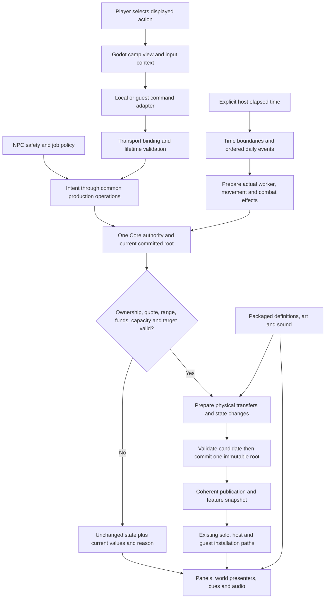

# Phase 7: Camp economy and development - Research

**Researched:** 2026-11-18 (Europe/Paris)
**Domain:** Host-authoritative Godot/C# camp simulation, physical economy, autonomous jobs and development
**Confidence:** MEDIUM — repository contracts are directly grounded; production Phase 6 integration names and the future Phase 5 runner must be verified after delivery.

<user_constraints>
## User Constraints (from CONTEXT.md)

The following locked scope and decisions are copied verbatim from the context. Source: [VERIFIED: .planning/phases/07-camp-economy-and-development/07-CONTEXT.md:15-74,143-145].

<!-- DATA_a73c81e9_START -->
**25 requirements are locked, including the 22 requirements assigned to Phase 7.** Read [07-SPEC.md](07-SPEC.md) before research, planning, or implementation. It defines the complete requirements, constraints, acceptance checks, and source scenario boundaries.

**In scope**

- A playable working camp on both sides, authored work, food and wildlife areas, and representative active and destroyed portal barriers.
- Authoritative day and night transitions, finite resources, once-per-day events, and live camp borders with refuge fallback before dependent jobs.
- The 22 requirements assigned to Phase 7: WORLD-05, ECON-01–05, NPC-01–08, and BUILD-01–08.
- Physical payments, food sales, recruitment limits, autonomous roles, equipment, food and ammunition, safety, hauling, and shared paid work.
- Three tiers for the main building, walls, and towers. Damageable frames, full-health build, rebuild and upgrade completion, and one flat-fee repair order to full health.
- Basic nearest-wall or refuge guarding and structural tower attacks using the shared combat and item rules.
- Working camp panels, produced art and sound, feature configuration, coherent snapshots, and repeatable scenarios with solo, host, and guest evidence.

**Out of scope**

- Phase 8 owns the full six-portal map and campaign, shared exploration and minimap, the full zombie roster and scheduled waves, full warrior allocation and rally/recall, and campaign outcomes.
- Phase 9 owns full saves and player-facing load, reconnection, late join, and complete changed-configuration behavior. Phase 12 owns stash and inventory filtering.
- The specification excludes direct NPC task and target commands, new economy systems such as crafting and equipment shops, alternate repair billing, and runtime dependence on recovered source folders.
- Hosted and release procedures own physical mixed-OS LAN, supported-display, hardware, endurance, release balance, and other distinct evidence.

### Locked Decisions

### Main-building navigation

- **D-01:** Use one tabbed camp window with **Stash**, **People**, **Food sales**, and **Main building**. Open on Stash every time. The Stash tab incorporates the Phase 6 equipment, carried storage, and shared stash workspace with its existing paging, item access, and transfer rules.
- **D-02:** Make the camp window almost full screen and semi-transparent. Carry forward the wooden frames and dark interiors. Keep the active world and warning cues visible. Each selected tab gets the entire workspace, so the equipment and storage grids appear only on Stash.
- **D-03:** Use the inventory input rules for all camp tabs. Block movement, attacks, quick-food keys, and world clicks while the window is open. Time, work, and threats continue, and Escape handles the active panel before the run menu.
- **D-04:** Leaving Stash closes open bag windows and remembers their positions for this session. Returning to the tab leaves them closed until manually reopened. Apply normal inventory cancellation and access rules to any unfinished interaction.
- **D-05:** Keep the camp window open on nonlethal damage and show the damage cues over it. Death or loss of main-building access closes the window.

### People and role assignment

- **D-06:** Use one scrollable roster grouped by current job, with a heading and count for each role. Include the survivor's current job and activity, including equipment waiting.
- **D-07:** Keep the roster visible while the selected survivor's status, role choices, prices, and gear requirements appear to its right.
- **D-08:** For a survivor who is away or under player control, show the job choices disabled with the specific reason. Keep prices and gear requirements visible and update availability as the survivor's state changes.
- **D-09:** Put **Buy recruit**, its carried-money price, and both the fireside and total population counts in a fixed header above the roster. Keep these visible while scrolling or inspecting a survivor. Show which limit or other eligibility rule is blocking recruitment.

### Purchases and food sales

- **D-10:** Let players type an exact whole-number sale quantity or adjust it with +/−. **Max** selects the current available quantity of the chosen food.
- **D-11:** Show current stash stock, selected quantity, unit price, total proceeds, and resulting stash money before **Sell**. The button submits the visible quote directly, including a quantity selected with Max.
- **D-12:** Submit recruitment, paid role changes, clearing, construction, upgrades, repairs, and rebuilding directly from their explicitly priced buttons. The visible price and action are the purchase step. Use the existing current-state eligibility and no-charge rules.
- **D-13:** Refresh the food-sale view and quote as current stock and prices arrive. If the available stock falls below the selected amount before Sell is pressed, reduce the amount to the available stock and update the displayed proceeds. At zero stock, the sale action is unavailable. A sale still needs an explicit Sell click.
- **D-14:** Evaluate the submitted sale against the quantity and price shown when the player pressed Sell. When the host rejects a changed quote or otherwise stale action, show the current values and explain the rejection. Preserve food and money on the rejected request and require a new click for any revised sale.

### Work and safety feedback

- **D-15:** As a player approaches a site with a paid order, show a small work bar or waiting marker in the world. The site panel shows the full paid progress and current state.
- **D-16:** Mark the nearby repair bar as paid repair and show current health against full health. The bar can move down after further damage during the paid order and back up as workers restore health.
- **D-17:** When a nearby civilian stops work because of danger or nightfall, show a brief marker identifying that cause, then let the retreat animation carry the action. Keep the current activity and reason in the People tab.
- **D-18:** Keep the nearby site waiting marker compact. Put the specific waiting reason in the site panel, such as no eligible worker, danger, or nightfall.

### the agent's Discretion

Research and planning can choose exact panel dimensions, responsive layout and scroll behavior, roster ordering within each role, cue range and duration, marker art, short labels, and display precision. Preserve the selected transitions, visibility, interaction, and live-update behavior. Use authoritative committed state for costs, ownership, progress, and feedback. Existing architecture, content identities, and verification procedures apply.

### Deferred Ideas (OUT OF SCOPE)

No new backlog items came out of the discussion. Later-phase owners are listed in the specification boundary.
<!-- DATA_a73c81e9_END -->
</user_constraints>

## Summary

Plan this as successive complete camp behaviors inside the existing pure Core, Godot composition and multiplayer ports. The current movement authority validates ownership/sequence and publishes immutable participant snapshots; it is a pattern source, not an inventory, payment, autonomous job or paid-work implementation. The Phase 6 specification explicitly makes persistent survivors, item ownership, local access, combat, corpses, Respawn and snapshots prerequisite production systems. Begin execution by reading and verifying those delivered APIs; do not create a parallel camp inventory or count fixture substitutes as delivery. [VERIFIED: src/core/FoundationSession.cs:8-23,73-100,148-165; .planning/phases/06-survivors-inventory-and-combat/06-SPEC.md:33-49,61-135; 07-SPEC.md:19-28,207-220]

The key invariant is one authoritative commit joining eligibility, exact physical item effects, order/population changes and a result. Time, resources, reservations, paid progress, cooldowns and emitted effects must share that committed root. NPCs use the same real item/combat operations as controlled survivors, with role/safety policy deciding their intent. Construction work is a retained quantity, while paid repair is a target of full health; those need different progress semantics. [VERIFIED: 07-SPEC.md:234-238,260-294,304-320; src/core/ExampleStateStore.cs:22-43]

**Primary recommendation:** first deliver a headless production tracer that opens the real camp workspace, assigns a real unassigned worker, accepts one carried-money site purchase, walks the worker to it, advances actual work and observes the completed structure on solo/host/guest views. Then extend that same path to the remaining roles, resource loops and lifecycle cases. This is an implementation recommendation derived from the locked working-camp goal and the no-window implementation policy; it is not permission to omit the full phase or require a rendered gate after a task. [VERIFIED: 07-SPEC.md:14-17,187-193,318-320; docs/workflow/local-testing.md:5-21]

## Architectural Responsibility Map

These assignments are recommendations within the existing responsibility boundary, not new architectural tiers or projects. Core owns pure gameplay, Godot owns native lifecycle/composition, and multiplayer abstractions remain independent replaceable contracts. [VERIFIED: docs/architecture/boundaries.md:3-19; docs/architecture/decisions/0003-state-and-engine.md:7-15]

| Capability | Primary Tier | Secondary Tier | Rationale |
| --- | --- | --- | --- |
| Money, sale, recruitment, roles and accepted orders | Core authority | Godot command adapter | All validations and physical consequences commit together. |
| Time/dawn events, borders, safety, task selection, hauling | Core simulation | Godot elapsed/native movement integration | Supply explicit time and current world facts; views cannot grant work. |
| Item ownership, fit, load, food, arrows, damage, death, control | Delivered Phase 6 Core contracts | Godot presentation | Extend common production operations, including NPC callers. |
| Input capture, tabs, bag windows, People/sale/site presentation | Godot client view | Core immutable projections | Local focus is view state; eligibility and outcomes remain authoritative. |
| Connection binding, command transport, publication installation | Godot coordinator/provider | Independent multiplayer ports | Keep actual sender/lifetime binding and monotonic coherent installation. |
| Definitions, art, audio and translation references | Packaged content plus Core validation | Godot resource loading/playback | Parse data separately from native objects; no donor-directory runtime dependency. |
| Snapshots | Core detached state/validation | Existing coordinator/Phase 9 future persistence | Current feature round trips are required; save UX and late join keep later ownership. |

## Project Constraints (from AGENTS.md)

- Read the focused documents selected by the root guide; the guide explicitly requires the branch/PR rules before starting or finishing phase implementation. This research does not start implementation or switch the active branch. [VERIFIED: AGENTS.md:5-24]
- At implementation start, branch from current origin/dev, push the first implementation commit and open a draft PR to dev; reuse the same branch/PR, keep it draft until checks finish, then mark it ready. Merge remains the creator's decision. [VERIFIED: docs/workflow/ai-collaboration.md:5-17]
- Keep the enforced project graph, pure engine-independent rules, provider/port independence, native thread/lifetime fences, strict detached snapshot validation and atomic immutable root replacement. Do not add a project, service architecture or broad exemption to make camp code compile. [VERIFIED: docs/architecture/boundaries.md:3-19; docs/architecture/decisions/0003-state-and-engine.md:7-15]
- Preserve the executable code rules, central pins, lock files, strict compiler/analyzer policy and exact permissions. Literal current settings include `"14.0"`, `"enable"`, `"disable"` and `true` for the corresponding shared language/nullability/implicit-using/warnings properties; see the verbatim baseline below. Use focused small responsibilities and review invariants/public surface with the existing qualitative checklist. [VERIFIED: docs/code/README.md:3-23; Directory.Build.props:3-15; docs/code/review-checklist.md]
- Implement the entire phase without rendered game windows; review its entire code and fix findings first. Routine local rendered work is Windows at 1280×720, without a VM. Use all active Critical plus all new/changed and affected cases, grouped independent scenarios, batched repairs, focused repair checks, then the entire selected set on the repaired build. Keep hosted/release evidence distinct. No per-task rendered tracer gate. [VERIFIED: docs/workflow/local-testing.md:5-39; docs/workflow/ai-collaboration.md:29-50]
- Store stable scenario IDs, requirement/source mapping, importance/rationale, setup/seed, production actions, observations, replay, process roles, ordered run groups, resets, deadlines and owned cleanup. Preserve immutable failure history, reports and input identities; a planned/unselected/blocked case receives no pass credit. [VERIFIED: docs/workflow/local-testing.md:41-73]
- Use exact ordinal local Markdown path/heading identity, strict UTF-8 and project documentation validation; documentation checks must preserve the Git index. [VERIFIED: docs/code/README.md:23; docs/workflow/verification.md:69-75]

## Specification Reconciliation

The specification now has a dated reconciliation immediately under Goal for all D-01–D-18. It changes no requirement statement, global owner/status, acceptance checkbox or edge resolution. It binds the later UI decisions to the already-required interfaces and transaction outcomes. [VERIFIED: 07-SPEC.md:10-17; 07-CONTEXT.md:43-69]

| Decisions | Planning consequence |
| --- | --- |
| D-01–D-05 | One tabbed camp window always opens on Stash; Phase 6 grids exist only there. Preserve bag positions but close bags on leaving. All tabs block gameplay intent without pausing. Nonlethal damage keeps the window; death/access loss closes it. |
| D-06–D-09 | Grouped roster plus persistent selected details; live disabled reasons; recruitment price and both caps fixed above scrolling. |
| D-10–D-14 | Editable integer quantity, +/− and Max; current visible quote; one Sell click; pre-click stock clamp; stale clicked quote rejects unchanged and needs another click. Direct priced buttons for every other paid action. |
| D-15–D-18 | Nearby compact work/wait cues and detailed panels. Paid repair displays current health/full health and can fall after damage. Civilian danger/night cue is brief; People retains the reason. |

The inspection data explicitly says `"sampleDataOnly": true` and `"gameplayTransactions": false`. Its sale quantity has `Editable = false`, calls `Modal(amount: amount, result: result)`, and creates `Name = "SaleConfirmation"`. Reuse theme/composition ideas, not these superseded interaction choices. [VERIFIED: src/godot-game/content/ui/camp-panels.json:2-5; src/godot-game/inspection/CampLayouts.cs:932-948,1112-1128]

## Standard Stack

### Core

Use the project's existing pins, not a latest-version upgrade. Version/publication dates of newer releases are outside this phase; installed-version probes below establish the working environment, not upstream currency. No external package installation is recommended. [VERIFIED: .planning/PROJECT.md:143-158; global.json:2-6; tools/phase1/toolchain.json:3-13]

<!-- DATA_35edc871_START -->
Verbatim baseline: `"engine": "4.7.2"`, `"engineFullVersion": "4.7.2.stable.mono.official.ed1daf0bf"`, `"sdk": "10.0.404"`, `"language": "14.0"`, `"framework": "net10.0"`, `"node": "24.22.1"`, `"runtime": "10.0.15"`, `"editorRuntime": "8.0.16"`. Shared properties: `<Nullable>enable</Nullable>`, `<ImplicitUsings>disable</ImplicitUsings>`, `<LangVersion>14.0</LangVersion>`, `<TreatWarningsAsErrors>true</TreatWarningsAsErrors>`, `<MSBuildTreatWarningsAsErrors>true</MSBuildTreatWarningsAsErrors>`. Existing test pins: `<PackageVersion Include="xunit.v3" Version="[4.0.2]" />`, `<PackageVersion Include="Shouldly" Version="[4.3.0]" />`.
<!-- DATA_35edc871_END -->
[VERIFIED: tools/phase1/toolchain.json:3-13; Directory.Build.props:3-8; Directory.Packages.props:10-11]

| Component | Version | Purpose | Planning rule |
| --- | --- | --- | --- |
| Godot .NET | 4.7.2 | Existing native scenes, controls, transport and presentation | Keep pinned archive/feed and current adapters. |
| C# / .NET | 14.0 / net10.0; SDK 10.0.404 | Core transactions/simulation and native composition | Preserve engine-free Core and strict analyzers. |
| Node.js | 24.22.1 | Existing repository/case/evidence runners | Extend delivered Phase 5 runner when available. |
| Existing xUnit / Shouldly | 4.0.2 / 4.3.0 | Existing executable proof project | Reuse its actual project/runner; do not add a sixth test project. |

### Supporting

Use immutable collections, ordinal identity comparison, checked integer arithmetic and the existing strict JSON/native resource paths. Foundation snapshots copy detached participants before validation, and the proof store commits only after decode and cancellation checks. These are patterns to apply to the larger delivered Phase 6 root, not a reason to reuse the movement-only snapshot schema for camp state. [VERIFIED: src/core/FoundationSnapshot.cs:12-27,34-57; src/core/ExampleStateStore.cs:22-43; src/godot-game/foundation/FoundationProtocol.cs:28-51,149-160]

### Alternatives Considered

| Instead of | Could use | Decision |
| --- | --- | --- |
| Existing Core policies and task/state records | External behavior-tree/ECS framework | Keep the existing boundary; explicit priorities and interruption state are already specified. |
| Existing physical ownership/transfer operations | Camp wallet, NPC inventory copy or UI-maintained stock | Use actual items and authoritative transactions as required. |
| Existing authored route/access model | A new pathfinding service | Reuse and extend Phase 6 reachability with authored barriers; full-map campaign remains later. |

These decisions follow the explicit no-new-architecture and physical-economy constraints. [VERIFIED: 07-SPEC.md:202-220; 07-CONTEXT.md:27-34]

**Installation:** none. **Package Legitimacy Audit:** not applicable: this research recommends no new package or package upgrade. Retain the existing official engine archive, central package pins and lock files. A later plan introducing a dependency must run the legitimacy gate in its actual ecosystem; the current seam's npm/PyPI/crates gate is not a NuGet legitimacy verdict. [VERIFIED: tools/phase1/toolchain.json:14-47; Directory.Packages.props:1-21; .codex/gsd-core/bin/gsd-tools.cjs:4490-4506]

## Architecture Patterns

### System Architecture Diagram

The diagram is the recommended flow derived from the existing single-writer composition and locked acceptance; component names are conceptual responsibilities, not claims that new APIs already exist. [VERIFIED: src/godot-game/foundation/FoundationCoordinator.cs:77-107,116-134,161-200; 07-SPEC.md:234-238,308-320]



### Recommended Project Structure and Component Responsibilities

Keep the existing projects. The following new basenames and directories are **proposed candidates**, not verified existing paths or final Phase 6 symbols. Resolve actual extension points after the prerequisite inspection. Group by responsibility rather than placing all rules into the movement session or a native scene script. [VERIFIED: docs/architecture/boundaries.md:3-19; 07-SPEC.md:210-220]

| Candidate ownership / proposed file family | Responsibility | Existing analog to inspect |
| --- | --- | --- |
| Core: proposed CampTransactions, CampOrders and CampProjection | Atomic actions, receipts/eligibility, paid site lifecycle and immutable views | FoundationSession, ExampleStateStore and delivered Phase 6 authority |
| Core: proposed CampTime, CampTerritory, CampResources | Time boundaries, processed daily IDs, borders, plant stock and wildlife admissions | Explicit elapsed input and delivered Phase 6 access/safety |
| Core: proposed NpcJobs, NpcEquipment and HaulingReservations | Intent priority, physical visits, real inventory operations, cargo and reservation validation | Delivered Phase 6 transfer/combat/control APIs |
| Godot: proposed camp view/controllers and world presenters | Four-tab shell, shared Stash workspace, People, sale/site views, nearby markers | Foundation input/lifetime integration; CampLayouts and InventoryLayouts visual composition |
| Existing configuration/content domains | Typed validation/mapping, production field docs, packaged references and translations | Jobs, food/wildlife, structures, towers, map/site and time definitions |
| Existing proof project and delivered Phase 5 catalog | Pure transitions, headless native/network scenarios and post-review rendered groups | Phase 3 catalog/evidence/selection patterns |

The named existing analogs were opened this session. They establish responsibilities; proposed names do not authorize a public API or exemption. Prefer internal types where the existing composition permits them and check exact compiled boundaries/public-surface rules. [VERIFIED: src/core/FoundationSession.cs:8-23; src/core/ExampleStateStore.cs:6-23; src/godot-game/foundation/FoundationInput.cs:5-23; tests/phase1/KingdomZombies.Phase1.Tests.csproj:9-46; docs/code/README.md:5-20]

### Pattern 1: One current-state transaction with a reviewable quote

Use the delivered Phase 6 command envelope, identity binding, transaction preparation and inventory mutation paths. A camp action must carry the intended target and displayed commercial terms, plus a request identity tied to session/control lifetime. On the host, resolve the acting controlled survivor from the trusted connection binding, validate the target and all required current-state facts, prepare exact item moves and the gameplay consequence, validate the whole candidate, then commit once. Publish the result and current projection. Do not debit before checking the site/capacity, and do not replace a rejected command with a new purchase automatically. [VERIFIED: 07-SPEC.md:234-238,246-254,282-294; src/core/FoundationSession.cs:73-89,137-145; src/godot-game/foundation/FoundationCoordinator.cs:161-200]

For sales, capture the exact visible quantity and price at click time. Maintain a quote revision/token over the relevant food availability and commercial terms, rather than rejecting on every movement revision. Refresh/clamp the view before the click; after submission, reject a quote whose relevant inputs changed. Never apply a smaller quantity or new price silently. A conservative per-food stock revision is a practical implementation choice; document it and test stale same-item mutations, NPC/player competition, unrelated movement and duplicate requests. The locked rule is a changed/stale quote rejection with zero mutation and a new click, not a particular wire field name. [VERIFIED: 07-CONTEXT.md:58-62; 07-SPEC.md:234-238]

Payment preparation selects only accessible carried money stacks owned by that survivor, in deterministic ordinal order, with exact integer totals and retained change. Sale preparation consumes only the chosen actual stash food and uses the normal stack-first paged deposit for physical proceeds. NPC/player operations compete through the same commit path. Retain accepted command/result identity through the snapshot/lifetime rules delivered by Phase 6; do not confuse movement sequence rejection with a complete economic receipt design. [VERIFIED: 07-SPEC.md:234-238,308-316; src/godot-game/content/config/jobs.json:4-23; src/core/FoundationSession.cs:73-89]

### Pattern 2: Explicit time and individually committed daily events

Use explicit host elapsed time with retained fractional progress; split long intervals at relevant transitions so a hitch cannot skip a dawn, grant unsafe night work or compress cooldowns into one decision. Keep ordered event processing separate from reading views/snapshots. Store day/phase progress and stable event/subject/day identities in the feature root. Commit each resource event and its processed identity together, so a snapshot before or between events can resume without replay. A skipped/partial wildlife batch is processed for that day; free cap space later must not retry it. [VERIFIED: 07-SPEC.md:226-228,240-244,308-314; src/core/FoundationSession.cs:92-100; docs/architecture/decisions/0003-state-and-engine.md:7-11]

The exact authored time contract is quoted here to avoid inventing event strings:

<!-- DATA_b830d96f_START -->
`"id": "DT-02"`, `"daylightSeconds": 600`, `"nightSeconds": 300`, `"activeGamePauses": false`, `"dailyEventPolicy": "once-per-dawn-no-replay-on-load-or-join"`, `"dawnEvents": ["advance-day", "update-stage", "refill-plants", "introduce-wildlife", "retreat-eligible-zombies", "autosave"]`, `"transitionTiming": "at-phase-boundary"`.
<!-- DATA_b830d96f_END -->
[VERIFIED: src/godot-game/content/config/time.json:2-18]

Implement the owned time/resource events now. Preserve ordered extension points and ownership for campaign retreat and actual autosave orchestration; do not fabricate a successful save/retreat event or transfer Phase 8/9 acceptance to this phase. Plants refill to configured stock. Wildlife admission iterates otherwise equal zones by stable identity, creates persistent animal identity and actual meat inventory once at admission, retains old animals and routes death through common corpse ownership. [VERIFIED: 07-SPEC.md:187-205,226-244,322-335; src/godot-game/content/config/food-wildlife.json:52-105]

### Pattern 3: Live territory and interruptible NPC policy over real actions

Calculate borders from completed living walls on each side with inner-wall/refuge fallback; towers and unfinished frames cannot contribute. Revalidate both route and work location, not just the NPC's current position. Reuse the Phase 6 authored reachability model, adding representative active/destroyed portal barriers and current threat clearance. An active portal must remain blocking at all legal jump heights. Keep work-safety permission distinct from natural-healing qualification. [VERIFIED: 07-SPEC.md:230-232,266-268; specs/0.1/initial-spec.md:160-170; src/godot-game/content/config/map-sites.json:49-68]

Use explicit, snapshot-preserved job/activity records with current target, pending physical action, cooldown/progress and reason. Before ordinary duty, evaluate safety/escape, necessary self-defense, food and essential restocking. All specialists keep their primary duty before optional hauling. A role is not an activity: an assigned hunter waiting for equipment remains a hunter, and an unassigned builder away working still counts in fireside occupancy. On interruption release only unused claims; committed cargo stays with the carrier. Walk and fight through common movement/combat, so load and damage remain real. [VERIFIED: 07-SPEC.md:248-274; src/godot-game/content/config/jobs.json:126-146,186-247]

At a safe actual stash visit, plan suitable equipment changes using common fit/containment rules and preserve replaced gear/descendants before equipping replacements. Role equipment lists need semantic mapping: melee entries are suitable alternatives, not a demand to own every listed weapon. NPC automatic arrow-hand refill consumes carried reserves; stash restocking is a separate safe visit. Broken/empty fallback must legally stow or persistently drop unusable gear before a hand is freed. [VERIFIED: specs/0.1/initial-spec.md:429-459; 07-SPEC.md:252-264]

### Pattern 4: Reservations protect selection; transfers establish ownership

Reserve actual item identity and an eligible quantity without removing it from its source. At pickup, recheck the reservation, source quantity/location, carrier capacity, current safety and target existence, then transfer through Phase 6 once. A player withdrawal or actor death may invalidate an outstanding claim. Clear/replan that claim without restoring already collected items to their old corpse. Track cargo as references/classification on the actual ownership graph, not copied item records. Deposit only cargo while preserving personal equipment and configured reserves. [VERIFIED: 07-SPEC.md:260-276; specs/0.1/initial-spec.md:330-350]

Snapshot restore must validate reservations against actual sources/carriers and reject contradictory ownership atomically. Keep in-transit cargo, job and original item identities coherent with death: carrier death transfers all its remaining belongings to its own corpse. Nonempty loot cannot age out, including a broken item or an empty container item. [VERIFIED: 07-SPEC.md:260-276,308-316; specs/0.1/initial-spec.md:334-351]

### Pattern 5: Separate completed structure state from its paid order

Model the persistent site, last completed tier, current living structure/health, optional destination/order and retained work separately. Payment creates one noncancelable order; contributors are the currently eligible unassigned workers physically present, capped by configuration. Fixed-quantity work advances only their actual worker-seconds. A new/rebuilt frame is damageable and grants no completed benefit; an upgrading old tier continues at actual current health. Completion validates that the same living order still exists, switches completed tier once, restores full destination health and publishes its benefits once. Destruction that commits first ends the order and cannot be undone by later work. [VERIFIED: 07-SPEC.md:270-288; src/godot-game/content/config/structures.json:410-439]

For repair, retain a paid-to-full-health goal, not a fixed purchased number of health points. Charge its fixed current-tier full-valuation fee once; subsequent damage extends actual required restoration at no extra fee. Use current health/full health for D-16, not a monotonically increasing historical restored counter. Close immediately at full health; a later committed hit requires another explicit purchase. Buyer death/disconnect does not change the job. Main destruction stops both work and attachments permanently within this phase's boundary. [VERIFIED: 07-SPEC.md:288-302; src/godot-game/content/config/structures.json:441-470; 07-CONTEXT.md:66-69]

Structural archers are structure-owned attack slots/cooldowns, not ordinary survivors with invented inventories. Each attacks independently through common projectile collision/faction rules. Standalone tiers and main attachments read their own attack profiles; a main attachment has the lower single-archer profile and shares main health. Tie resolution uses nearest eligible zombie, attacker-of-defended-structure preference, then stable identity. Use current destroyed/completed state to gate attacks and presentation. [VERIFIED: 07-SPEC.md:298-302; src/godot-game/content/config/towers.json:4-88]

### Anti-Patterns to Avoid

- Debiting money and later discovering an invalid site, or auto-adjusting a clicked sale: violates atomic no-charge rejection. [VERIFIED: 07-SPEC.md:234-238; 07-CONTEXT.md:59-62]
- Granting new-tier capacity/border/guards when paid, or carrying old damage into valid completion: contradicts completed-tier/full-health rules. [VERIFIED: 07-SPEC.md:280-288]
- Advancing paid work in a view getter, animation callback or snapshot installation: only actual eligible elapsed contributors earn work. [VERIFIED: 07-SPEC.md:270-272,308-314]
- A reserved item disappearing from its source before pickup, returning after carrier death, or a replacement bag losing nested descendants: contradicts physical ownership. [VERIFIED: 07-SPEC.md:260-276]
- A fullscreen transparent panel with only GUI mouse filtering: global held-input polling can still issue gameplay intent; explicitly close/clear the gameplay context as well. [CITED: https://docs.godotengine.org/en/stable/classes/class_input.html] [VERIFIED: src/godot-game/foundation/FoundationInput.cs:15-45]
- Reusing the inspection role IDs as production enums: the sample says `"id": "melee"` and `"id": "archer"`, whereas production configuration says `"roleId": "melee-warrior"` and `"roleId": "warrior-archer"`. Use exact canonical IDs and a deliberate presentation mapping. [VERIFIED: src/godot-game/content/ui/camp-panels.json:33-43; src/godot-game/content/config/jobs.json:99-123]

## Don't Hand-Roll

| Problem | Don't build | Use instead | Grounding |
| --- | --- | --- | --- |
| NPC inventories, payment stacks, sale deposits | Parallel wallet/stock or simplified NPC bags | Delivered Phase 6 ownership, transfer, stack, fit and paged stash operations | [VERIFIED: 07-SPEC.md:210-218,234-238,260-264] |
| Hunter, warrior and tower hits | Independent damage/faction/arrow collision code | Common production combat with actor-appropriate ammunition source | [VERIFIED: 07-SPEC.md:242,256,264,298-302] |
| Control after recruitment/departure | Separate successor picker or cloned survivor | Existing Phase 6 explicit Respawn queue/control path | [VERIFIED: 07-SPEC.md:246-250; ../06-survivors-inventory-and-combat/06-CONTEXT.md:90-99] |
| Native lifetime/thread safety | Unfenced callbacks retaining old panels/sessions | Existing lifetime guard and engine-thread dispatch | [VERIFIED: docs/architecture/decisions/0003-state-and-engine.md:7-15] |
| Multiplayer game authority | A second local-host fast path or scene RPC authority | Existing coordinator/provider ports plus the same Core transactions | [VERIFIED: src/godot-game/foundation/FoundationCoordinator.cs:116-134,161-200] |
| Scenario selection/evidence reuse | New Phase 7 certification framework | Delivered Phase 5 mechanisms, verified before adoption | [VERIFIED: docs/workflow/verification.md:9-23; ../05-ci-and-repeatable-game-testing/05-CONTEXT.md:61-68] |

**Key insight:** policy is new here; ownership, combat, control, transport, lifecycle and test accounting must remain shared. That follows the specified Phase 6 prerequisite and prohibition on a new architecture. [VERIFIED: 07-SPEC.md:202-220]

## Content and Configuration Integration

Use existing authored domains as baseline input, then validate their gameplay interpretation and update field documentation/text bindings with changes. Asset inspection does not certify production gameplay. The exact currently declared content IDs are `"DT-02"`, `"DT-07"`, `"DT-08"`, `"DT-09"`, `"DT-10"` and `"DT-11"`, quoted from each domain's `"id"` field. [VERIFIED: src/godot-game/content/config/time.json:2; src/godot-game/content/config/jobs.json:2; src/godot-game/content/config/food-wildlife.json:2; src/godot-game/content/config/map-sites.json:2; src/godot-game/content/config/structures.json:2; src/godot-game/content/config/towers.json:2]

| Existing domain | Production integration | Required validation |
| --- | --- | --- |
| Time | Phase/fraction and ordered resource events | Finite positive durations, boundary processing, exact processed identities; no menu pause. |
| Jobs | Payment, prices, roles, preference/reserves, safety/work/hauling | Destination role alternatives, integer money/caps, ties, safe visits, retained belongings and no wages. |
| Food/wildlife | Recovery/sale, finite plant stock, prey admission/meat | Valid food/item references, integer stocks/batches, cap partials, one-time physical creation. |
| Map/site | Working camp on both sides, authored sites/plants/zones and representative barriers | Units/anchors, stable instance IDs, route clearance, passable destroyed portals; no full campaign claim. |
| Structures | Full tier/prerequisite/price/work/valuation/frame/lifecycle data | Incremental upgrade versus cumulative rebuild/repair valuation, fractional frame health, impossible states. |
| Towers | Independent structural profiles and sockets | Actual count and attack profile, shared-main health, no population/inventory artifacts. |

The integration/validation obligations above come from the complete phase configuration and numeric acceptance, not a newly selected framework. [VERIFIED: 07-SPEC.md:278-316; specs/0.1/assets-and-resources.md:448-475]

Key exact authored values to preserve while mapping:

<!-- DATA_629a8db3_START -->
- Recruitment: `"price": 12`, `"populationCap": 100`, `"outfitRefs": ["IT-11", "IT-12", "IT-17"]` (whitespace collapsed only); `"newSupplies": false`.
- Work: `"maximumWorkers": 3`, `"workerRole": "unassigned"`, `"constructionClearingUnit": "worker-seconds"`, `"repairUnit": "actual-health-restored"`.
- Safety: `"noWallRefugeUnits": 12`, `"enemyClearanceUnits": 12`, `"exteriorNaturalHealing": false`.
- Food/reserves: `"npcReserveItems": 3`, `"healthThresholdFraction": 0.6`, `"staminaThresholdFraction": 0.3`, `"cooldownSeconds": 6`; `"hunterArrowReserve": 30`, `"archerArrowReserve": 60`, `"arrowHandIncluded": true`.
- Repairs: `"priceFormula": "max(1,ceil(fraction*current-tier-full-valuation))"`, `"fraction": 0.5`, `"minimumFee": 1`, `"healthPerWorkerSecond": 10`, `"additionalDamageCoveredUntilFull": true`.
<!-- DATA_629a8db3_END -->
[VERIFIED: src/godot-game/content/config/jobs.json:35-63,169-184,186-213,238-247; src/godot-game/content/config/food-wildlife.json:27-38; src/godot-game/content/config/structures.json:441-464]

The food data currently describes `"location": "separate-main-building-food-menu"`; treat it as the food-sale destination within the selected camp tab shell, not authority to create a separate confirmation flow. Preserve inspection history and stable content identity while production composition follows D-01 and D-10–D-14. If the field's documented meaning changes, update its validation/documentation/consumers together. [VERIFIED: src/godot-game/content/config/food-wildlife.json:40-50; 07-CONTEXT.md:43,58-62]

Bind produced building tier/damage/frame/ruin visuals, worker/gather/hunt/carry/retreat animations, real equipment/corpse appearances, warning/UI theme/text and applicable payment/recruit/sale/work/bow/audio events to current state or committed event identity. Do not replay one-shot sounds because a full state was republished or installed. Asset plan obligations include separate independent guard anchors and attack origins; art silhouettes cannot substitute for collision/navigation/interaction geometry. [VERIFIED: specs/0.1/assets-and-resources.md:300-317,384-395,411-440; 07-SPEC.md:304-310; src/godot-game/content/config/structures.json:472-480]

## Suggested Complete Vertical Slices

These are recommended plan boundaries, not a replacement roadmap or a reduced deliverable. Each slice includes its configuration mapping, common authority path, production view/projection, feature snapshot state and pure/headless proof. Finish every slice and full-phase review before opening any rendered window. [VERIFIED: 07-SPEC.md:187-193,308-320; docs/workflow/local-testing.md:5-21]

1. **Prerequisite read and end-to-end paid worker tracer.** Verify delivered Phase 6 APIs/evidence, extend early time and territory, compose real camp access on Stash, route a direct-priced site order through actual carried payment, and dispatch an existing unassigned worker to a reachable authored site. Prove actual work, completion, snapshot and guest convergence headlessly. Reuse representative threats/barriers from Phase 6; do not postpone safety to Phase 8.
2. **People and sustainable physical economy.** Complete recruitment/basic outfit/caps/Respawn integration, paid roles/cargo-first transitions, missing gear, grouped People UI and safe real equipment/food/ammo visits. Add gatherer plants, daily refill and direct quoted stash-food sales. Exercise NPC/player competition and stale quotes at each transaction boundary.
3. **Hunting, wildlife and general logistics.** Add once-only zone admissions with existing meat, real hunter arrows/kill/corpse recovery, all-role idle hauling, claims/pickup/deposit/death and full safety/night interruption. Preserve specialist duty and persistent belongings.
4. **Complete development and defense.** Finish clearing groups/site unlocks and every main/wall/tower tier, old-tier upgrade behavior, frame destruction, full-health completion, paid-to-full repairs, last-tier rebuilds, basic real warriors and structure-owned archers/main attachments. Both sides and representative portal-state branches must be covered.
5. **Whole-camp hardening and acceptance.** Complete Unicode/configuration/snapshot/malformed-input/transport-budget and concurrency edges, all D-01–D-18 feedback, catalog/source/edge mapping, independent review/fixes, declared post-review solo/LAN rendered groups and the required repair/final selected-set cycle.

Avoid a sequence that builds all domain classes first and defers every playable UI/authority integration to the final plan. The tracer should prove the same command/item/view chain later slices extend; no test-only wallet, teleporting worker or timer-only automatic completion can count. [VERIFIED: 07-SPEC.md:234-238,266-276,318-320; .planning/PROJECT.md:129-141]

## Common Pitfalls

| Pitfall | Failure mode | Prevention / decisive check |
| --- | --- | --- |
| Treating future contracts as current | Planner references invented item/control APIs or movement fixture admission creates supplies | Mandatory delivered Phase 6 source/evidence read; real ownership tests before camp implementation. [VERIFIED: 07-SPEC.md:19-28,210-218] |
| Quoting by global movement revision | Every moving world invalidates sale, or changed food/price is accepted silently | Relevant quote identity plus unchanged-state stale rejection and a new click. [VERIFIED: 07-CONTEXT.md:58-62; src/core/FoundationSession.cs:92-100] |
| Duplicate irreversible effects | Retry charges twice, creates another recruit, replays dawn or completion cue | Command/event identities and consequence in the same candidate; replay before/after snapshot tests. [VERIFIED: 07-SPEC.md:228,234-238,282,308-316] |
| Stationary safety assumption | Border breach, exact cutoff or a dangerous route leaves workers working | Boundary/route revalidation and actual flee/self-defense transitions at exact distance/nightfall. [VERIFIED: 07-SPEC.md:230-232,266-268] |
| Repair as purchased health | More damage prompts another bill or bar never falls | Paid full-health target, actual health progress, no payer dependency, closure/hit ordering tests. [VERIFIED: 07-SPEC.md:290-294; 07-CONTEXT.md:67] |
| Upgrade/frame state collapse | Unfinished wall expands camp; destroyed upgrade revives at completion | Separate completed state/order/health; destruction and completion tested in both committed orders. [VERIFIED: 07-SPEC.md:280-288] |
| Capacity shortcuts | NPC conjures bag, deletes displaced gear or counts only top-level weight | Shared ownership/placement/load and persistent legal fallback; nested-container identity census. [VERIFIED: 07-SPEC.md:260-276] |
| Wildlife cap/event confusion | Skipped batch respawns later, or death creates fresh meat | Mark batch even with zero admission; real animal inventory at spawn and exact corpse transfer. [VERIFIED: 07-SPEC.md:228,242-244] |
| Structural guard inheritance | Guards get recruited, reserve arrows, corpse loot or haul | Separate structure-owned attack slots; assert zero ordinary belongings/population changes. [VERIFIED: 07-SPEC.md:298-302] |
| Unlimited state versus fixed packet bounds | Camp snapshot grows beyond existing transport limit | Measure delivered Phase 6 payload/codec behavior using realistic camp/population/nested-stash fixtures before widening bounds. [VERIFIED: src/godot-game/foundation/FoundationProtocol.cs:13-22; 07-SPEC.md:248,280,308-316] |
| False acceptance through previews/headless logs | Source fixture results counted as gameplay/readability/listening/physical LAN | Separate pure, native headless, rendered input/review and hosted/release evidence. [VERIFIED: 07-SPEC.md:217-220,318-320; docs/workflow/verification.md:25-27] |

The current wire cap is explicitly `internal const int MaximumBytes = 32768;`. A complete camp has growing inventory state; this is a risk to measure, not a claim that a particular future Phase 6 snapshot fails. Compression does not remove the decoded application limit. Reuse any delivered bounded snapshot-transfer solution before designing changes within the same ports. Never truncate possessions, arbitrarily cap stash pages, or remove bounds to conceal an oversized state. [VERIFIED: src/godot-game/foundation/FoundationProtocol.cs:13-22; src/godot-game/foundation/FoundationWireFrame.cs:14-30,43-51; 07-SPEC.md:260,280,308-316]

## Code Examples

### Validate before committing a complete root

This existing proof-store excerpt demonstrates detached preparation and one commit. It is **not** the future camp API; integrate with the delivered Phase 6 transaction root. Source statements are quoted verbatim, and no new enum, error code or serialized field is invented. [VERIFIED: src/core/ExampleStateStore.cs:33-38]

<!-- DATA_421b9e7d_START -->
```csharp
cancellationToken.ThrowIfCancellationRequested();
ExampleState candidate = SnapshotCodec.Decode(document: document);
beforeCommit?.Invoke(obj: candidate);
cancellationToken.ThrowIfCancellationRequested();
Interlocked.Exchange(location1: ref _root, value: candidate);
return candidate;
```
<!-- DATA_421b9e7d_END -->

### Keep input context independent of simulation

The existing input helper closes held commands on context changes. Extend the delivered Phase 6 equivalent to all camp tabs; the authoritative session continues stepping. [VERIFIED: src/godot-game/foundation/FoundationInput.cs:15-23; 07-CONTEXT.md:45]

<!-- DATA_5c60d2ab_START -->
```csharp
internal void SetContext(bool gameplay)
{
    if (_gameplay != gameplay)
    {
        Clear();
        _gameplay = gameplay;
    }
}
```
<!-- DATA_5c60d2ab_END -->

Godot GUI event consumption prevents subsequent unhandled-input delivery, but global input polling remains unaffected. Therefore use GUI capture plus gameplay-intent gating/held-clear behavior; Escape and numeric quantity editing must not leak into world actions. These API facts were checked against official docs; no undocumented C# skeleton is supplied. [CITED: https://docs.godotengine.org/en/stable/tutorials/inputs/inputevent.html] [CITED: https://docs.godotengine.org/en/stable/classes/class_input.html]

### Sale race trace to encode as a production test

The context's exact example is “seven selected berries and a stock update to four.” Before Sell, show four and revised proceeds. After the click, a changed quote must yield unchanged food/money, current corrected values, a rejection reason and no further sale until another click. Exercise both race orders with real stash withdrawal/NPC consumption, and replay the losing request. This is a trace of locked behavior, not existing test code. [VERIFIED: 07-CONTEXT.md:58-62,136-138]

## State of the Art

No engine/framework migration is recommended. The current authoritative source is the pinned baseline plus the later context and source specification amendments. [VERIFIED: .planning/PROJECT.md:143-158; 07-CONTEXT.md:43-69; 07-SPEC.md:10-17]

| Superseded approach | Required current approach | Change authority | Impact |
| --- | --- | --- | --- |
| Separate Open stash navigation / sale confirmation sample | Four-tab camp shell opening on Stash; direct displayed-quote Sell | Phase 7 context, 2026-11-18 | Production behavior supersedes inspection samples. |
| Absolute-damage carry-forward at upgrade completion | Full-health valid build/rebuild/upgrade completion | Final Phase 7 specification/source amendment | No extra money or worker time to heal at valid completion. |
| Bounded repair purchase / automatic extra charges | One fixed fee until full health; another purchase only after closure | Final creator repair amendment | Keep full-health target rather than prepaid health quota or payer takeover. |
| Per-task rendered tracer / local VM / failed-only closure | Whole-phase implementation and review, then grouped development-OS tests and full selected-set final pass | Local policy, 2026-11-15 | Use headless production tracer during development. |

Grounding for the historical/current comparisons: [VERIFIED: 07-CONTEXT.md:43,58-69,136-138; 07-SPEC.md:285-294,551-561; docs/workflow/local-testing.md:3-21].

## Environment Availability

| Dependency | Required by | Available | Observed version / evidence | Fallback or action |
| --- | --- | --- | --- | --- |
| Node.js | Existing research/test runners | Yes | `node --version` → `v24.22.1` | Preserve pin. [VERIFIED: local command probe, 2026-11-18] |
| .NET SDK | C# strict builds/tests | Yes | `dotnet --version` → `10.0.404` | Use isolated setup; command availability is not a fresh solution-build pass. [VERIFIED: local command probe, 2026-11-18] |
| Godot .NET console | Native headless and later rendered scenarios | Yes | `--version` → `4.7.2.stable.mono.official.ed1daf0bf` | Resolve exact archive executable via existing bootstrap. [VERIFIED: local command probe, 2026-11-18; tools/phase1/toolchain.json:17-24] |
| Context7 MCP / ctx7 CLI | Research lookup | Not available in this session | Tool inventory has no Context7 entry; command lookup returned no ctx7 command | Official documentation via web fallback used. [VERIFIED: tool inventory and command lookup, 2026-11-18] |
| Phase 5 production catalog/reuse integration | Phase 7 feature verification | Not yet established | Current STATE is Phase 4; Phase 5/6 are required predecessors | Re-read delivered Phase 5 commands before planning executable selectors. [VERIFIED: .planning/STATE.md:5-16,26-44; ../06-survivors-inventory-and-combat/06-SPEC.md:3-7] |
| Phase 6 production inventory/combat/control/snapshot | Every camp slice | Required future delivery | Current Core session is movement-only; Phase 6 status says implementation pending | Dependency gate before Phase 7 implementation; do not fake a replacement. [VERIFIED: src/core/FoundationSession.cs:8-23,92-100; ../06-survivors-inventory-and-combat/06-SPEC.md:3-7,33-49] |

**Missing dependencies with no implementation fallback:** delivered Phase 6 gameplay and the prerequisite verification integration. These block implementation readiness, not writing a dependency-aware plan. **Research fallback used:** official web documentation because Context7 was unavailable. No database, cloud account or new package is required by this research. [VERIFIED: 07-SPEC.md:202-220; 07-CONTEXT.md:73; .planning/STATE.md:5-16]

## Validation Architecture

Validation is enabled by `"nyquist_validation": true`; security is enabled by `"security_enforcement": true`, with `"security_asvs_level": 1`. The framework below separates existing commands from proposed Phase 7 selectors. No Phase 7 test is claimed implemented or passed by this research. [VERIFIED: .planning/config.json:26-56]

### Test Framework and Currently Executable Commands

| Property | Current evidence |
| --- | --- |
| Framework | Existing xUnit executable proof project with existing Shouldly references; pins quoted in Standard Stack. [VERIFIED: tests/phase1/KingdomZombies.Phase1.Tests.csproj:1-7,42-45; Directory.Packages.props:10-11] |
| Current catalogs | Existing Phase 1/3 independently declared cases and Phase 4 content proofs; Phase 3 list command succeeded during this research. [VERIFIED: tools/phase3/required-cases.json:1-40; docs/workflow/verification.md:25-47; local `--list` probe] |
| Current Phase 7 framework/config | No delivered Phase 7 implementation is claimed. Use the actual completed Phase 5 catalog and Phase 6 production driver when they exist. [VERIFIED: 07-SPEC.md:19-28,210-220] |
| Quick existing pure feedback | `node tools/phase3/check.cjs --case core.authority` — existing command, inherited movement authority only. [VERIFIED: tools/phase3/check.cjs:7-16; tools/phase3/required-cases.json:6-39] |
| Existing native no-window groups | `node tools/phase3/check.cjs --group network` — production foundation headless transport, not camp acceptance. [VERIFIED: docs/workflow/lan-foundation-checks.md:15-31] |
| Existing strict build | `dotnet build KingdomZombies.slnx --no-restore --disable-build-servers -p:UseSharedCompilation=false -nodeReuse:false -p:NuGetAudit=false -v:q` after isolated setup/locked restore. [VERIFIED: docs/workflow/verification.md:49-57] |
| Existing documentation feedback | `node tools/phase1/check.cjs --group docs`; exact navigation case also exists. [VERIFIED: docs/workflow/verification.md:31-43] |
| Existing full Phase 1 command | `node tools/phase1/check.cjs --phase 1` — full inherited obligations; neither a Phase 7 selector nor a substitute for feature validation. [VERIFIED: docs/workflow/verification.md:41-47] |
| Proposed Phase 7 quick/full commands | Define and verify actual catalog selectors after reading delivered Phase 5 CLI. The family names below are proposed test IDs, not runnable flags or files. |

Pure feature test families should target less than 30 seconds after build, using explicit time advancement instead of real-time waits. This is a planning budget, not a measured performance claim or authorization to shorten required behavior. Headless process groups get recorded deadlines based on real startup/transport measurements. [VERIFIED: docs/workflow/local-testing.md:43-61; ../05-ci-and-repeatable-game-testing/05-CONTEXT.md:85-105]

### Phase Requirements → Test Map

All IDs/descriptions below are copied from the approved requirements. Each proposed family requires both pure behavior tests and production headless integration, plus the applicable post-review rendered scenario. `P7.<family>` is a **proposed selector placeholder**, not an executable command. Actual command spelling is a Wave 0 deliverable. All Phase 7 test files are **Wave 0/new**, not present delivery. [VERIFIED: .planning/REQUIREMENTS.md:144,152-182; 07-SPEC.md:318-320]

<phase_requirements>
## Phase Requirements

| ID | Description | Research Support / proposed family |
| --- | --- | --- |
| WORLD-05 | Completed living outer walls define camp borders, with inner-wall/refuge fallback and danger-aware safe-work conditions. | Territory/interrupt policy; P7.territory. |
| ECON-01 | Players pay for actions using accessible physical money in their own carried inventory, with current-state validation and no charge on failed or duplicate actions. | Common transaction/receipt path; P7.payments. |
| ECON-02 | Players can sell only actual shared-stash food, receiving physical proceeds in that stash rather than an automatic carried wallet. | Exact visible quote, real stash transfers; P7.sales. |
| ECON-03 | Gatherers collect finite plant food into real inventories, with each plant refilled to its configured limit once per dawn. | Worker time, finite stock and daily identities; P7.gathering. |
| ECON-04 | Hunters consume real ammunition to hunt rabbits and deer and collect their existing meat inventory. | Shared combat/ownership and safe routes; P7.hunting. |
| ECON-05 | Wildlife batches respect daily identities and living caps while preserving animals left from earlier days. | Individual event commits and stable admissions; P7.wildlife. |
| NPC-01 | Players can buy recruits only at the main building, receiving the basic outfit without replenishing money, food, weapons, or starting supplies. | Atomic basic-outfit recruit and Phase 6 control queue; P7.recruitment. |
| NPC-02 | Recruitment obeys separate fireside and total-population limits, completed-tier capacity, and non-destructive temporary-control overflow rules. | Real role/control counting, cap conflicts; P7.population. |
| NPC-03 | Players can assign gatherer, hunter, melee-warrior, and warrior-archer roles to living uncontrolled NPCs returned to the main building, with specified costs, same-role behavior, cargo/obsolete-gear deposit before new duties, and visible missing-equipment waiting. | People/role transition and nearest guard; P7.roles. |
| NPC-04 | NPCs safely acquire and upgrade real equipment from the stash while preserving replaced gear and container contents. | Actual safe visits and atomic gear plans; P7.equipment. |
| NPC-05 | NPCs restock actual food/ammunition and safely stow or drop unusable gear without creating or deleting items. | Common consumption, reserves and legal fallback; P7.supplies. |
| NPC-06 | Every civilian job may work outside camp in reachable, zombie-clear daylight territory; civilians abandon unsafe work and flee with cargo, fight only when escape is blocked, and retreat from exterior work at night. | Whole-route safety and role/activity separation; P7.safety. |
| NPC-07 | Unassigned workers alone automatically select and perform shared paid construction, repair, and clearing under configured priorities; replacement builders preserve the same payment and completed progress. | Shared order and actual contributors; P7.workers. |
| NPC-08 | Eligible non-busy ordinary NPCs can reserve, collect, and deliver loot within capacity while retaining their role; carrier death leaves cargo on the carrier's corpse. | Reservation/ownership separation and real cargo; P7.hauling. |
| BUILD-01 | Players can pay workers to clear required trees and unlock reachable building sites without producing a wood resource. | Retained paid clearing and authored site unlocks; P7.clearing. |
| BUILD-02 | Players can build and upgrade the main building, walls, and towers through three tiers with completed-main-tier prerequisites. | Completed-tier versus pending destination; P7.tiers. |
| BUILD-03 | Accepted work orders commit once, preserve progress on interruption, and supply no completed benefits while a new frame remains unfinished. | Atomic accepted orders and damageable frames; P7.orders. |
| BUILD-04 | An old tier remains functional during an upgrade; valid construction, rebuild, and upgrade completion restores full destination-tier health at the original price/work quantity, while destruction retains the specified last-completed-tier behavior. | Lifecycle ordering and full-health completion; P7.completion. |
| BUILD-05 | One fixed repair fee of 50% of current-tier full build valuation, rounded up with a minimum of one and independent of missing health, buys worker repairs to full health including damage during that active order; no extra fee is charged, and damage after closure requires a new purchase. | Paid full-health target and actual health bar; P7.repairs. |
| BUILD-06 | Players can rebuild a destroyed defense at its last completed tier while retaining useful inner walls. | Retained site/last completed tier; P7.rebuilding. |
| BUILD-07 | Standalone tower tiers provide one, two, and three structural archers with no survivor inventory, population use, corpse, or transferable loot. | Structure-owned attack slots/common projectile path; P7.towers. |
| BUILD-08 | The tier-three main building provides exactly two single-archer level-one attack profiles sharing the main building's health. | Independent attachments gated by actual main completion; P7.attachments. |
</phase_requirements>

### Complete Local Acceptance and Edge Allocation

Use the canonical edge rows to generate a coverage crosswalk from each exact edge ID to a concrete assertion/case and observable result. Do not reduce the 168 resolved specification edges to a few happy-path scenarios. The table maps every local requirement and all 48 acceptance IDs to proposed families; supplemental shared checks apply to every family. Every future automated command is presently **not defined — Wave 0**. [VERIFIED: 07-SPEC.md:344-514]

| Local requirement / proposed family | Acceptance coverage | Exact edge allocation |
| --- | --- | --- |
| R01 time | AC-01,02,43,45 | E001–E004, E165–E166 |
| R02 territory | AC-03,04,07,45 | E005–E011 |
| R03 payments | AC-05,07,45 | E012–E018 |
| R04 sales | AC-06,07,45 | E019–E025 |
| R05 gathering | AC-02,08,45 | E026–E032 |
| R06 hunting | AC-04,09,18,20,26,45 | E033–E039 |
| R07 wildlife | AC-02,10,45 | E040–E046 |
| R08 recruitment | AC-05,07,11,45 | E047–E053 |
| R09 population | AC-07,12,13,45 | E054–E060 |
| R10 roles/guard | AC-07,14,15,16,45 | E061–E067 |
| R11 equipment | AC-17,18,45 | E068–E074 |
| R12 supplies | AC-18,19,20,45 | E075–E081 |
| R13 safety | AC-04,21,22,45 | E082–E088 |
| R14 workers | AC-23,24,45 | E089–E095 |
| R15 hauling | AC-18,25,26,45 | E096–E102 |
| R16 clearing | AC-27,29,45 | E103–E109 |
| R17 tiers | AC-12,28,31,45 | E110–E116 |
| R18 orders/frames | AC-24,29,30,32,45 | E117–E123 |
| R19 completion | AC-31,32,45 | E124–E127 |
| R20 repairs | AC-33,34,35,45 | E128–E131, E167 |
| R21 rebuilding | AC-03,30,36,45 | E132–E138 |
| R22 towers | AC-37,38,45 | E139–E145 |
| R23 attachments | AC-32,39,45 | E146–E152 |
| R24 UI/input/audio | AC-40,41,45,46; D-01–D-18 | E153–E156, E168 |
| R25 snapshot/config/identity/evidence | AC-42,43,44,45,46,47,48 | E157–E164 |

For each family, automate exact boundary/adjacent/empty/ordering/precision/idempotency/concurrency cases actually assigned by the source edge table. Use stable equal-definition/distinct-instance fixtures and shuffled enumeration to expose identity collapse. Numeric tests include exact funds, integer quantities/overflow, inclusive border/danger/range, fractional health and worker time; failures assert no mutation of either physical ownership or paid consequences. Snapshot tests cover mid-order, mid-pickup, between daily events and valid/invalid restore with unchanged root on rejection. [VERIFIED: 07-SPEC.md:226-320,344-514]

Headless integration must invoke production entry/composition/commands and observe ordinary movement/work/combat and all peer projections. It must not call private setters to simulate a paid order or substitute a fake inventory. Cover solo, host-local and guest purchase paths; at least a host with three guests must exercise simultaneous food, item, last fireside slot and site-order races plus NPC competition. Include buyer/worker death/disconnect, loaded paid state, delayed duplicate actions, dawn interruptions and no replayed sounds. [VERIFIED: 07-SPEC.md:238,246,272,292-294,306-320]

### Scenario and Run-Group Strategy

Proposed persistent groups below require actual Phase 5 schema/CLI registration. They are not current executable commands. Keep stable source A-IDs; source boundaries stay as specified, including A-06/A-10/A-11, A-12–A-21, A-25/A-26/A-28–A-31 and the Phase 7 portions of A-41/A-42. Full campaign, actual saves/late join and release environments receive no substituted credit. [VERIFIED: 07-SPEC.md:322-335; docs/workflow/local-testing.md:41-73]

| Proposed group | Process/environment | Ordered compatible scenarios and reset |
| --- | --- | --- |
| P7-G0 pure/content | No game window | Transaction, time, routes, policy, ownership, structure, snapshot/config and catalog cases; each fresh detached state. |
| P7-G1 native headless | Owned headless solo then actual host/guests | Production tracer, ordinary input-to-authority, NPC work, item ownership, fights/hauling, races and coherent publications; fresh scenario state/reset, no rendered credit. |
| P7-G2 reviewed solo | One Windows 1280×720 game process | Camp Stash/tab/bag/input flows, People/limits/waiting, sale quote/clamp/rejection, resource/work/repair/tier/guard feedback; ordinary new-run/menu resets; destructive main loss last. |
| P7-G3 reviewed LAN | Host plus three guests, Windows 1280×720 | Shared camp actions, player/NPC competition, cap/order races, independent views, death/Respawn and retained cargo/order; reuse compatible process set and ordinary session resets. |
| P7-G4 terminal lifecycle, only if incompatible | Reuse G3 where possible | Buyer disconnect, worker death, guest/host terminal paths last; create another process set only with recorded incompatibility reason. |

Store source requirement/local AC/edge/D-decision mappings per case, importance/rationale, reproducible seed/setup, exact production actions and waits, expected states, evidence paths/replay, persistent group/order, role membership, cleanup and reset. Treat money/item loss, double authority, resurrection and essential control corruption as Critical by consequence. UI/readability cues get explicit observations and actual image/listening review where applicable. [VERIFIED: docs/workflow/local-testing.md:23-73; 07-SPEC.md:304-320]

### Sampling Rate

- **During each implementation task:** strict build plus the affected pure/headless family and its shared inventory/combat/snapshot/authority regressions; no rendered game window. Actual selector command must be defined from delivered Phase 5 tooling. [VERIFIED: docs/workflow/local-testing.md:5-7; 07-SPEC.md:210-220]
- **At a dependency wave:** run complete affected non-window groups and update the exact impact/selection map. Every active Critical plus all new/changed/affected cases remains selected; unknown impact must be resolved before narrowing. [VERIFIED: docs/workflow/local-testing.md:23-39]
- **Phase gate:** whole implementation, independent code review and fixes, declared selected/omitted list and groups, then rendered selection. Batch repairs, renew failed/blocked/newly affected checks and run the entire selected set on the repaired build. An initially clean set needs no duplicate pass. Required scenarios and real per-peer evidence must be green before verify-work. [VERIFIED: docs/workflow/local-testing.md:5-21,63-73]

### Wave 0 Gaps

- [ ] Read the actual completed Phase 6 implementation and tests for authority/control binding, explicit Respawn queue, item accessibility/placement, safe local stash, damage/projectile/corpse, movement/safety, input context and detached snapshots. Record actual symbols/ownership in the plans; re-run their focused contract proofs. The currently inspected movement source cannot satisfy this dependency. [VERIFIED: 07-SPEC.md:210-220; ../06-survivors-inventory-and-combat/06-SPEC.md:33-49]
- [ ] Read and use delivered Phase 5 catalog/selection/evidence schema and actual selectors. Register Phase 7 families as required when implemented; preserve independent case discovery and pending later owners. Do not invent `--phase 7` on a runner that does not implement it. [VERIFIED: docs/workflow/verification.md:9-23,41-47; docs/workflow/local-testing.md:41-61]
- [ ] Add feature pure tests in the existing allowed proof project; add real headless scene/driver observations and four-process production cases to existing permitted integration infrastructure. Proposed basenames: CampTransactionTests, CampTimeTests, CampNpcTests, CampStructureTests and CampSnapshotTests; these are not current files. [VERIFIED: tests/phase1/KingdomZombies.Phase1.Tests.csproj:1-7,9-46; 07-SPEC.md:318-320]
- [ ] Author tracked Phase 7 scenarios, edge/source crosswalk, selected/omitted list and ordered groups. Include every edge row, all local/global requirements and D-01–D-18. Add deterministic seeds, explicit time and actual production reset paths. [VERIFIED: 07-SPEC.md:318-320,344-514]
- [ ] Prove prelaunch review enforcement and the current repaired-source input identity; block rendered work until the whole phase code is reviewed/fixed. Retain original failures and all required review/evidence links. [VERIFIED: docs/workflow/local-testing.md:5-21,63-73]
- [ ] Exercise realistic production snapshot sizes and bounded transfer behavior using the delivered Phase 6 transport before broad NPC/state expansion. Add malformed/truncated/oversized/duplicate-identity rejection tests without increasing global bounds blindly. [VERIFIED: src/godot-game/foundation/FoundationProtocol.cs:13-39; 07-SPEC.md:308-316]

## Security Domain

Security enforcement is enabled. This is a native LAN game with host authority and no newly requested account, web server or authentication service. Apply relevant validation/authorization/session-lifetime controls to camp commands and feature snapshots; do not claim full web ASVS compliance or add password/OAuth infrastructure. [VERIFIED: .planning/config.json:51-53; .planning/PROJECT.md:145-149; 07-SPEC.md:202-220]

### Applicable ASVS Categories

The official ASVS 5.0.0 taxonomy uses V2 Validation and Business Logic, V6 Authentication, V7 Session Management, V8 Authorization and V11 Cryptography. Older template headings that call V2 Authentication/V3 Session/V4 Access/V5 Validation/V6 Crypto must not be presented as the 5.0 taxonomy. Applicability below is a phase-specific engineering mapping, not certification. [CITED: https://github.com/OWASP/ASVS/tree/v5.0.0/5.0/en]

| ASVS 5 category | Applies here | Standard control / planned evidence |
| --- | --- | --- |
| V2 Validation and Business Logic | Yes | Strict shapes/ranges/finite values, checked counts/costs, sequential current-state commit, limits and replay controls. Test malformed/overflow/stale/duplicate commands and unchanged-state rejection. [CITED: https://raw.githubusercontent.com/OWASP/ASVS/v5.0.0/5.0/en/0x11-V2-Validation-and-Business-Logic.md] |
| V6 Authentication | Connection identity binding only; no new account/password flow | Resolve actor from trusted connection/session/control, never client-claimed owner. Preserve existing admission/provider semantics. [CITED: https://raw.githubusercontent.com/OWASP/ASVS/v5.0.0/5.0/en/0x15-V6-Authentication.md] [VERIFIED: src/godot-game/foundation/FoundationCoordinator.cs:161-200; src/core/FoundationSession.cs:137-145] |
| V7 Session Management | Lifetime/replay aspects | Reject stale session/binding generations and actions after control loss, disconnect or teardown. Preserve paid jobs independently of payer lifetime. [CITED: https://raw.githubusercontent.com/OWASP/ASVS/v5.0.0/5.0/en/0x16-V7-Session-Management.md] [VERIFIED: src/godot-game/foundation/FoundationCoordinator.cs:161-172; 07-SPEC.md:292-294] |
| V8 Authorization | Yes | Enforce living controlled purchaser, spectator restrictions, target access/range, local NPC presence, real ownership and allowed action at host commit. Disabled buttons are feedback, not authorization. [CITED: https://raw.githubusercontent.com/OWASP/ASVS/v5.0.0/5.0/en/0x17-V8-Authorization.md] [VERIFIED: 07-SPEC.md:234-238,252-254,306] |
| V11 Cryptography | Existing platform/content primitives only | Do not create custom cryptography or treat replayable simulation randomness as a credential. Preserve existing platform identities/content verification; no new cryptographic protocol is needed for the requested phase. [CITED: https://raw.githubusercontent.com/OWASP/ASVS/v5.0.0/5.0/en/0x20-V11-Cryptography.md] [VERIFIED: 07-SPEC.md:202-220] |
| Web frontend, cookies, OAuth/token and browser controls | No new web surface in this phase | Keep these out of implementation scope; no such compliance claim follows from local LAN tests. [VERIFIED: .planning/PROJECT.md:145-149; 07-SPEC.md:195-205] |

### Known Threat Patterns for the Existing Stack

| Pattern | STRIDE | Standard mitigation and verification |
| --- | --- | --- |
| Forged purchaser/owner or spectator action | Spoofing / elevation of privilege | Trusted binding-to-current-control mapping; reject wrong actor, old binding, lost access and spectator purchase. |
| Retry/race creates money/recruits/orders | Tampering | Atomic prepare/commit with durable request/event identity; test both conflict orders and duplicate delivery. |
| Oversized/deep malformed snapshot, arithmetic overflow or command flood | Denial of service / tampering | Retain bounded parsing/packet acceptance, checked arithmetic and per-update processing bounds; measure valid production-state budget and rate-limit through existing adapter policy as needed. |
| Client asserts cost, target range or completion | Tampering | Compare clicked terms with host quote and current target; host computes prices/work and physical effects. |
| Retired callback mutates new camp view/session | Tampering | Existing lifetime/thread fence, closed input context and event-id-bound one-shot effects. |

These are derived threat cases for the mandatory current-state/identity guarantees, grounded in current bounded parsing/binding code and official Godot server-authority guidance. They are not claims of an external attack or a new compliance obligation. [VERIFIED: src/godot-game/foundation/FoundationProtocol.cs:28-51,57-79,149-160; src/godot-game/foundation/FoundationCoordinator.cs:161-200; 07-SPEC.md:234-238,308-316] [CITED: https://docs.godotengine.org/en/stable/tutorials/networking/high_level_multiplayer.html]

## Assumptions Log

No gameplay, enum, package, threshold, retention or compliance claim is deliberately left as training-only `[ASSUMED]`. Proposed module/test names, family selectors and component decomposition are recommendations under the context's discretion, explicitly distinguished from existing implementation. Unknown future APIs and runner commands remain open integration reads rather than invented facts or locked decisions. [VERIFIED: 07-CONTEXT.md:71-74; 07-SPEC.md:210-220]

| # | Claim | Section | Risk if wrong |
| --- | --- | --- | --- |
| — | No unverified external claim is promoted to a locked decision. | Throughout | Integration gaps below still require source/proof checks before execution. |

## Open Questions and Execution Readiness — RESOLVED

All five questions are **RESOLVED FOR PLANNING** with settled architecture and named execution checks below. Pending predecessor delivery and unperformed measurements remain explicit execution blockers; resolution here grants no implementation or acceptance credit.

1. **Phase 6 production API integration — RESOLVED FOR PLANNING.** Use the delivered Phase6 single writer, current-control identity, real item ownership/placement/transfer, reachability/safety, movement, food/ammunition, damage/projectile/corpse, death/Respawn, input-context and coherent snapshot/codec paths. **Owner: 07-01-T1**, before every gameplay task. Record exact tracked files, signatures, extension ownership and authentic focused proof commands/results in07-CONTRACTS; rebind candidate paths and task ownership before coding. Missing production source, delivery evidence or a required common operation halts dependent execution; movement-only FoundationSession and inspection fixtures cannot satisfy the gate. The integration architecture is settled; Phase6 is not asserted delivered. [VERIFIED: 07-SPEC.md:19-28,210-220; ../06-survivors-inventory-and-combat/06-SPEC.md:33-49]
2. **Phase 5 commands and evidence schema — RESOLVED FOR PLANNING.** Extend the actually delivered catalog, independent required-case discovery, selection/grouping, current-source review gate and immutable evidence schema through the Phase7 bridge. **Owners: 07-01-T1 delivery/schema audit and 07-01-T2 CLI/negative controls.** Record actual commands/schema and demonstrate both a real nonzero-assertion clean control and rejection of missing/zero/stale/no-peer/no-review results before feature selectors execute. Absent or incompatible predecessor delivery is a blocking dependency, with no invented selector or evidence-reuse claim; Phase3 remains a pattern only. [VERIFIED: docs/workflow/verification.md:9-27; .planning/STATE.md:5-16]
3. **Camp payload and bounded transfer — RESOLVED FOR PLANNING.** Extend the delivered Phase6 codec/transport and retain its service boundary and bounded detached validation. **Owners: 07-21-T1 real capture/install/host-guest tracer and 07-21-T2 measured budget and rejection matrix.** Record actual encoded/decoded bytes and transfer limits for empty, single and100-survivor production camps with nested/growing stash pages; prove complete possession/order/event identity and next-outcome convergence with no truncation. Malformed, deep, oversized, incomplete, duplicate-identity, stale-generation or forged-sender input must reject without replacing the prior root. If a valid measured state needs bounded transfer changes, scope the exact delivered seam/ownership before edit and prove them; never blindly raise global bounds. A valid state that cannot transfer, missing measurement or failed rejection proof blocks acceptance. No camp payload measurement is claimed here. [VERIFIED: src/godot-game/foundation/FoundationProtocol.cs:13-22; 07-SPEC.md:260,280,308-316]
4. **Relevant sale quote identity — RESOLVED FOR PLANNING.** Use a host-owned per-food quote revision scoped to committed availability and price terms for the selected food, separate from the global publication/movement revision. Send that revision with the exact quantity and unit price displayed at the Sell click; compute and validate proceeds against those clicked terms at the host. **Owners: 07-18-T1 quote/command/publication path and 07-18-T2 stock/price race proofs.** Per D-11 through D-14, refresh/clamp before click; after a relevant terms change reject the clicked request with no food/money mutation, return current values and reason, and require a new explicit click. An unrelated movement publication does not invalidate the quote. Acceptance includes7-to4 stock changes before versus after click, competing sellers/withdrawals, price changes, duplicate requests and unchanged roots on rejection. This is the settled representation within planning discretion. [VERIFIED: 07-CONTEXT.md:58-62,71-74]
5. **Final UI/content reconciliation — RESOLVED FOR PLANNING.** Use final packaged Phase4 resources and exact field/text contracts together with the delivered Phase6 Stash workspace, preserving D-01 through D-18 when samples differ. **Owners: 07-05-T1 mandatory final Stash/theme/input read before production window composition; 07-22-T1/T2 typed production consumers; 07-24-T1/T2 mandatory final resource/field/text read and reconciliation before whole-phase review.** Read and verify exact source prefixes, stable references and final Phase6 workspace APIs from07-CONTRACTS before these integrations. Missing final resources/workspace or an unresolved consumer/schema/docs/text mismatch blocks their execution/acceptance. Prove production-reachable bindings, exact Unicode labels, direct sale/no-confirmation behavior, current/full paid-repair health, activity/wait reasons and event-fenced audio; inspection samples remain samples. No open UI/content architecture choice remains. [VERIFIED: 07-CONTEXT.md:115-136; src/godot-game/content/ui/camp-panels.json:2-5,33-43]

Research is resolved and sufficient for dependency-aware planning. Phase7 implementation remains blocked until actual Phase5/6 predecessor production delivery and contract verification pass07-01; payload and final-content acceptance additionally require the named real checks. None of this document claims Phase4 completion, Phase6 gameplay acceptance, a payload measurement, a fresh strict build, rendered validation or a release-platform result. [VERIFIED: .planning/STATE.md:5-16,26-44; 07-SPEC.md:210-220,318-320]

## Sources

### Primary repository sources (opened in this session)

- [Phase 7 specification](07-SPEC.md), [context](07-CONTEXT.md), [requirements](../../REQUIREMENTS.md), [roadmap](../../ROADMAP.md#phase-7-camp-economy-and-development), [state](../../STATE.md) and [project](../../PROJECT.md): scope, dependencies, all 22 global/25 local requirements, 48 AC and 168 edges. [VERIFIED: cited repository sources]
- [Phase 6 specification](../06-survivors-inventory-and-combat/06-SPEC.md) and [context](../06-survivors-inventory-and-combat/06-CONTEXT.md): required future production inventory/combat/control/access/snapshot and shared Stash UI contracts. [VERIFIED: cited repository sources]
- [Game specification](../../../specs/0.1/initial-spec.md), [asset plan](../../../specs/0.1/assets-and-resources.md), [Phase 4 context](../04-asset-production/04-CONTEXT.md), [Phase 5 context](../05-ci-and-repeatable-game-testing/05-CONTEXT.md): rules/baselines, content, visual treatment and verification scope. [VERIFIED: cited repository sources]
- [Architecture](../../../docs/architecture/README.md), [state/engine decision](../../../docs/architecture/decisions/0003-state-and-engine.md), [code index](../../../docs/code/README.md), [collaboration](../../../docs/workflow/ai-collaboration.md), [local testing](../../../docs/workflow/local-testing.md), [verification](../../../docs/workflow/verification.md), [LAN checks](../../../docs/workflow/lan-foundation-checks.md), [setup](../../../docs/workflow/setup.md): enforced responsibilities and executable/evidence rules. [VERIFIED: cited repository sources]
- Current Core session/snapshot/store/codec/content code; Godot coordinator/protocol/framing/input/CampLayouts; time/jobs/food/wildlife/map/structure/tower/camp-panel data; shared pins and existing proof project/catalog/runner: precise citations and verbatim discrete values appear above. [VERIFIED: cited source-file ranges]

### Official external sources (MEDIUM confidence from seam)

- [Godot input flow](https://docs.godotengine.org/en/stable/tutorials/inputs/inputevent.html) and [global Input state](https://docs.godotengine.org/en/stable/classes/class_input.html): GUI consumption versus held polling. [CITED: docs.godotengine.org]
- [Godot high-level multiplayer](https://docs.godotengine.org/en/stable/tutorials/networking/high_level_multiplayer.html): server-side authority and input validation; used as guidance, not a transport rewrite. [CITED: docs.godotengine.org]
- [Godot command line](https://docs.godotengine.org/en/stable/tutorials/editor/command_line_tutorial.html): headless execution and project selection. Installed engine version was separately probed. [CITED: docs.godotengine.org]
- [OWASP ASVS v5.0.0 chapters](https://github.com/OWASP/ASVS/tree/v5.0.0/5.0/en): verified taxonomy and relevant validation/authorization/session/crypto categories; phase applicability is explicitly scoped above. [CITED: github.com/OWASP/ASVS]

### Research Method and Confidence

The research-plan seam selected Context7 for three Godot questions and websearch for ASVS. Context7 was absent from tools and ctx7 absent from command lookup, so the official-documentation web fallback was used. `query classify-confidence --provider websearch --verified` returned `"confidence": "MEDIUM"`; that tier was used for the four stored digests. No new package legitimacy inference was made. The graph status returned `"disabled": true`, so no graph relationships were used. Agent-skills self-load returned no configured skills; no new domain skill was needed. [VERIFIED: research-plan/classify-confidence/graphify/agent-skills tool results, 2026-11-18]

The seam cache entries were temporary working outputs and were removed from the shared planning tree after their contents were incorporated here, preserving this task's artifact ownership. No implementation, index, branch or unrelated staged content was changed. [VERIFIED: scoped tool operations, 2026-11-18]

## Metadata

| Area | Confidence | Reason |
| --- | --- | --- |
| Standard stack | MEDIUM | Direct pin/installed-version evidence; no upgrade or upstream-current claim. |
| Architecture | MEDIUM | Existing authority, boundaries and source patterns directly read; exact production extension APIs await prerequisite delivery. |
| Pitfalls | MEDIUM | Spec/source contradiction checks and official input/authority guidance; no Phase 7 runtime probe yet. |
| Validation | MEDIUM | Existing executable selectors read/listed; proposed camp selectors remain explicitly Wave 0. |

**Research date:** 2026-11-18. **Recheck:** at Phase 5/6 delivery and immediately before Phase 7 execution; external documentation should be refreshed if planning extends beyond 2026-12-18. This interval is a research-maintenance recommendation, not a gameplay or compliance rule.
